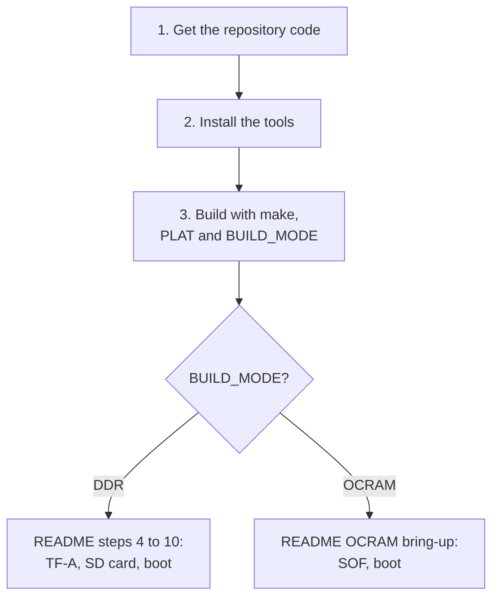

# Building on Linux

This page builds the bare-metal image on a Linux PC with the top-level
[Makefile](Makefile). It covers getting the code, installing the tools, and
building each platform and mode.

Building on Windows instead? Use [BUILD_WINDOWS.md](BUILD_WINDOWS.md).
Build variables, output files, and build modes are described in
[BUILD.md](BUILD.md).



## Names in the commands

Replace each name below with your own path or value.

| Name | Replace it with |
|---|---|
| `<repository-url>` | The clone URL shown on this repository's page |
| `/path/to/baremetal` | The folder where you want the source |
| `/path/to/toolchain` | The folder where you extracted the Arm GNU Toolchain |
| `<PLAT>` | `agilex5` or `agilex3` |

---

## 1. Get the repository code

Clone the repository with `git`:

```bash
git clone <repository-url> /path/to/baremetal
cd /path/to/baremetal
```

You can also download the source as a ZIP file from the repository page and
extract it. All commands on this page run from the root of that folder.

---

## 2. Install the tools

Install:

- CMake 3.20 or later, and GNU Make
- `git`
- the Arm GNU Toolchain for an x86_64 Linux host and the AArch64 GNU/Linux
  target (`aarch64-none-linux-gnu`), from the
  [Arm GNU Toolchain downloads page](https://developer.arm.com/downloads/-/arm-gnu-toolchain-downloads)

This release was built with Arm GNU Toolchain 14.3.Rel1.

Add the toolchain `bin` directory to `PATH`, then check the compiler:

```bash
export PATH=/path/to/toolchain/bin:$PATH
aarch64-none-linux-gnu-gcc --version
```

You should see a version number. If the shell says the command is not found,
check the `PATH` line above.

The DDR boot flow needs more tools on Linux (TF-A, `fiptool`, `guestfish`,
Quartus Prime Programmer). They are listed in
[README step 1](README.md#1-install-the-prerequisites).

---

## 3. Build

Pass `PLAT` and `BUILD_MODE` on every `make` line. `PLAT` has no default.

| Build | Command |
|---|---|
| Agilex 5, DDR, release | `make PLAT=agilex5 BUILD_MODE=DDR` |
| Agilex 5, OCRAM, release | `make PLAT=agilex5 BUILD_MODE=OCRAM` |
| Agilex 3, DDR, release | `make PLAT=agilex3 BUILD_MODE=DDR` |
| Agilex 3, OCRAM, release | `make PLAT=agilex3 BUILD_MODE=OCRAM` |
| Any of the above, debug | Add `DEBUG=1`, for example `make PLAT=agilex5 BUILD_MODE=DDR DEBUG=1` |

The build writes its files to:

```text
build/<PLAT>/release/    DEBUG=0
build/<PLAT>/debug/      DEBUG=1
```

The build is done when `make` finishes with no error and
`build/<PLAT>/release/baremetal.bin` is a new file. The full list of output
files is in [BUILD.md](BUILD.md#output-artifacts).

### Keep a DDR and an OCRAM build side by side

DDR and OCRAM builds for the same `PLAT` and `DEBUG` value use the same
folder, so the second build replaces the first. To keep both, give each its
own folder with `BUILD_DIR`:

```bash
make PLAT=agilex5 BUILD_MODE=DDR   BUILD_DIR=build/agilex5/ddr
make PLAT=agilex5 BUILD_MODE=OCRAM BUILD_DIR=build/agilex5/ocram
```

Use the matching folder in the later steps, for example
`build/agilex5/ddr/baremetal.bin` for `fiptool`.

---

## 4. Other commands

| Command | What it does |
|---|---|
| `make print PLAT=<PLAT>` | Prints the resolved `PLAT`, toolchain file, build folder, `DEBUG`, and `BUILD_MODE` |
| `make clean` | Deletes the whole `build/` folder, including every platform and mode |

---

## 5. Next steps

| Build mode | Continue with |
|---|---|
| `DDR` | [README step 4](README.md#4-build-tf-a-and-pack-the-ddr-image): build TF-A and pack `baremetal.bin` into `fip.bin`, then steps 5 to 10 |
| `OCRAM` | [OCRAM bring-up](README.md#ocram-bring-up): combine `baremetal.hex` with the SOF and boot |

---

## Troubleshooting

| What you see | What to check |
|---|---|
| `PLAT='' is not supported` | Add `PLAT=agilex5` or `PLAT=agilex3` to the `make` line |
| `aarch64-none-linux-gnu-gcc: not found` | Add the toolchain `bin` directory to `PATH` (step 2) |
| CMake is older than 3.20 | Install CMake 3.20 or later |
| The output is for the wrong platform or mode | Check `PLAT` and `BUILD_MODE`, then rebuild. If you build both modes, use separate `BUILD_DIR` folders |
| A file under `examples/` fails to build | A `DDR` build includes every example except the performance self-test. Open the failing module's guide |

## Related documents

- [README.md](README.md): board bring-up, boot flow, UART, and first commands
- [BUILD.md](BUILD.md): build variables, output files, build modes, and boot helpers
- [BUILD_WINDOWS.md](BUILD_WINDOWS.md): the same build on Windows
