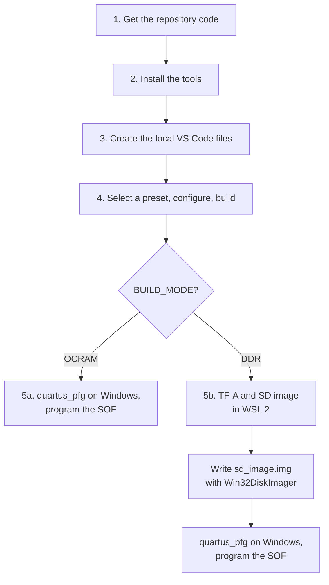

# Building on Windows

This page builds the bare-metal image on a Windows PC with Visual Studio Code,
the Ashling Altera extension, and CMake presets. It then shows how to finish
the DDR or OCRAM boot from Windows.

Building on Linux instead? Use [BUILD_LINUX.md](BUILD_LINUX.md).
Build variables, output files, and build modes are described in
[BUILD.md](BUILD.md).



## Names in the commands

Replace each name below with your own path or value.

| Name | Replace it with |
|---|---|
| `<repository-url>` | The clone URL shown on this repository's page |
| `C:\work\baremetal` | The folder where you want the source |
| `<ASHLING_ROOT>` | The Ashling RiscFree install folder |
| `<ARM_GCC_ROOT>` | The folder where you installed the Arm GNU Toolchain |
| `<PLAT>` | `agilex5` or `agilex3` |

In the JSON files below, write Windows paths with forward slashes, for
example `C:/Ashling/RiscFree`, or with doubled backslashes.

---

## 1. Get the repository code

Choose one of these:

- **Git.** Install [Git for Windows](https://git-scm.com/download/win), open
  PowerShell, and run:

  ```powershell
  git clone <repository-url> C:\work\baremetal
  ```

- **ZIP file.** On the repository page, select **Code**, then
  **Download ZIP**. Extract it to `C:\work\baremetal`.

Use a short folder path. All steps on this page use the root of that folder.

---

## 2. Install the tools

Install:

1. [Visual Studio Code](https://code.visualstudio.com/)
2. The Ashling RiscFree package and the Ashling Altera FPGA extension for VS
   Code, from the [Ashling page on altera.com](https://www.altera.com/products/development-tools/ashling).
   It provides CMake and Make for Windows.
3. The Arm GNU Toolchain for a Windows host and the AArch64 GNU/Linux target
   (`aarch64-none-linux-gnu`). Ashling does not include this compiler. Use one
   of these packages:
   - [MSI installer](https://gitlab.arm.com/api/v4/projects/tooling%2Fgnu-toolchains-for-arm/packages/generic/gnu-toolchain/15.3.rel1/arm-gnu-toolchain-15.3.rel1-mingw-w64-i686-aarch64-none-linux-gnu.msi)
   - [ZIP archive](https://gitlab.arm.com/api/v4/projects/tooling%2Fgnu-toolchains-for-arm/packages/generic/gnu-toolchain/15.3.rel1/arm-gnu-toolchain-15.3.rel1-mingw-w64-i686-aarch64-none-linux-gnu.zip)
4. Quartus Prime Programmer and `quartus_pfg` (Programming File Generator),
   to create the SOF and program the board.
5. A serial terminal, such as PuTTY or Tera Term.

Check that these files exist:

| Tool | Expected location |
|---|---|
| CMake | `<ASHLING_ROOT>/build_tools/cmake/bin/cmake.exe` |
| Make | `<ASHLING_ROOT>/build_tools/bin/make.exe` |
| GCC | `<ARM_GCC_ROOT>/bin/aarch64-none-linux-gnu-gcc.exe` |

Check the compiler from PowerShell:

```powershell
& "<ARM_GCC_ROOT>\bin\aarch64-none-linux-gnu-gcc.exe" --version
```

You should see a version number.

---

## 3. Create the local VS Code files

Create these three files in `C:\work\baremetal`. They hold paths for your PC,
so they are not part of the repository.

| File | Purpose |
|---|---|
| `.vscode/settings.json` | Points VS Code at the Ashling CMake and turns on presets |
| `CMakeUserPresets.json` | One preset for each platform, mode, and release or debug build |
| `.vscode/tasks.json` | Optional task that deletes the `build` folder |

### `.vscode/settings.json`

```json
{
    "cmake.useCMakePresets": "always",
    "cmake.cmakePath": "<ASHLING_ROOT>/build_tools/cmake/bin/cmake.exe",
    "cmake.enableAutomaticKitScan": false,
    "cmake.showSystemKits": false,
    "cmake.configureOnOpen": false,
    "files.associations": {
        "*.ld": "c",
        "*.ld.S": "c"
    }
}
```

### `CMakeUserPresets.json`

Replace `<ASHLING_ROOT>` and `<ARM_GCC_ROOT>`. Keep the rest as it is.

```json
{
    "version": 3,
    "cmakeMinimumRequired": {
        "major": 3,
        "minor": 20,
        "patch": 0
    },
    "configurePresets": [
        {
            "name": "base-agilex5",
            "hidden": true,
            "generator": "Unix Makefiles",
            "toolchainFile": "${sourceDir}/cmake/toolchain-agilex5.cmake",
            "cacheVariables": {
                "PLAT": "agilex5",
                "ATF_DIRECT_BOOT": "0",
                "CMAKE_MAKE_PROGRAM": "<ASHLING_ROOT>/build_tools/bin/make.exe"
            },
            "environment": {
                "PATH": "<ARM_GCC_ROOT>/bin;<ASHLING_ROOT>/build_tools/bin;$penv{PATH}"
            }
        },
        {
            "name": "base-agilex3",
            "hidden": true,
            "generator": "Unix Makefiles",
            "toolchainFile": "${sourceDir}/cmake/toolchain-agilex3.cmake",
            "cacheVariables": {
                "PLAT": "agilex3",
                "ATF_DIRECT_BOOT": "0",
                "CMAKE_MAKE_PROGRAM": "<ASHLING_ROOT>/build_tools/bin/make.exe"
            },
            "environment": {
                "PATH": "<ARM_GCC_ROOT>/bin;<ASHLING_ROOT>/build_tools/bin;$penv{PATH}"
            }
        },
        {
            "name": "agilex5-ocram",
            "displayName": "Agilex 5 | OCRAM | Release",
            "inherits": "base-agilex5",
            "binaryDir": "${sourceDir}/build/agilex5/release",
            "cacheVariables": { "BUILD_MODE": "OCRAM", "DEBUG": "OFF" }
        },
        {
            "name": "agilex5-ddr",
            "displayName": "Agilex 5 | DDR | Release",
            "inherits": "base-agilex5",
            "binaryDir": "${sourceDir}/build/agilex5/release",
            "cacheVariables": { "BUILD_MODE": "DDR", "DEBUG": "OFF" }
        },
        {
            "name": "agilex5-ocram-debug",
            "displayName": "Agilex 5 | OCRAM | Debug",
            "inherits": "base-agilex5",
            "binaryDir": "${sourceDir}/build/agilex5/debug",
            "cacheVariables": { "BUILD_MODE": "OCRAM", "DEBUG": "ON" }
        },
        {
            "name": "agilex5-ddr-debug",
            "displayName": "Agilex 5 | DDR | Debug",
            "inherits": "base-agilex5",
            "binaryDir": "${sourceDir}/build/agilex5/debug",
            "cacheVariables": { "BUILD_MODE": "DDR", "DEBUG": "ON" }
        },
        {
            "name": "agilex3-ocram",
            "displayName": "Agilex 3 | OCRAM | Release",
            "inherits": "base-agilex3",
            "binaryDir": "${sourceDir}/build/agilex3/release",
            "cacheVariables": { "BUILD_MODE": "OCRAM", "DEBUG": "OFF" }
        },
        {
            "name": "agilex3-ddr",
            "displayName": "Agilex 3 | DDR | Release",
            "inherits": "base-agilex3",
            "binaryDir": "${sourceDir}/build/agilex3/release",
            "cacheVariables": { "BUILD_MODE": "DDR", "DEBUG": "OFF" }
        },
        {
            "name": "agilex3-ocram-debug",
            "displayName": "Agilex 3 | OCRAM | Debug",
            "inherits": "base-agilex3",
            "binaryDir": "${sourceDir}/build/agilex3/debug",
            "cacheVariables": { "BUILD_MODE": "OCRAM", "DEBUG": "ON" }
        },
        {
            "name": "agilex3-ddr-debug",
            "displayName": "Agilex 3 | DDR | Debug",
            "inherits": "base-agilex3",
            "binaryDir": "${sourceDir}/build/agilex3/debug",
            "cacheVariables": { "BUILD_MODE": "DDR", "DEBUG": "ON" }
        }
    ],
    "buildPresets": [
        { "name": "agilex5-ocram", "configurePreset": "agilex5-ocram" },
        { "name": "agilex5-ddr", "configurePreset": "agilex5-ddr" },
        { "name": "agilex5-ocram-debug", "configurePreset": "agilex5-ocram-debug" },
        { "name": "agilex5-ddr-debug", "configurePreset": "agilex5-ddr-debug" },
        { "name": "agilex3-ocram", "configurePreset": "agilex3-ocram" },
        { "name": "agilex3-ddr", "configurePreset": "agilex3-ddr" },
        { "name": "agilex3-ocram-debug", "configurePreset": "agilex3-ocram-debug" },
        { "name": "agilex3-ddr-debug", "configurePreset": "agilex3-ddr-debug" }
    ]
}
```

OCRAM and DDR presets for the same platform and build type share one
`binaryDir`. Run **CMake: Configure** again after you switch between them.

### `.vscode/tasks.json` (optional)

```json
{
    "version": "2.0.0",
    "tasks": [
        {
            "label": "Hard Clean: delete build folder",
            "type": "shell",
            "command": "Set-Location \"${workspaceFolder}\"; Remove-Item -Recurse -Force build -ErrorAction SilentlyContinue; if (Test-Path build) { Write-Error \"build folder is locked. Close terminals using build/* and retry.\" } else { Write-Host \"build folder deleted\" }",
            "problemMatcher": []
        }
    ]
}
```

---

## 4. Select a preset, configure, and build

1. Open `C:\work\baremetal` in VS Code (**File**, then **Open Folder**).
2. Reload the window so VS Code reads the new files: press `Ctrl+Shift+P` and
   run **Developer: Reload Window**.
3. Press `Ctrl+Shift+P` and run **CMake: Select Configure Preset**.
4. Choose the preset for your kit and mode:

   | Platform | OCRAM Release | DDR Release | OCRAM Debug | DDR Debug |
   |---|---|---|---|---|
   | `agilex5` | `agilex5-ocram` | `agilex5-ddr` | `agilex5-ocram-debug` | `agilex5-ddr-debug` |
   | `agilex3` | `agilex3-ocram` | `agilex3-ddr` | `agilex3-ocram-debug` | `agilex3-ddr-debug` |

5. Press `Ctrl+Shift+P` and run **CMake: Configure**.
6. Select **Build** in the Ashling Build Actions panel.

The build writes its files to `build\<PLAT>\release\` or
`build\<PLAT>\debug\`. The build is done when it finishes with no error and
`baremetal.bin` in that folder is a new file. The full list of output files is
in [BUILD.md](BUILD.md#output-artifacts).

---

## 5. Boot the image

### 5a. OCRAM

Follow [OCRAM bring-up](README.md#ocram-bring-up). Every step runs on
Windows: `quartus_pfg` and Quartus Prime Programmer are Windows programs. In
PowerShell, put the `quartus_pfg` command on one line and use Windows paths:

```powershell
cd C:\work\baremetal
quartus_pfg -c -o hps_path=build\agilex5\release\baremetal.hex C:\path\to\ghrd_a5ed065bb32ae4s_hps_debug.sof ocram_bm.sof
```

For Agilex 3, use `build\agilex3\release\baremetal.hex` and that kit's HPS
debug SOF.

### 5b. DDR

The DDR boot needs three Linux steps: building TF-A and `fiptool`, packing
`fip.bin`, and building the SD-card image with `tools/sdimage_build.sh`.
`sdimage_build.sh` needs `sh`, `bash`, and `guestfish`, which Windows does not
provide. Run these steps in WSL 2 (Windows Subsystem for Linux), or on a
Linux PC. The WSL steps below were not run as part of this release check.

1. Install WSL 2 with Ubuntu, from an administrator PowerShell, then restart:

   ```powershell
   wsl --install -d Ubuntu
   ```

2. In the Ubuntu terminal, install the Linux tools:

   ```bash
   sudo apt update
   sudo apt install build-essential libssl-dev git libguestfs-tools
   ```

   Also install the Arm GNU Toolchain for an x86_64 Linux host, as in
   [BUILD_LINUX.md step 2](BUILD_LINUX.md#2-install-the-tools).

3. Clone this repository inside the WSL home folder, not under `/mnt/c`. A
   copy cloned on Windows can have Windows line endings, and the shell
   scripts in `tools/` do not run with those line endings:

   ```bash
   git clone <repository-url> ~/baremetal
   ```

4. Copy `baremetal.bin` from your Windows build into WSL:

   ```bash
   mkdir -p ~/baremetal/build/agilex5/release
   cp /mnt/c/work/baremetal/build/agilex5/release/baremetal.bin ~/baremetal/build/agilex5/release/
   ```

5. In WSL, follow [README step 4](README.md#4-build-tf-a-and-pack-the-ddr-image)
   and [README step 5](README.md#5-create-the-sd-card-image) up to the point
   where `sd_image.img` is written. Use `~/baremetal` as `/path/to/baremetal`.
   Do not run the `dd` command in WSL.

   If `guestfish` does not run in your WSL setup, run step 5 on a Linux PC
   and copy `sd_image.img` back.

6. Copy the files that Windows needs back to the Windows side:

   ```bash
   mkdir -p /mnt/c/work/boot
   cp ~/baremetal/sd_image.img /mnt/c/work/boot/
   cp /path/to/tf-a/build/agilex5/release/bl2.hex /mnt/c/work/boot/
   ```

7. On Windows, write `C:\work\boot\sd_image.img` to the micro-SD card with
   [Win32DiskImager](https://sourceforge.net/projects/win32diskimager/).
   Select the image file and the drive letter of the SD card, then select
   **Write**. Writing erases the whole card. Check that the drive letter is
   the SD card.
8. Create the SOF with `bl2.hex` (README step 6). In PowerShell:

   ```powershell
   cd C:\work\boot
   quartus_pfg -c -o hps_path=bl2.hex C:\path\to\ghrd_a5ed065bb32ae4s_hps_debug.sof fsbl_bm.sof
   ```

9. Continue with [README steps 7 to 10](README.md#7-prepare-the-development-kit).
   On Windows, the serial port is a COM port in Device Manager.

For Agilex 3, change every `agilex5` in these steps to `agilex3`, and use
that kit's HPS debug SOF.

---

## Troubleshooting

| Problem | What to do |
|---|---|
| Build exit code `-1` | Run **CMake: Configure** again, then build |
| Compiler not found | Check `<ARM_GCC_ROOT>/bin/aarch64-none-linux-gnu-gcc.exe` and the `PATH` entry in `CMakeUserPresets.json` |
| Generator mismatch | Delete the `build` folder and configure again |
| Preset missing | Check `CMakeUserPresets.json` for JSON errors, then reload VS Code |
| `EEXIST` or `query.json` error | Close terminals that use the build folder, close VS Code, delete the `build` folder, then reopen and configure |
| `release is not a directory` | The build folder is locked or damaged. Restart VS Code and rebuild from a clean `build` folder |
| `$'\r': command not found` in WSL | The repository was cloned on Windows. Clone it again inside WSL (step 5b.3) |
| `guestfish` fails in WSL | Build `sd_image.img` on a Linux PC and copy it to Windows |

### Recovery procedure

If configure or build fails with file-API or lock errors:

1. Close every terminal that uses a `build/...` folder.
2. Close VS Code.
3. Delete the `build` folder from the repository root.
4. Reopen VS Code.
5. Select the preset again.
6. Run **CMake: Configure**.
7. Build again.

## Related documents

- [README.md](README.md): board bring-up, boot flow, UART, and first commands
- [BUILD.md](BUILD.md): build variables, output files, build modes, and boot helpers
- [BUILD_LINUX.md](BUILD_LINUX.md): the same build on Linux
