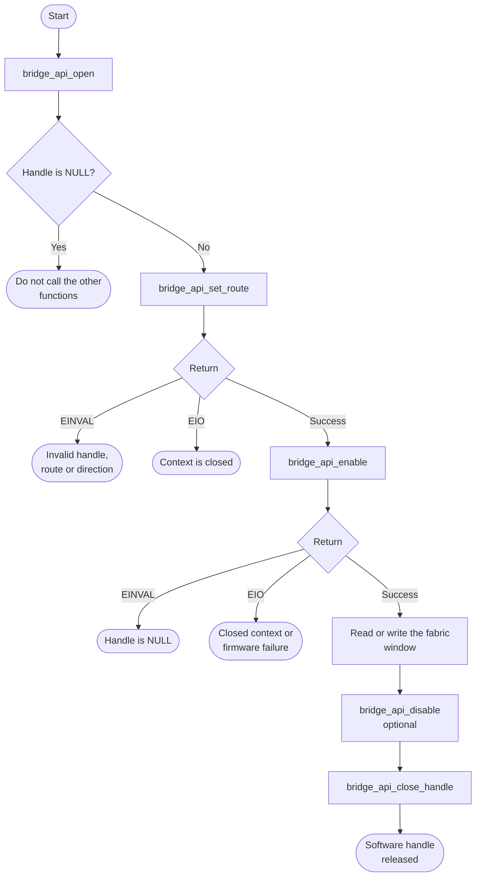

# HPS-to-FPGA Bridge Bare-Metal API Guide

## Overview

The HPS and the FPGA fabric are joined by four AXI bridges: H2F and LWH2F let the processor master the fabric, while F2H and the FPGA-to-SDRAM bridge let fabric logic master HPS memory. Each can be enabled or disabled independently.

This module opens a handle on one bridge and enables, disables, pauses or resumes it. Enabling is what makes the fabric address window respond; once a bridge is up, an application reads and writes the fabric with ordinary pointer accesses rather than through a transfer call in this API.

Include [`bridge_api.h`](bridge_api.h). Keep the handle returned by `bridge_api_open()` and pass it to later bridge calls. Close it when finished.


## Quick-start API flow

Prerequisites are in [Before You Start](#before-you-start). `bridge_api_open()` returns a handle, not a status code. A NULL handle means the id was not a bridge this module knows, or that bridge is already open. Do not call the other functions with it.



Enabling a bridge changes who can reach the fabric. Confirm the HPS-visible window address, size and memory attributes against your FPGA design and the selected platform address map before the first store.

### Walkthrough

1. Open one bridge. Stop if the handle is NULL.
2. Record the route. `-EINVAL` means the handle or route pointer is NULL, or the direction is invalid. `-EIO` means the context is closed. The route is software metadata, not hardware address-decoder configuration.
3. Enable. `0` means the firmware call returned success. `-EIO` means the context is closed or the firmware call failed; do not assume the bridge changed.
4. Use the window, then disable and close when the path should go idle.

This helper demonstrates handle ownership and route metadata without enabling a
bridge or accessing a fabric address. Setting a route records values in software;
it neither programs an address decoder nor validates that FPGA storage exists.
Before extending this flow with enable and memory accesses, obtain the actual
HPS-visible address, size and cache attributes from the loaded FPGA design and
the selected platform's address map. Reserve the test region for this purpose.

```C
#include <stddef.h>
#include <stdint.h>
#include "errno.h"
#include "bridge_api.h"

/* Store route metadata only: no bridge enable and no memory access. */
int bridge_route_example(uint64_t fabric_base, uint64_t fabric_size)
{
    bridge_handle_t handle;
    bridge_api_route_t route;
    int32_t rc;
    int32_t close_rc;

    handle = bridge_api_open(BRIDGE_API_HPS2FPGA);
    if (handle == NULL) {
        return -EINVAL;
    }
    route.direction = BRIDGE_API_DIR_HPS_TO_FPGA;
    route.base_addr = fabric_base;
    route.window_size = fabric_size;
    rc = bridge_api_set_route(handle, &route);
    close_rc = bridge_api_close_handle(handle);
    return rc != 0 ? (int)rc : (int)close_rc;
}
```

The same helper is in [docs/examples/bridge_consumer.c](../../docs/examples/bridge_consumer.c).

> **Do not run the supplied loopback on Agilex 5 or Agilex 3.** On both
> platforms the bridge platform header selects `0xC0000000` for the HPS-to-FPGA
> window, and the IOSSM platform header declares DDR from `0x80000000` to
> `0x17FFFFFFF`, which includes `0xC0000000`. The loopback overwrites memory
> with test patterns at that address. This command is not a bridge data-path
> test in this release. A successful read-back alone does not show that
> traffic crossed the bridge.

## Before You Start

- An FPGA design must be loaded and must implement whatever the HPS accesses. Enabling a bridge opens an address window; it does not create anything behind it. Reading a window with no design behind it returns undefined data, and disabling an FPGA-facing bridge can fail outright because the handshake never completes.
- Exercising this module against real hardware needs an FPGA design implementing the accessed fabric region.

## Public API Summary

| Function | Purpose | Returns |
|---|---|---|
| `bridge_api_open()` | Validates a bridge identifier and returns a handle for it. | Returns a handle on success. Returns NULL on failure. |
| `bridge_api_enable()` | Enables the bridge in hardware through the firmware service call, making its address window respond. | Returns 0 on success; `-EINVAL`, `-EIO` |
| `bridge_api_set_route()` | Validates and stores a direction, base address and window size for the bridge. | Returns 0 on success; `-EINVAL`, `-EIO` |
| `bridge_api_set_flow_ctrl()` | Stores a flow-control mode for the bridge. | Returns 0 on success; `-EINVAL`, `-EIO` |
| `bridge_api_get_status()` | Reports whether the bridge is currently enabled. | Returns 1 when the bridge is enabled and 0 when it is disabled. Also returns `-EINVAL` and `-EIO`. |
| `bridge_api_get_route()` | Returns the routing configuration previously stored for this bridge. | Returns 0 on success; `-EINVAL`, `-EIO` |
| `bridge_api_get_backpressure()` | Reports whether the bridge is currently passing traffic, derived from its enabled and paused state. | Returns 0 when the bridge is enabled and not paused (passing traffic). Returns 1 when it is disabled or paused. Also returns `-EINVAL` and `-EIO`. |
| `bridge_api_pause()` | Disables the bridge while retaining its routing and flow-control settings. | Returns 0 on success; `-EINVAL`, `-EIO` |
| `bridge_api_resume()` | Re-enables a paused bridge. | Returns 0 on success; `-EINVAL`, `-EIO` |
| `bridge_api_close_handle()` | Releases the software context for a bridge handle. | Returns 0 on success; `-EINVAL`, `-EIO` |
| `bridge_api_close()` | Closes a bridge by identifier instead of by handle. | Returns 0 on success; `-EINVAL`, `-EIO` |
| `bridge_api_disable()` | Disables the bridge in hardware. | Returns 0 on success; `-EINVAL`, `-EIO` |

Public header: [`bridge_api.h`](bridge_api.h).


## Return values and error handling

Shared conventions: [`RETURN_VALUES.md`](../../RETURN_VALUES.md).

`bridge_api_open()` does not return errno. NULL is its failure result. Mutating calls return `0` or a negative errno-style code; status and backpressure queries return `0` or `1` on success. `-EIO` means the middleware context is closed, or an enable/disable firmware
request failed. The firmware status is not exposed by this API.

| API / group | Return value | Meaning and exact triggering condition | Customer action / output validity |
|---|---|---|---|
| `bridge_api_open` | handle | `bridge_id` is one of the four `BRIDGE_API_*` identifiers and it was not already open. | Use the handle. |
| `bridge_api_open` | NULL | `bridge_id` is not a public bridge identifier, or the bridge is already open. | No handle exists. Do not enable or close it. |
| Mutating handle calls (`enable`, `disable`, `pause`, `resume`, `set_flow_ctrl`, `close_handle`) | `0` | A live handle was accepted and the lower layer returned success. | The operation completed; closing releases only software state. |
| `bridge_api_get_status`, `bridge_api_get_backpressure` | `0` or `1` | A live handle was accepted and the middleware flags were queried. | Interpret the value using the Public API Summary; this is not a register measurement. |
| Those handle calls | `-EINVAL` | `handle` is NULL; `set_flow_ctrl` also rejects an unsupported mode, and `close_handle` rejects a pointer outside the middleware context array. | No hardware change from this call. |
| `bridge_api_set_route`, `bridge_api_get_route` | `-EINVAL` | `handle` or the route pointer is NULL; `set_route` also rejects an invalid direction or a direction incompatible with the selected bridge. | Route output is not written. |
| `bridge_api_close` | `-EINVAL` | `bridge_id` is not a public bridge identifier. | That id is not closed. |
| All handle calls and close-by-identifier | `-EIO` | The context is not open. Enable, disable, pause and resume also map a failed firmware request to this value. | Do not use route output on failure. Software-only operations do not issue a firmware request. |

## API Notes

### State and routing

`bridge_api_set_route()` and `bridge_api_set_flow_ctrl()` retain software metadata.
They do not restrict the hardware address window or shape AXI traffic. Read-back
returns that metadata; status and backpressure queries use the middleware's
tracked enabled/paused flags rather than sampling the interconnect. Opening a
handle resets those flags, so an initial disabled status is not a hardware probe.

### Enabling, pausing and closing

Enable, disable, pause and resume call Trusted Firmware-A. Check their returns
before assuming hardware state changed. Quiesce the relevant masters before
disabling a bridge or reconfiguring its FPGA design. A disable handshake can
fail if the fabric-side design is absent or does not respond.

Closing releases the software handle without disabling the hardware. Disable
explicitly first if the bridge must be left disabled. New applications should
close by handle; the close-by-identifier call remains for compatibility. Keep
all operations under one owner's control and do not reuse a closed handle.

Exact arguments and returns are in [bridge_api.h](bridge_api.h) and its generated
API reference.

## Real-Hardware Validation

### Control operations and data-path checks

With a configured FPGA and TF-A, check each enable/disable operation's return
and restore the intended final state. These calls exercise bridge control.
To validate data traffic, use a separately reserved memory implemented by the
FPGA design, verify its address and cache attributes, and confirm activity on
the fabric side. Route metadata and successful firmware calls do not prove
that a load or store reached the fabric.

### Existing `bridge_selftest` command

The command is present in the engineering source. It is not a qualified
data-path test for this release. `bridge_selftest help` only prints usage;
running the command without arguments enables, pauses, resumes and disables
bridges. Its `loopback` option has the address conflict described above. Do
not use it on Agilex 5 or Agilex 3. The `f2h_enable` option leaves
the FPGA-to-HPS bridge enabled and requires a design-specific, reserved memory
region for any subsequent verification.

Per-step `[PASS]` output records the individual API results. The completion
banner does not validate an address map or establish data-path coverage.

Source: [bridge_selftest.c](../../examples/bridge/bridge_selftest.c).

## Important Constraints

| Constraint | Application impact |
|---|---|
| Routing and flow control are software state only | `bridge_api_set_route()` and `bridge_api_set_flow_ctrl()` are recorded and read back accurately but are not programmed into hardware. They cannot be used to restrict addresses or to shape traffic. |
| Backpressure is inferred, not measured | `bridge_api_get_backpressure()` reflects the enabled and paused state, so it cannot detect real interconnect congestion. |
| Closing does not disable | A bridge left enabled remains enabled in hardware after its handle is closed. Disable explicitly if that matters. |
| Requires Trusted Firmware-A | Enable and disable are firmware service calls. An image that runs without that firmware layer cannot change bridge state through this module. |

## Troubleshooting

| Symptom | Likely area | What to try |
|---|---|---|
| `bridge_api_open()` returns NULL | Identifier or state | Either the identifier is not one of the four bridges, or that bridge is already open. One context exists per bridge; close it before re-opening. |
| Reads through an enabled window return wrong or changing data | FPGA design | Enabling a bridge opens an address window but does not create storage behind it. Confirm the loaded FPGA design implements addressable storage at the address you are accessing. |
| `bridge_api_disable()` fails on an FPGA-facing bridge | FPGA design | The firmware disable handshake does not complete when no design is driving the fabric side. Load a design, or leave those bridges alone on a board with no FPGA image. |
| A route was set but the bridge still exposes the whole window | Unimplemented routing | Routing is stored in software only in this release. Do not use it as an access-control mechanism. |

## Related Documentation

- [`bridge_api.h`](bridge_api.h) - public API declarations and types.
- [`examples/bridge/bridge_selftest.c`](../../examples/bridge/bridge_selftest.c) - example source for `bridge_selftest`.
- [`README.md`](../../README.md) - board bring-up, boot modes, UART and the first console session.
- [`NoC Firewall`](../noc_firewall/README.md) - related module.
