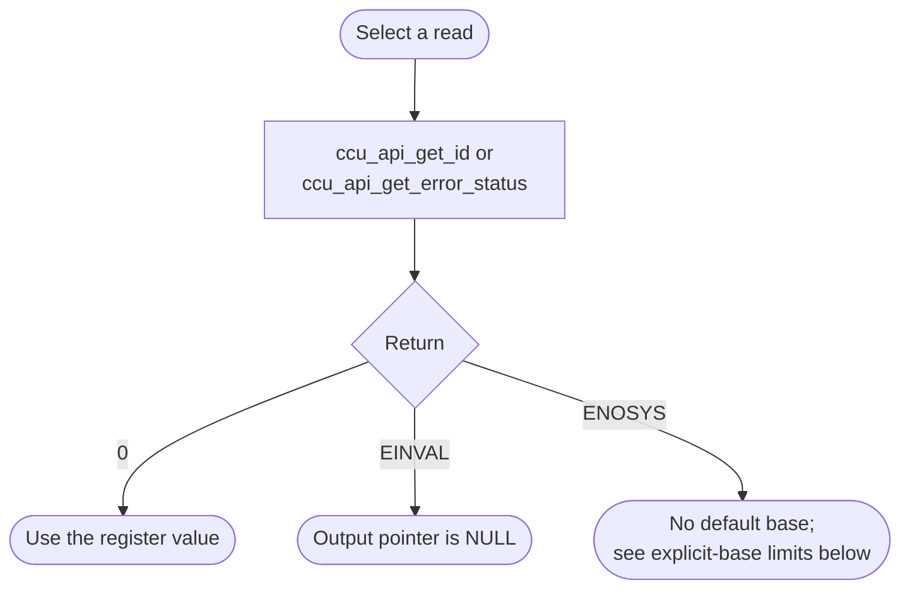
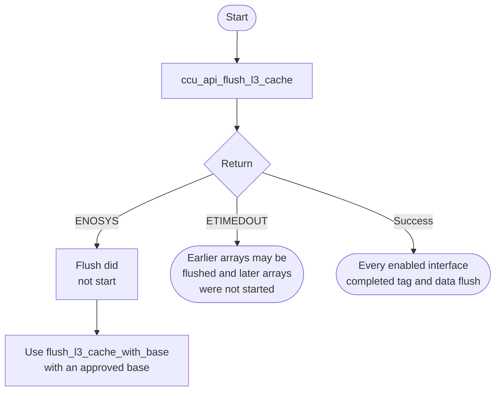

# CCU Bare-Metal API Guide

## Overview

The CCU is the interconnect block that keeps the processor caches coherent with other bus masters and that holds the system-level (L3) cache.

This module reads the coherency unit's identity and its uncorrected error status, and flushes enabled L3 cache arrays so that lines in those arrays are written back. It does not reconfigure the CCU.

Include [`ccu_api.h`](ccu_api.h). Identity reads, error-status reads and L3 flushes are independent operations; none requires an open or initialization call.

## Quick-start API flow

The Agilex 5 and Agilex 3 builds define `SOCFPGA_CCU_BASE`, so the calls without `_with_base` are the ones to use. `ccu_api_get_id_with_base()` and `ccu_api_flush_l3_cache_with_base()` take a caller-supplied base. `ccu_api_get_error_status()` has no base-address variant.

### Inspect identity and uncorrected-error status

These two reads do not depend on each other, and neither one flushes the cache.



### Flush enabled L3 arrays

> **Global cache maintenance.** This walks every enabled CCU distributed-memory interface and flushes its tag array and its data array. It is not a flush of one buffer. It does not run CPU cache-maintenance instructions, and it does not replace the maintenance the [DMA](../dma/README.md) API performs around its own buffers.



`ccu_api_flush_l3_cache_with_base(base, timeout_polls)` is the same flush with an explicit base and poll budget. `timeout_polls == 0` or `base == 0` returns `-EINVAL` before any maintenance command is written.

### Walkthrough

1. To see which block answered, call `ccu_api_get_id(&id)`. Branch on the return value first. On `0`, print or compare `id`. On `-EINVAL`, `id` was NULL. On `-ENOSYS`, the CCU base macro was missing or zero. Agilex 5 and Agilex 3 builds define it.
2. To read uncorrected-error status, call `ccu_api_get_error_status(&status)`. On `0`, interpret `status` as the register value, not as a second return code. Zero means the register read as zero. Non-zero means that register reports an uncorrected error; this software does not clear it and does not document a software recovery. This call has no `_with_base` form.
3. Call the flush only when you intend global L3 maintenance. Check the return value. `0` means each enabled interface finished both the tag flush and the data flush. `-ETIMEDOUT` means at least one of those operations did not finish inside its poll budget. Assume L3 writeback is incomplete. Do not increase `CCU_API_DEFAULT_TIMEOUT_POLLS` by editing the header; if your platform needs a different budget, pass it to `ccu_api_flush_l3_cache_with_base()`.

```C
#include <stdint.h>
#include "ccu_api.h"

/* Illustrative. Compile and link for your target; not run on a board. */
int32_t ccu_read_identity_and_error(uint32_t *id, uint32_t *status)
{
    int32_t rc;

    rc = ccu_api_get_id(id);
    if (rc != 0) {
        return rc; /* *id is not valid */
    }

    rc = ccu_api_get_error_status(status);
    if (rc != 0) {
        return rc; /* *id is valid; *status is not */
    }

    /* *status == 0: register read zero.
     * *status != 0: register reports an uncorrected error.
     * rc == 0 in both cases. */
    return 0;
}
```

```c
#include <stdint.h>
#include "ccu_api.h"

/* Illustrative. Compile and link for your target; not run on a board.
 * Global L3 maintenance. Not a per-buffer DMA flush. */
int32_t ccu_flush_enabled_l3(void)
{
    int32_t rc = ccu_api_flush_l3_cache();

    if (rc == -ETIMEDOUT) {
        /* Partial: some arrays may already have completed. */
        return rc;
    }
    return rc;
}
```

## Before You Start

- The Agilex 5 and Agilex 3 builds define the CCU base address, so the calls without `_with_base` are the ones to use. `ccu_api_get_id_with_base()` and `ccu_api_flush_l3_cache_with_base()` accept a caller-supplied base. The error-status call has no base-address variant.
- The flush is global maintenance of enabled L3 arrays. It does not establish by itself that a CPU store is visible to a DMA engine. CPU cache maintenance and memory attributes must still meet the DMA driver's buffer requirements. See the [DMA guide](../dma/README.md).

## Public API Summary

| Function | Purpose | Returns |
|---|---|---|
| `ccu_api_get_id()` | Reads the identification register at the platform base. | Returns 0 on success and writes `*id`. Also returns `-EINVAL` if `id` is NULL, and `-ENOSYS` if the default base is missing. |
| `ccu_api_get_error_status()` | Reads the uncorrected-error status register at the platform base. | Returns 0 on success and writes the raw register, which may be non-zero. Also returns `-EINVAL` and `-ENOSYS`. No `_with_base` variant. |
| `ccu_api_get_id_with_base()` | Reads the identification register at `base_address`. | Returns 0 on success; `-EINVAL` if the base is 0 or `id` is NULL. |
| `ccu_api_flush_l3_cache()` | Flushes enabled L3 tag and data arrays at the platform base. | Returns 0 on success; poll budget is `CCU_API_DEFAULT_TIMEOUT_POLLS` (200000) per array operation. `-ETIMEDOUT` leaves maintenance partial; `-ENOSYS` if the default base is missing. |
| `ccu_api_flush_l3_cache_with_base()` | Same flush at `base_address`, with `timeout_polls` as a poll count. | Returns 0 on success; `-EINVAL` if the base or budget is 0; `-ETIMEDOUT` if maintenance does not complete within the budget. |

Public header: [`ccu_api.h`](ccu_api.h).

## Return values and error handling

Shared conventions: [`RETURN_VALUES.md`](../../RETURN_VALUES.md).

A return of `0` and a non-zero error-status register are different results. The return says the read completed. The register says what the hardware reported.

| API / group | Return value | Meaning and exact triggering condition | Customer action / output validity |
|---|---|---|---|
| `ccu_api_get_id`, `ccu_api_get_error_status` | `0` | The platform base is non-zero, and the output pointer is non-NULL. The register was read. | `*id` is the identification register. `*status` is `CCU_CAIU_UESR`. Use it only after this return. Non-zero `*status` is a hardware error indication, not a failed call. |
| Those two calls | `-ENOSYS` | `SOCFPGA_CCU_BASE` is not defined, or the base helper returned 0. The driver is not called, so a NULL pointer is not the reason for this code. | ID: use `ccu_api_get_id_with_base()` with an approved base. Error status: this API has no alternate. Outputs are not written. |
| Those two calls | `-EINVAL` | The platform base was usable and the output pointer is NULL (`id` or `status`). The check is in `socfpga_ccu_read_reg()` before the load. | Do not read the output. |
| `ccu_api_get_id_with_base` | `0` | `base_address` is non-zero and `id` is non-NULL. | `*id` is valid. |
| `ccu_api_get_id_with_base` | `-EINVAL` | `base_address` is 0 or `id` is NULL. | No read. `*id` is not written. |
| `ccu_api_flush_l3_cache` | `0` | The platform base is non-zero. For every interface whose control register was non-zero, the tag flush and the data flush each saw the maintenance-done bit clear within 200000 polls. | Enabled L3 arrays that this call visited completed. This is not a CPU-cache or DMA-visibility proof. |
| `ccu_api_flush_l3_cache` | `-ENOSYS` | The platform base is missing or zero. No maintenance command is written. | Nothing was flushed by this call. |
| `ccu_api_flush_l3_cache` | `-ETIMEDOUT` | After the base check passed, an enabled array's status still had `CCU_DMI_CACHE_OP_DONE_MASK` set when its poll count hit 0. The default path does not return `-EINVAL`: its budget is the non-zero constant `CCU_API_DEFAULT_TIMEOUT_POLLS`. | Maintenance is partial and is not rolled back. Do not use any "flushed" assumption for arrays that did not finish. A larger budget is not a documented recovery. |
| `ccu_api_flush_l3_cache_with_base` | `0` | `base_address` and `timeout_polls` are both non-zero, and every enabled array completed as above, using `timeout_polls` as the budget for each array operation. | Same success meaning as the default flush. The budget is still in polls. |
| `ccu_api_flush_l3_cache_with_base` | `-EINVAL` | `base_address` is 0 or `timeout_polls` is 0. Checked before the interface loop. | No maintenance command from this call. |
| `ccu_api_flush_l3_cache_with_base` | `-ETIMEDOUT` | Same completion miss as the default flush, counted in `timeout_polls` for the array that failed. | Same partial-maintenance result. Do not retry automatically. |

## Hardware checks and limitations

### `ccu_selftest`

The command reads the identity and the uncorrected-error status, and flushes the L3 cache. The flush writes lines back; it does not erase memory. It is still global L3 maintenance, not a harmless query.

```text
ccu_selftest
```

| Property | Value |
|---|---|
| What it exercises | `ccu_api_get_id()`, `ccu_api_get_error_status()`, `ccu_api_flush_l3_cache()` |
| What it does not prove | That a PASS banner means those calls succeeded, or that CPU-to-DMA visibility holds |
| Extra peripheral | None beyond the target board. |
| Trustworthy observations | `CCU ID: 0x...` after a successful ID read, `CCU uncorrected error status: 0x...` after a successful status read, and `CCU L3 cache flush PASS` only from the flush command's own success path. Failure text is `CCU ID read failed: <code>`, `CCU error status read failed: <code>`, `CCU base is not defined for this platform build.`, or `CCU L3 cache flush timed out.` |
| Banner limitation | **Do not rely on the `PASS` line after each test or on the final `SELF-TEST PASSED` line.** The example increments its pass count and prints those lines even when a step fails. |

Source: [`examples/ccu/ccu_selftest.c`](../../examples/ccu/ccu_selftest.c)

To check the documented flows, call the functions from [Quick-start API flow](#quick-start-api-flow) and branch on the return value, then interpret `*status` separately. A zero status register and a zero return are not the same check.

## Important Constraints

| Constraint | Application impact |
|---|---|
| A flush affects enabled L3 arrays, not one buffer | It is global maintenance, so it is costly and it perturbs unrelated traffic. Use it deliberately. |
| Not a full coherency sequence | The flush does not clean CPU L1 or L2 caches and does not publish a buffer to a DMA master by itself. |
| Read-only apart from the flush | You cannot reconfigure the coherency unit through this module. |
| Uncorrected status only | Only the uncorrected error status register is exposed. This API does not decode or clear it. |

## Troubleshooting

| Symptom | Likely area | What to try |
|---|---|---|
| A default-base call returns `-ENOSYS` | CCU base macro | The base macro was missing or zero. Agilex 5 and Agilex 3 builds define it. The error-status call has no base-address variant. See [Return values](#return-values-and-error-handling). |
| A flush returns `-ETIMEDOUT` | An enabled array did not finish inside the poll budget | Treat the flush as incomplete. Do not assume a retry or a larger `timeout_polls` will finish safely; this software does not document that recovery. Report the timeout. |
| `ccu_api_get_error_status()` returns 0 and `*status` is non-zero | Uncorrected-error register | The call succeeded and the register reports an error. Do not retry the read as a fix. Treat it as a hardware or configuration fault. |
| The self-test prints `PASS` and also prints `read failed` or `timed out` | Example banner | Trust the failure text and the function return, not the `PASS` lines. |

## Related Documentation

- [`RETURN_VALUES.md`](../../RETURN_VALUES.md) - shared return-value conventions.
- [`ccu_api.h`](ccu_api.h) - public API declarations and types.
- [`examples/ccu/ccu_selftest.c`](../../examples/ccu/ccu_selftest.c) - example source for `ccu_selftest`.
- [`README.md`](../../README.md) - board bring-up, boot modes, UART and the first console session.
- [`DMA`](../dma/README.md) - related module.
- [`SMMU`](../smmu/README.md) - related module.
- [`GIC`](../gic/README.md) - related module.
