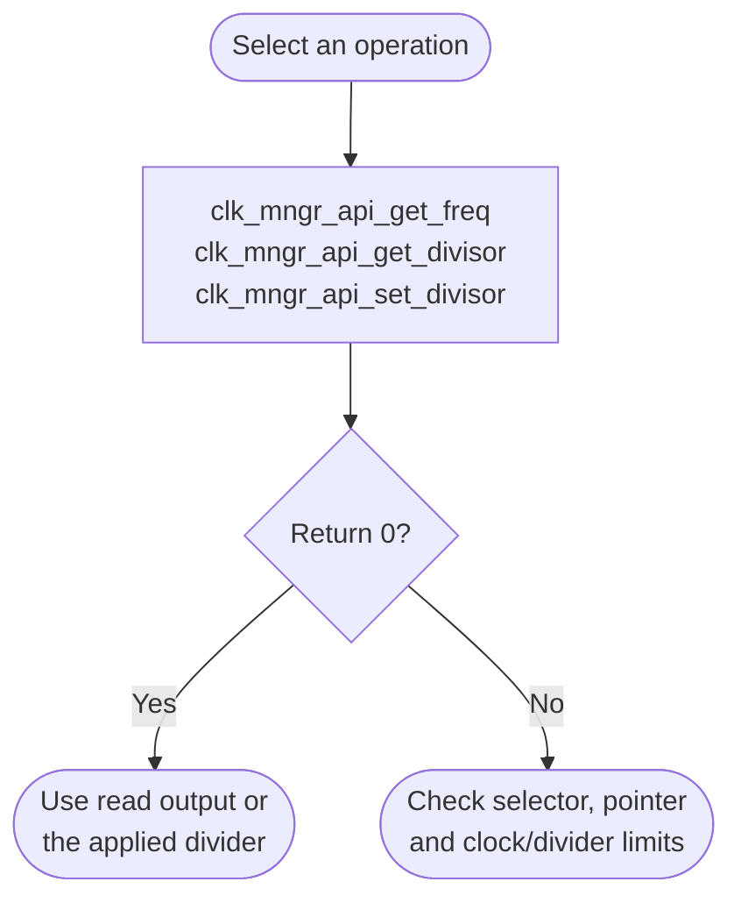

# Clock Manager Bare-Metal API Guide

## Overview

The Clock Manager holds the HPS phase-locked loops and the divider tree that derives every peripheral clock from them.

This module reports the frequencies of the supported peripheral clocks and reads or writes the interconnect divider fields. Several other modules depend on it: I2C, SPI and the timers all derive their timing from the frequency it reports, so a wrong or zero answer here surfaces as a failure there.

Include [`clk_mngr_api.h`](clk_mngr_api.h). Frequency and divider calls access the Clock Manager directly and take no handle.


## Quick-start API flow

This module has two independent operations: read a clock frequency, and read or write an interconnect divider. `clk_mngr_api_init()` calls `clk_mngr_platform_init()` and returns that function's status. See [Before You Start](#before-you-start).



### Walkthrough

1. Pass a non-NULL `uint32_t` output pointer to `clk_mngr_api_get_freq()`. Check its return value before reading or printing the frequency.
2. Read a divider with `clk_mngr_api_get_divisor()` the same way.
3. Call `clk_mngr_api_set_divisor()` only when you intend to change that divider. This API does not document a restore of the previous value.

```C
#include <stdint.h>
#include "clk_mngr_api.h"

/* Illustrative. Not run on a board. */
int clk_show(uint32_t block, uint32_t *hz)
{
    return clk_mngr_api_get_freq(block, hz);
}
```

## Before You Start

- Which boot stage owns the clock tree depends on the platform and build ([`src/main.c`](../../src/main.c)). An Agilex 5 `OCRAM` build locks the phase-locked loops (PLLs) itself at startup and does not call `clk_mngr_api_init()`. Every other build (Agilex 5 `DDR`, and Agilex 3 `OCRAM` and `DDR`) calls `clk_mngr_api_init()` at startup, which re-applies the platform's default interconnect divider settings. A `DDR` build therefore inherits the PLL settings from earlier firmware but not its divider settings.
- Frequency computation reads values that earlier firmware leaves in the boot scratch registers. Where those values are absent, the module falls back to a fixed 25 MHz oscillator value for the clocks derived from it; for a clock with no fallback, `clk_mngr_api_get_freq()` returns `-EINVAL`.

## Public API Summary

| Function | Purpose | Returns |
|---|---|---|
| `clk_mngr_api_init()` | Applies the platform's default interconnect divider settings. Startup already calls it, except in an Agilex 5 `OCRAM` build. | Returns 0 on success, or `-EINVAL` if a default divider is rejected. Same as `clk_mngr_platform_init()`. |
| `clk_mngr_platform_init()` | Platform hook that `clk_mngr_api_init()` calls. | Returns 0 on success, or `-EINVAL` |
| `clk_mngr_api_set_divisor()` | Programs one interconnect clock divider field (in the NOCDIV register). Accepted values are listed below. | Returns 0 on success; `-EINVAL` for an invalid type or value; nothing is written |
| `clk_mngr_api_get_freq()` | Returns the current frequency of one supported clock block, in Hz. | Returns 0 on success; `-EINVAL` for an invalid block, or when the frequency cannot be determined |
| `clk_mngr_api_get_divisor()` | Reads the currently programmed divider for one interconnect clock. | Returns 0 on success; `-EINVAL`, including for any field set to divide-by-1 (see constraints) |

Accepted values for `clk_mngr_api_set_divisor()`:

| Divider types | Accepted values |
|---|---|
| L4_SYS_FREE, L4_SP, SOFT_PHY, MPU_PERIPH | 1, 2, 4 |
| L4_MP, CCU | 1, 2 |
| CS, CS_TRACE, CS_PDBG | 1, 2, 4, 8 |

Public header: [`clk_mngr_api.h`](clk_mngr_api.h).


## Return values and error handling

Shared conventions: [`RETURN_VALUES.md`](../../RETURN_VALUES.md).

| API / group | Return value | Meaning and exact triggering condition | Customer action / output validity |
|---|---|---|---|
| `clk_mngr_api_get_freq` | `0` | `freq_hz` is non-NULL and `clk_mngr_ll_get_clk()` returned 0. | `*freq_hz` is valid. |
| `clk_mngr_api_get_freq` | `-EINVAL` | `freq_hz` is NULL, the block is unsupported, or its computed frequency is zero. | A NULL rejection writes nothing. The driver can store zero before returning failure; do not use it as a measured frequency. |
| `clk_mngr_api_get_divisor` | `0` | `divisor` is non-NULL and `clk_mngr_ll_get_divisor()` returned 0. | `*divisor` is valid. |
| `clk_mngr_api_get_divisor` | `-EINVAL` | `divisor` is NULL, the selector is unsupported, or the encoded field reads zero (including divide-by-1). | The driver can store zero before rejecting it; do not use that value as a divisor. |
| `clk_mngr_api_set_divisor` | `0` or other | Whatever `clk_mngr_ll_set_divisor()` returns. This wrapper adds no check of its own. | A non-zero return means the divider write was not reported successful. Do not assume the old value is intact. |
| `clk_mngr_api_init` | same as `clk_mngr_platform_init()` | The wrapper returns that call directly. | Treat a non-zero value as init failed. |

## Hardware checks and limitations

### `clk_mngr_selftest`

> **Changes hardware state.** The command re-applies the platform divider defaults (`clk_mngr_api_init()`) and writes the L4_SP divider to 4. Those dividers feed the console UART and the timers. It does not erase or reset anything.

```Text
clk_mngr_selftest
```

| Property | Value |
|---|---|
| What it does | Prints each divider, re-applies the defaults and prints the dividers again, sets L4_SP to 4 and checks that the invalid value 99 is rejected, then prints the clock frequencies |
| Extra peripheral | None beyond the target board. |
| Pass criterion | No overall verdict; the command's own output ends with `Clock Manager Example Done`. Check that `init: OK`, `L4_SP div=4 (valid)   : OK` and `L4_SP div=99 (invalid): OK` appear and that the frequencies are non-zero. Fields set to divide-by-1 print `error (rc=-22)` because of the read-back limitation below; that line alone is not a failure. The console then adds `DONE` and its own `RESULT :` line, which is not a verdict. |

Source: [`examples/clk_mngr/clk_mngr_selftest.c`](../../examples/clk_mngr/clk_mngr_selftest.c)

## Important Constraints

| Constraint | Application impact |
|---|---|
| PLL setup varies by platform and build mode | Only an Agilex 5 `OCRAM` build locks the PLLs. Every other build re-applies the platform divider defaults at startup. |
| Divide-by-1 fields cannot be read back | `clk_mngr_api_get_divisor()` returns `-EINVAL` for any field programmed to divide-by-1, including fields the platform defaults set to 1 (for example SOFT_PHY and CS). The divider itself is set correctly. |
| Changing an interconnect divider affects every peripheral below it | A divider change is not scoped to one peripheral. Lowering an interconnect clock changes the timing of the console, the timers and the serial buses at once, and can make the console unreadable. |
| In a later-stage payload build, initialization overwrites inherited dividers | The platform defaults are re-applied over whatever earlier firmware programmed, so a board that relies on non-default dividers set by earlier firmware will see them replaced. |
| Not supported: enabling or gating individual peripheral clocks | The public API reads frequencies and changes dividers. It cannot gate a peripheral clock. |

## Troubleshooting

| Symptom | Likely area | What to try |
|---|---|---|
| A frequency query returns `-EINVAL` or reports zero | Clock block identifier, or phase-locked loop not locked | Confirm the block identifier is valid for this platform. If it is, the phase-locked loop is probably not locked: on the on-chip-memory boot path, confirm platform initialization ran before the query. |
| A divider write returns `-EINVAL` | Divider value | The value is not accepted for that divider type (see the table above). Nothing was written. |
| A divider read returns `-EINVAL` for a valid type | Divide-by-1 field | Known limitation: a field set to divide-by-1 cannot be read back. |
| A peripheral driver fails to open, reporting a clock problem | Clock tree | I2C, SPI and the timers derive their timing from the frequency this module reports. Check `clk_mngr_api_get_freq()` for that clock first. |

## Related Documentation

- [`clk_mngr_api.h`](clk_mngr_api.h) - public API declarations and types.
- [`examples/clk_mngr/clk_mngr_selftest.c`](../../examples/clk_mngr/clk_mngr_selftest.c) - example source for `clk_mngr_selftest`.
- [`README.md`](../../README.md) - board bring-up, boot modes, UART and the first console session.
- [`Timer`](../timer/README.md) - related module.
- [`Reset Manager`](../rst_mngr/README.md) - related module.
