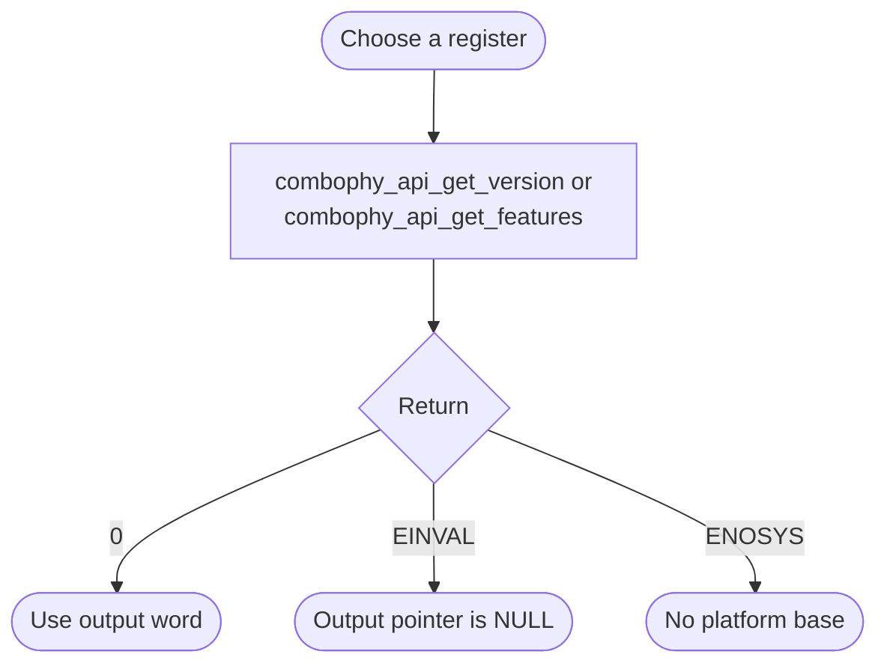

# ComboPHY Bare-Metal API Guide

## Overview

The Combo PHY is the shared physical-layer block that serves the SD/MMC and NAND interfaces.

This module reads two identification registers from the Combo PHY: its version and its feature set. It is a diagnostic interface, not a configuration interface.

Include [`combophy_api.h`](combophy_api.h). Each read uses the platform base or an explicit base address; no initialization or handle is required.


## Quick-start API flow

The two reads are independent. There is no init or close. Agilex 5 and Agilex 3 builds supply the Combo PHY base, so both calls use that address. See [Before You Start](#before-you-start).



### Walkthrough

1. Call `combophy_api_get_version()`. On `0`, use `*version` as the identification word only.
2. Call `combophy_api_get_features()` the same way. On `0`, `*features` is the feature register, not a decoded capability list.
3. A return of `-ENOSYS` means the Combo PHY base macro was missing or zero. Agilex 5 and Agilex 3 builds define that base. This API has no `_with_base` variant.

```C
#include <stdint.h>
#include "combophy_api.h"

/* Illustrative. Not run on a board. */
int32_t combophy_id(uint32_t *version, uint32_t *features)
{
    int32_t rc = combophy_api_get_version(version);
    if (rc != 0) {
        return rc;
    }
    return combophy_api_get_features(features);
}
```

## Before You Start

- Agilex 5 and Agilex 3 builds define the Combo PHY base address, so both calls use that address. `-ENOSYS` means that base macro was missing or zero, not that the PHY hardware failed.

## Public API Summary

| Function | Purpose | Returns |
|---|---|---|
| `combophy_api_get_version()` | Reads the Combo PHY version register. | Returns 0 on success; `-EINVAL`, `-ENOSYS` |
| `combophy_api_get_features()` | Reads the Combo PHY features register. | Returns 0 on success; `-EINVAL`, `-ENOSYS` |

Public header: [`combophy_api.h`](combophy_api.h).


## Return values and error handling

Shared conventions: [`RETURN_VALUES.md`](../../RETURN_VALUES.md).

| API / group | Return value | Meaning and exact triggering condition | Customer action / output validity |
|---|---|---|---|
| `combophy_api_get_version`, `combophy_api_get_features` | `-ENOSYS` | `SOCFPGA_COMBOPHY_BASE` is absent or the helper returned 0. The driver is not called. | Outputs are not written. There is no alternate base call. |
| Those calls | `0` | The driver accepted a non-zero base and a non-NULL pointer and completed the read. | The output word is valid. It is an identification or feature register, not link status. |
| Those calls | `-EINVAL` | `socfpga_combophy_get_version()` or `socfpga_combophy_get_features()` rejected a zero base or a NULL pointer. | Do not read the output. |

## Hardware checks and limitations

### `combophy_selftest`

Non-destructive: reads two identification registers.

```Text
combophy_selftest
```

| Property | Value |
|---|---|
| What it does | Reads the version and features registers |
| Extra peripheral | None beyond the target board. |
| Pass criterion | Prints `Combo PHY version=0x... features=0x...`. The example does not check the return code of the features read, so a features value of 0 is not by itself proof of success |

Source: [`examples/combophy/combophy_selftest.c`](../../examples/combophy/combophy_selftest.c)

## Important Constraints

| Constraint | Application impact |
|---|---|
| Read-only diagnostic interface | You cannot configure the physical layer through this module. Do not expect calling it to prepare the Combo PHY for SD/MMC or NAND use. |

## Troubleshooting

| Symptom | Likely area | What to try |
|---|---|---|
| Both calls return `-ENOSYS` | Combo PHY base macro | The base macro was missing or zero. Agilex 5 and Agilex 3 builds define it. Nothing is wrong with the PHY hardware. |
| A call returns `-EINVAL` | Arguments | The destination pointer was NULL. |

## Related Documentation

- [`combophy_api.h`](combophy_api.h) - public API declarations and types.
- [`examples/combophy/combophy_selftest.c`](../../examples/combophy/combophy_selftest.c) - example source for `combophy_selftest`.
- [`README.md`](../../README.md) - board bring-up, boot modes, UART and the first console session.
- [`SD/MMC`](../sdmmc/README.md) - related module.
