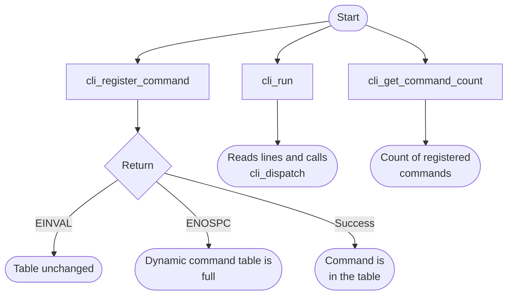
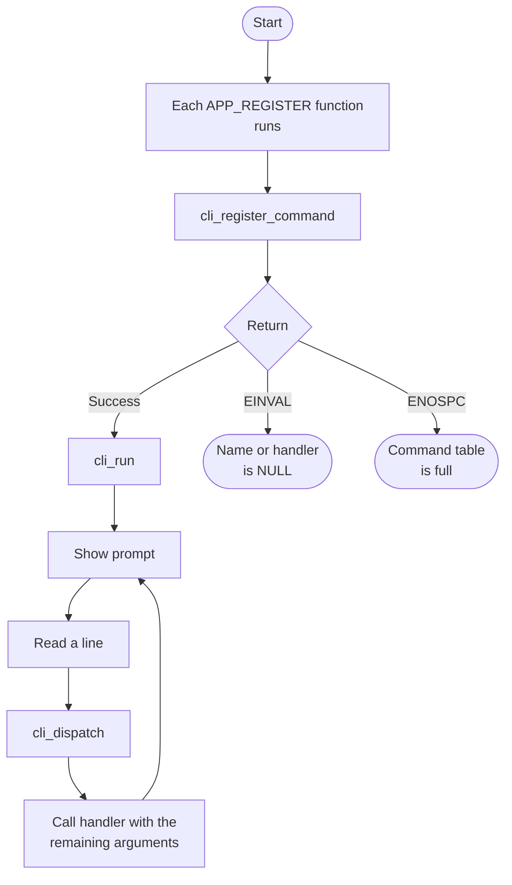

# Console and CLI Bare-Metal API Guide

## Overview

The console is not a hardware block. It is the command-line interface (CLI) this software stack presents on the serial port.

This module provides the interactive shell: a prompt, line editing, tab completion, the built-in commands, and the registration interface that lets any module add a command of its own. Every module's self-test becomes reachable by registering here, but each of those commands is documented in its own module guide -- this guide covers the framework.

Include [`console_api.h`](console_api.h) to register commands or use the command loop. [`command.h`](command.h) declares the built-in `cmd_*` handlers and two register-read helpers used by the dispatcher; applications normally use the console interface instead.


## Quick-start API flow

Adding a command is separate from running the shell. `cli_run()`, `cli_prompt()`, and `cli_dispatch()` return `void`. The console's framed `RESULT` line means the handler returned, not that the command passed. See [Before You Start](#before-you-start).



### Walkthrough

1. Register from an `APP_REGISTER` function so it runs at startup, before `cli_run()`.
2. Check `cli_register_command()`'s return value. `-ENOSPC` will not clear itself if you retry the same table.
3. In the handler, print the result you care about. Ignore the console `RESULT : command completed` line as a pass/fail signal.



At startup, each function placed in the registration section with `APP_REGISTER()` runs and registers its command. The command loop then reads a line, looks up the first word, and calls the matching handler with the rest of the line.

```c
#include <stdio.h>
#include "console_api.h"
#include "example_register.h"

static void cmd_my_app(const char *args)
{
	printf("args: '%s'\n", args);   /* text after the command name; leading spaces removed */
}

static void register_my_app(void)
{
	(void)cli_register_command("my_app", cmd_my_app);
}

APP_REGISTER(register_my_app)
```

This is the pattern of [`examples/hello/hello_selftest.c`](../../examples/hello/hello_selftest.c). It is not a standalone file: `example_register.h` and `APP_REGISTER` come from the example build. Where to put the file so that it is compiled is described in [step 11 of the top-level README](../../README.md#11-add-your-own-command).

How a registered command appears:

- `help` lists it under `Example Applications:`. Commands without a built-in description are shown as `run self-test`.
- Unless the command is one of the self-tests that format their own report, the console wraps its output in a framed report: a title box, `Run command ...............`, the command's own output, `DONE`, and a final `RESULT : command completed  -  CHECK DETAILED OUTPUT` line (or `RESULT : Step 1 of 2 completed  -  CHECK DETAILED OUTPUT` for a few multi-phase examples). That `RESULT` line means only that the handler returned; it is not a pass verdict.

## Before You Start

- The startup code in this repository already initializes the console UART and enters the command loop (see [What Happens After BL33 Starts](../../README.md#what-runs-after-tf-a-jumps-here)). To add a command, you only need to register it.
- If you write your own startup code, initialize the serial port before entering the command loop. The console reads and writes characters directly and does not check, so an uninitialized port gives a silent prompt that looks like a hang.

## Public API Summary

Application interface ([`console_api.h`](console_api.h)):

| Function | Purpose | Returns |
|---|---|---|
| `cli_register_command()` | Adds a named command and its handler to the command table. The name is stored by pointer, so pass a string that stays valid for the life of the program (a string literal). Registering an existing name replaces its handler. | Returns 0 on success. Also returns `-EINVAL` for a NULL name or handler, and `-ENOSPC` when the table (96 entries) is full. |
| `cli_get_command_count()` | Returns the number of registered commands. | Returns the number of registered commands, from 0 to 96. This is a count, not a success code. |
| `cli_get_command()` | Returns a read-only entry from the command table. | Returns a pointer on success. Returns NULL for an out-of-range index. |
| `cli_dispatch()` | Parses one command line and calls the matching built-in or registered handler. | No return value. |
| `cli_prompt()` | Prints the prompt `SoCFPGA Bare-Metal > `. | No return value. |
| `cli_run()` | Runs the interactive command loop. | No return value. Does not return. |

Built-in command handlers ([`command.h`](command.h)), normally reached by typing the command:

| Function | Command | Returns |
|---|---|---|
| `cmd_help()` | `help` | Returns 0 on success. |
| `cmd_core()` | `core` | Returns 0 on success. |
| `cmd_mpidr()` | `mpidr` | Returns 0 on success. |
| `cmd_el()` | `el` | Returns 0 on success. |
| `cmd_clear()` | `clear` | Returns 0 on success. |
| `cmd_memdump()` | `memdump <addr> [count]` | Returns 0 on success, or `-EINVAL` if the address is missing. |
| `cmd_memread()` | `memread <addr>` | Returns 0 on success, or `-EINVAL` if the address is missing. |
| `cmd_memwrite()` | `memwrite <addr> <value>` | Returns 0 on success, or `-EINVAL` if the address or value is missing. |
| `read_mpidr_el1()` | — | No status code. Returns the raw `MPIDR_EL1` value. |
| `read_currentel()` | — | No status code. Returns the current exception level, 0 to 3. |

For `memdump`, `memread` and `memwrite`, the address and value are parsed as hexadecimal and the `memdump` count as decimal (default 16 bytes).

Public header: [`console_api.h`](console_api.h) and [`command.h`](command.h).


## Return values and error handling

Shared conventions: [`RETURN_VALUES.md`](../../RETURN_VALUES.md).

| API / group | Return value | Meaning and exact triggering condition | Customer action / output validity |
|---|---|---|---|
| `cli_register_command` | `0` | `name` and `func` are both non-NULL and the dynamic table is not full. | The name is registered. |
| `cli_register_command` | `-EINVAL` | `name` is NULL or `func` is NULL. | Nothing was added. |
| `cli_register_command` | `-ENOSPC` | `dynamic_cmd_count >= CLI_MAX_DYNAMIC_CMDS`. | The table is full. Retrying does not add a slot. |
| `cli_get_command_count` | count | The number of dynamic commands. This is not an error code. | Zero means none are registered. |
| `cli_get_command` | pointer or NULL | NULL when the index is outside `0 .. dynamic_cmd_count-1`. | Do not dereference NULL. |
| `cli_dispatch`, `cli_prompt`, `cli_run` | No return value. | No status is returned. | Look at the handler's own output. The framed RESULT line is not a verdict. |
| Built-in `memread` / `memwrite` / `memdump` handlers | `-EINVAL` | The argument string is missing or empty. | Those handlers print their own usage. |

## API Notes

### `cli_register_command()`

At startup, from a function registered with `APP_REGISTER()`, as the shipped examples do. A handler that runs later can also register a command, because the dispatcher reads the live table.

> If a command is absent from `help`, confirm that its source was selected by the build, its registration function ran, and `cli_register_command()` returned 0. See [Which example commands are in each build](../../README.md#which-example-commands-are-built).

### `cli_dispatch()`

Only the first word of the line selects the command, and command names longer than 31 characters are truncated before matching. Built-in command names take precedence over registered ones.

### `cli_run()`

Last, after every module and command has been initialized and registered. This call never returns.

## Important Constraints

| Constraint | Application impact |
|---|---|
| `memwrite`, `memread` and `memdump` perform no access checking | They access any address you give them, so a wrong address can corrupt live state or cause a fault. They are debugging aids, not a safe interface to build on. |
| `exit` does not return | The processor parks in a wait loop and only a reset recovers it. |
| The command table holds 96 entries | `cli_register_command()` returns `-ENOSPC` once it is full. |
| The command table is global | There is no locking; register commands from a single context. |

## Troubleshooting

| Symptom | Likely area | What to try |
|---|---|---|
| The prompt never appears | Serial port initialization | The console writes characters without checking that the port is ready. Confirm the port was initialized successfully before the command loop was entered. |
| A module's command is missing from `help` | Build configuration | Confirm the example or module is included in the build for your platform and build mode. |
| `cli_register_command()` returns `-ENOSPC` | Command table capacity | The command table is full. Register fewer commands. |
| Your command runs a different handler | Name collision | Built-in names win over registered ones, and registering an existing name replaces the earlier handler. Choose a unique name. |
| The board stops responding after `exit` | Expected behaviour | `exit` parks the processor in a wait loop by design and does not return. Reset the board. |

## Related Documentation

- [`console_api.h`](console_api.h) and [`command.h`](command.h) - application and built-in command declarations.
- [`examples/hello/hello_selftest.c`](../../examples/hello/hello_selftest.c) - the smallest registered command.
- [`README.md`](../../README.md) - board bring-up, boot modes, UART and the first console session.
- [`UART`](../uart/README.md) - related module.
