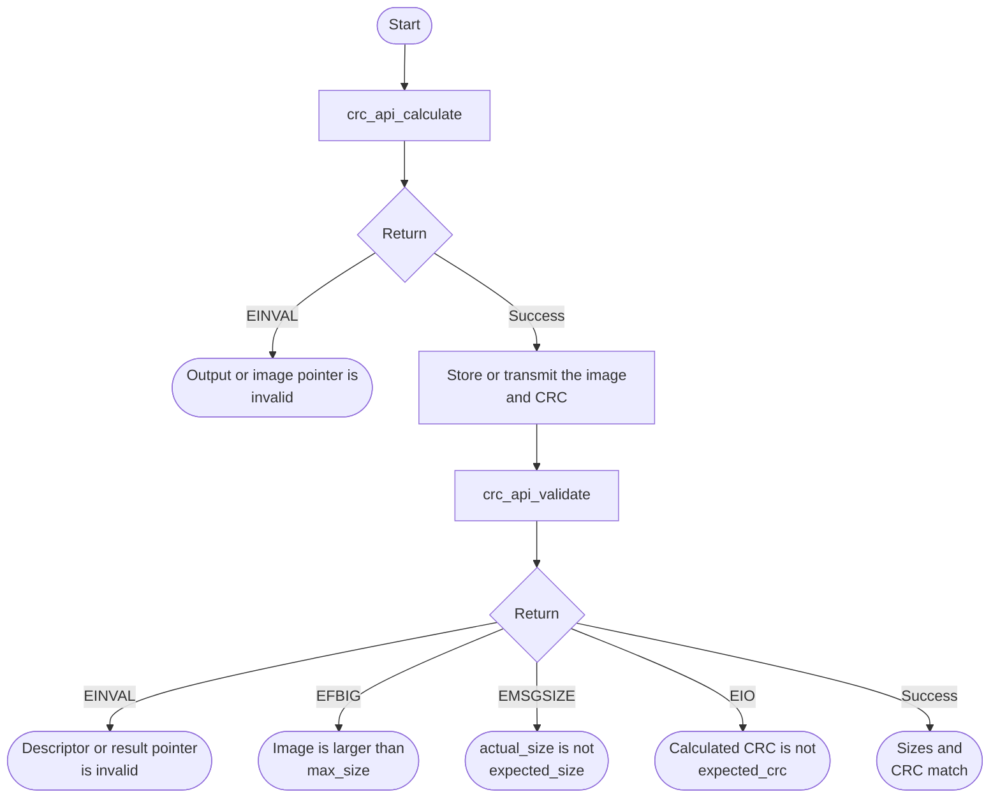
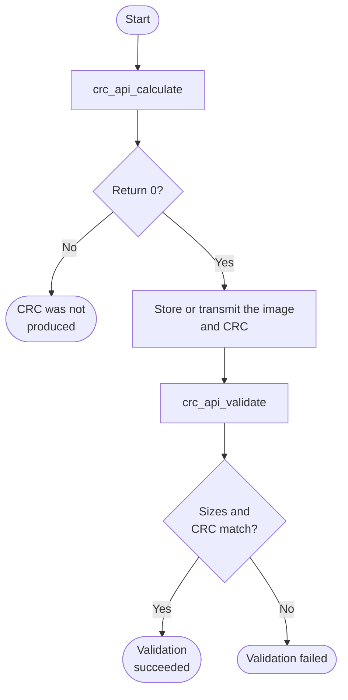

# CRC Bare-Metal API Guide

## Overview

The CRC API calculates a checksum in software and validates a buffer against an expected size and checksum. Use it to check an image after transferring it through another subsystem. It requires no peripheral clock, reset or register access.

Include [`crc_api.h`](crc_api.h). Each calculation or validation call takes its own buffer and settings; there is no initialization or retained context.


## Quick-start API flow

Compute and check are separate calls. Both must use the same 64-bit channel. See [Before You Start](#before-you-start).



### Walkthrough

1. Produce the image and call `crc_api_calculate()`. Keep the channel value with the image.
2. Later fill `crc_image_desc_t` and call `crc_api_validate()`.
3. Branch on the four failure codes above. They are different problems: a bad pointer, a size over the maximum, a size mismatch, and a checksum mismatch.



Compute the CRC with `crc_api_calculate()` when you produce an image; later fill a `crc_image_desc_t` with the image, its sizes and the expected CRC, and call `crc_api_validate()`. Both sides must use the same 64-bit `channel` value. A mismatch returns `-EIO`.

## Before You Start

- None. This module has no hardware dependency, needs no initialization, and works in every build and boot mode.

## Public API Summary

| Function | Purpose | Returns |
|---|---|---|
| `crc_api_calculate()` | Computes a 32-bit CRC over a buffer, in software, using a caller-supplied 64-bit channel value. | Returns 0 on success; `-EINVAL` |
| `crc_api_validate()` | Checks an image descriptor's size limits, then its CRC against the expected value. | Returns 0 on success; `-EFBIG`, `-EINVAL`, `-EIO` (CRC mismatch), `-EMSGSIZE` |

Public header: [`crc_api.h`](crc_api.h).


## Return values and error handling

Shared conventions: [`RETURN_VALUES.md`](../../RETURN_VALUES.md).

| API / group | Return value | Meaning and exact triggering condition | Customer action / output validity |
|---|---|---|---|
| `crc_api_calculate` | `0` | `crc_out` is non-NULL, and the image pointer is non-NULL or `image_size` is 0. | `*crc_out` is the checksum for that channel. |
| `crc_api_calculate` | `-EINVAL` | `crc_out` is NULL, or `image` is NULL and `image_size` is not 0. | `*crc_out` was not written. |
| `crc_api_validate` | `0` | Pointers passed the checks, `actual_size` is within `max_size` when `max_size` is non-zero, `actual_size` equals `expected_size`, and the calculated CRC equals `expected_crc`. | The descriptor matched. |
| `crc_api_validate` | `-EINVAL` | `desc` or `result` is NULL, or `desc->image` is NULL while `actual_size` is not 0. | Do not use `*result`. |
| `crc_api_validate` | `-EFBIG` | `max_size != 0` and `actual_size > max_size`. | The image is larger than the limit you set. The CRC was not the reason. |
| `crc_api_validate` | `-EMSGSIZE` | `actual_size != expected_size`, after the max-size check. | The length changed. This is not a CRC mismatch. |
| `crc_api_validate` | `-EIO` | The sizes matched and `calculated_crc != expected_crc`. | The bytes do not match the expected checksum. `result` retains the calculated CRC and `size_valid=1`; `crc_valid=0`. |

If either top-level pointer is NULL, the result is unchanged. Otherwise validation
zeroes the result and copies both sizes before checking the image pointer,
maximum size and size match. Those rejected calls leave these diagnostic fields
written; they do not establish that a CRC was calculated.

## API Notes

### `crc_api_validate()`

Checks the size limits of an image descriptor, then computes its CRC and compares it with the expected value. The computed value is returned in `result->calculated_crc` when the size checks pass.

| Returns | When | Meaning |
|---|---|---|
| `-EINVAL` | `(desc == NULL) \|\| (result == NULL)` | a required pointer argument was NULL |
| `-EINVAL` | `desc->image` is NULL while `desc->actual_size` is non-zero | the descriptor names data but gives no buffer |
| `-EFBIG` | `desc->max_size` is non-zero and `desc->actual_size` exceeds it | the image is larger than the allowed maximum |
| `-EMSGSIZE` | `desc->actual_size` differs from `desc->expected_size` | the image is not the expected size |
| `-EIO` | the computed CRC differs from `desc->expected_crc` | the data failed the checksum check; this is a validation result, not a hardware fault |

## Software self-test

### `crc_selftest`

Non-destructive: computes checksums over buffers owned by the example.

```text
crc_selftest
```

| Property | Value |
|---|---|
| What it does | Runs several calculate and validate cases, including cases that are expected to fail with a specific error code |
| Extra peripheral | None beyond the target board. |
| Pass criterion | The command's summary ends with `failed   : 0 case(s)`. Each case prints `verdict=` with its outcome; a case that returns its expected error code counts as passed. The console then adds `DONE` and its own `RESULT :` line, which is not a verdict. |

Source: [`examples/crc/crc_selftest.c`](../../examples/crc/crc_selftest.c)

## Important Constraints

| Constraint | Application impact |
|---|---|
| Software implementation | The processor does the work, so the cost is proportional to the buffer size. |
| Not a standard checksum | Compare CRCs only when both calculations use this algorithm, including its padding rules and the same 64-bit channel value. |
| The trailing partial word is zero-padded | A buffer whose length is not a multiple of the algorithm's word size is padded, so the length must be part of any comparison. This is why the validation call checks size and checksum together. |

## Troubleshooting

| Symptom | Likely area | What to try |
|---|---|---|
| Validation reports a size mismatch | Image length | The image is not the length you expected, usually a truncated transfer. Check how many bytes the source subsystem actually delivered. |
| Validation reports a checksum mismatch | Image content | The length was right and the content was not. Confirm both sides use this module's algorithm and the same channel value, then look for corruption in the transfer path. |
| Validation reports the image as too large | Maximum size | The image exceeded the maximum you stated. Raise the maximum or check the size you were given. |
| A checksum differs from one computed by another tool | Algorithm | This module implements one specific polynomial and mixes in a channel value. Both sides of a comparison must use equivalent calculations with the same channel value. |

## Related Documentation

- [`crc_api.h`](crc_api.h) - public API declarations and types.
- [`examples/crc/crc_selftest.c`](../../examples/crc/crc_selftest.c) - example source for `crc_selftest`.
- [`README.md`](../../README.md) - board bring-up, boot modes, UART and the first console session.
