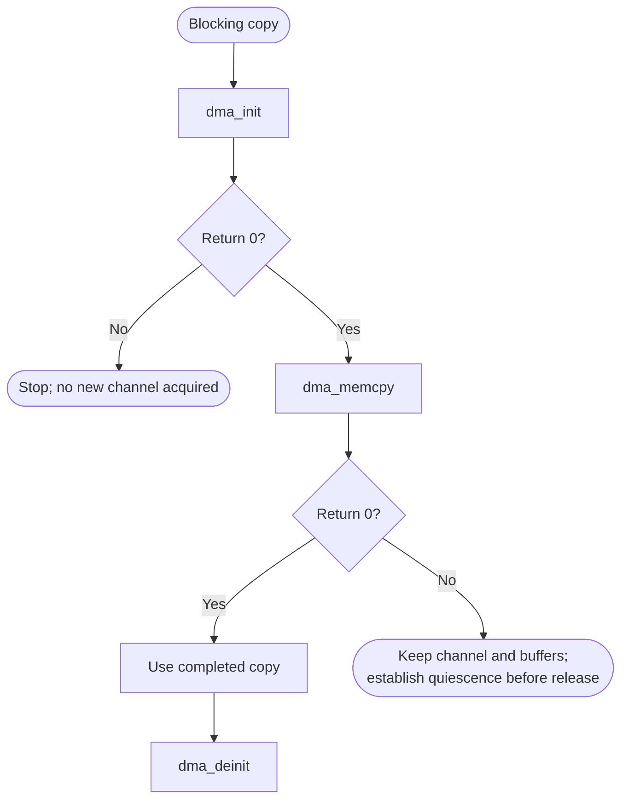
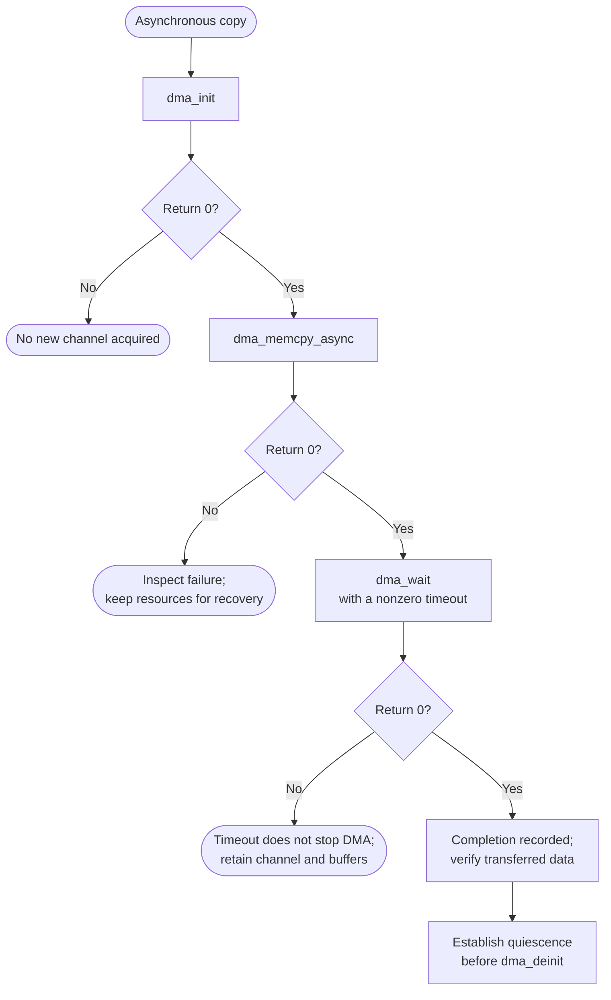

# DMA Bare-Metal API Guide

## Overview

DMA is the Synopsys DesignWare AXI DMA controller. It moves data between memory locations without processor load and store instructions, following chains of linked descriptors.

This module presents a memory-to-memory copy interface -- synchronous and asynchronous -- and builds the descriptor chains internally. It also performs the cache maintenance a DMA transfer needs, which most other modules in this repository leave to the caller.

Include [`dma_api.h`](dma_api.h). Initialize one controller/channel pair before copying. Later calls use that shared selection, so keep its transfer state and buffers valid until the transfer has stopped.


## Quick-start API flow

One channel is active at a time. `dma_api_*` names that alias `dma_*` have the same returns. See [Before You Start](#before-you-start). `dma_wait(0)` is `DMA_WAIT_FOREVER`: that path loops on the done flag and does not poll the channel. Use a non-zero `timeout_ms` if you need the poll.



### Walkthrough

1. Initialize. `-EBUSY` means a channel is already owned; establish that it is quiescent before deinitializing or opening another.
2. Copy. On `0` from `dma_memcpy()`, the synchronous call has finished. On `0` from `dma_memcpy_async()`, it has only started.
3. For the async path, call `dma_wait()` with a non-zero timeout. `-ETIMEDOUT` means the done flag was still false when the iteration budget hit 0. The buffer contents are not a completed copy. A zero return only records completion and can also follow a channel error; verify the data before using it.
4. `dma_is_busy()` is a Boolean, not a status code.



Initialize one channel; use `dma_memcpy()` for a blocking copy, or queue with `dma_memcpy_async()` when other work must run before waiting. `dma_wait()` itself blocks. Keep both buffers valid and untouched until the copy has finished. `dma_deinit()` does not stop a running transfer, so stop it first if necessary.

```c
#include <stdint.h>
#include "dma_api.h"

static uint8_t src[4096] __attribute__((aligned(64)));
static uint8_t dst[4096] __attribute__((aligned(64)));

int copy_once(void)
{
    int rc = dma_init(0U, 0U);   /* instance 0-1, channel 0-3 */
    if (rc != 0) {
        return rc;
    }
    rc = dma_memcpy(dst, src, sizeof(src));
    if (rc != 0) {
        /* Retain the channel and static buffers for recovery. A timeout
         * does not prove that DMA has stopped. Do not deinit or reuse
         * the buffers until hardware quiescence is established. */
        return rc;
    }
    dma_deinit();
    return rc;
}
```

This fragment is illustrative: it follows [`dma_selftest.c`](../../examples/dma/dma_selftest.c) but has not been compiled as a separate example.

## Before You Start

- The controller must be out of reset. Opening a channel checks this and deasserts the reset if needed, so the Reset Manager must be reachable.
- Completion is delivered by interrupt only if your application has initialized the GIC with `gic_api_init()` and unmasked interrupts at the processor; the startup code does neither (see the [GIC guide](../gic/README.md)). Interrupt registration succeeds even when the GIC is not initialized, so no warning is printed. Without interrupts, completion is detected only while you call `dma_wait()` with a finite timeout.
- Align source and destination buffers to the cache-line size (the shipped example uses 64 bytes), so that the driver's cache maintenance does not affect neighbouring data. The API does not check buffer alignment.
- Transfers are performed by a bus master that reads and writes memory independently of the processor. The driver performs the cache maintenance around your buffers itself, so pass ordinary cacheable memory.

## Public API Summary

| Function | Purpose | Returns |
|---|---|---|
| `dma_init()` | Initializes the DMA controller and channel. | Returns 0 on success; `-EBUSY`, `-ENODEV` |
| `dma_api_init()` | Same as `dma_init()`. | Returns 0 on success, or `-EBUSY` or `-ENODEV`. Same values as `dma_init()`. |
| `dma_get_error()` | Intended to return error details. | Returns 0 in this release, including when a transfer failed. Do not use it to detect a failure. |
| `dma_api_get_error()` | Same as `dma_get_error()`. | Returns 0 in this release, including when a transfer failed. Do not use it to detect a failure. |
| `dma_wait()` | Waits for the current DMA transfer to complete. | Returns 0 when the done flag is set, including channel-error completion; `-ETIMEDOUT` for an expired finite wait. Zero does not establish successful data transfer. |
| `dma_api_wait()` | Convenience wrapper for `dma_wait()`. | Same completion/error semantics as `dma_wait()`; 0 is a recorded done flag, not proof of a successful copy; `-ETIMEDOUT` for an expired finite wait |
| `dma_memcpy()` | Performs a synchronous memory-to-memory DMA copy and waits for completion. | Returns 0 on success. The call waits until the copy finishes. Also returns `-EBUSY`, `-EFAULT`, `-EINVAL`, `-EIO`, `-ENODEV`, or `-ETIMEDOUT`. |
| `dma_memcpy_async()` | Starts a descriptor-chain transfer and returns after the chain is queued. | Returns 0 on success. The call returns after the transfer is queued. Also returns `-EBUSY`, `-EFAULT`, `-EINVAL`, `-EIO`, or `-ENODEV`. |
| `dma_is_busy()` | Reports whether the last transfer has not yet been seen to complete. | No status code. Returns true before the first transfer completes, while a transfer is pending, and after `dma_deinit()`. Returns false only after a completion has been recorded. |
| `dma_api_memcpy()` | Standardized-name wrapper for `dma_memcpy()`. | Returns 0 on success, or the same error values as `dma_memcpy()`. |
| `dma_api_memcpy_async()` | Convenience wrapper for `dma_memcpy_async()`. | Returns 0 on success, or the same error values as `dma_memcpy_async()`. |
| `dma_api_is_busy()` | Same as `dma_is_busy()`. | No status code. Same as `dma_is_busy()`. |
| `dma_stop()` | Stops the active transfer. | Returns 0 on success; `-ENODEV` if not initialized; `-EIO` if the channel is already idle (the normal result after a completed transfer); `-ETIMEDOUT` |
| `dma_deinit()` | Releases the channel and clears the module state. Does not stop a running transfer. | No return value. |
| `dma_api_stop()` | Same as `dma_stop()`. | Returns 0 on success, or the same error values as `dma_stop()`. |
| `dma_api_deinit()` | Releases the singleton DMA handle and clears API-side transfer state. | No return value. |

Public header: [`dma_api.h`](dma_api.h).


## Return values and error handling

Shared conventions: [`RETURN_VALUES.md`](../../RETURN_VALUES.md).

`dma_get_error()` and `dma_api_get_error()` return a `uint64_t` error word, not errno. `dma_deinit()` and `dma_api_deinit()` are `void`.

| API / group | Return value | Meaning and exact triggering condition | Customer action / output validity |
|---|---|---|---|
| `dma_init`, `dma_api_init` | `0` | No channel was open, and the open produced a handle. | Later calls use that single context. |
| `dma_init`, `dma_api_init` | `-EBUSY` | `g_dma_handle` is already non-NULL. | The existing channel is untouched. |
| `dma_init`, `dma_api_init` | `-ENODEV` | The open left `g_dma_handle` NULL. | No channel. |
| `dma_memcpy`, `dma_api_memcpy` | `-ENODEV` | `g_dma_handle` is NULL. | No copy. |
| Those memcpy calls | `-EINVAL` | `dst` is NULL, `src` is NULL, or `size` is 0. | No copy. |
| Those memcpy calls | `-EIO` | `dma_mw_get_channel_status()` returned `DMA_CH_ERROR`. | Do not treat `dst` as a finished copy. |
| `dma_memcpy_async`, `dma_api_memcpy_async` | `-EINVAL` | The same NULL or size check, or the copy needs a 129th descriptor. The pool holds 128 descriptors, so a transfer that fits in 128 is accepted. | The transfer did not start. |
| `dma_wait`, `dma_api_wait` | `0` | `timeout_ms` is 0 and the done flag became true, or a non-zero timeout saw the flag before the iteration budget hit 0. | The flag also becomes true on channel error. Verify transferred data; this return does not distinguish successful from failed completion. |
| `dma_wait`, `dma_api_wait` | `-ETIMEDOUT` | `timeout_ms` was non-zero and `max_count` reached 0 while `g_transfer_done` was still false. | The copy is not complete. Do not read `dst` as the result. |
| `dma_is_busy`, `dma_api_is_busy` | `bool` | Inverse of the recorded done flag; true before first completion and after deinit, false after completion or an error callback. | Neither a live hardware-busy measurement nor a success status. |
| `dma_stop`, `dma_api_stop` | `-ENODEV` | `g_dma_handle` is NULL. | Nothing was stopped. |
| `dma_deinit`, `dma_api_deinit` | No return value. | No status. | Does not stop a running transfer. Call `dma_stop()` first when one might be active. |

## API Notes

### `dma_get_error()`

Always returns 0 in this release, even after a failed transfer. Check the return value of `dma_memcpy()` instead.

### `dma_wait()`

Waits for the current DMA transfer to complete.

**Blocking.** With a finite `timeout_ms`, the call polls the controller and returns `-ETIMEDOUT` when the bound expires. The bound is an iteration count (`timeout_ms` × 10000 polls), not a wall-clock time, so the real duration depends on processor speed; values above about 429 000 are clamped.

| Returns | When | Meaning |
|---|---|---|
| `0` | the transfer finished | also returned when the channel finished with an error; only `dma_memcpy()` reports a channel error |
| `-ETIMEDOUT` | the bounded wait expired | the done flag was not observed within the iteration budget; hardware can still be active |

> **Use a finite timeout.** `DMA_WAIT_FOREVER` (0) does not poll the controller; only the interrupt can end the wait. Unless you have called `gic_api_init()` and unmasked interrupts, a `DMA_WAIT_FOREVER` wait never returns, and no warning is printed beforehand.

### `dma_api_wait()`

Convenience wrapper for `dma_wait()`.

> Same return values and timeout behaviour as `dma_wait()`.

### `dma_memcpy()`

Performs a synchronous memory-to-memory DMA copy and waits for completion.

**Blocking.** The copy is split into chunks; each chunk waits for completion with a bound of about 5000 ms (an iteration count, not wall-clock time) and returns `-ETIMEDOUT` if a chunk does not complete. It attempts to stop the
channel but discards that stop result. Keep the channel and buffers reserved
until hardware quiescence has been established; the timeout alone does not
establish it.

| Returns | When | Meaning |
|---|---|---|
| `-ENODEV` | DMA has not been initialized | call `dma_init()` first |
| `-EINVAL` | `dst == NULL \|\| src == NULL \|\| size == 0` | a required pointer argument was NULL, or the requested length is zero or outside the supported range |
| `-EIO` | the DMA channel reports an error state | the transfer failed in the controller |

It can also return `-EBUSY`, `-EFAULT`, `-ETIMEDOUT` from the layer below.

### `dma_memcpy_async()`

Starts a descriptor-chain transfer and returns after the chain is queued.

Use when you want the copy to continue while other code runs.

**Asynchronous.** Returns before the operation completes; completion arrives through a later callback or event. Keep caller-owned resources referenced by this operation valid until completion is observed.

| Returns | When | Meaning |
|---|---|---|
| `-ENODEV` | DMA has not been initialized | call `dma_init()` first |
| `-EINVAL` | `dst == NULL \|\| src == NULL \|\| size == 0` | a required pointer argument was NULL, or the requested length is zero or outside the supported range |
| `-EINVAL` | the copy needs more than 128 descriptors | the transfer is too large for one asynchronous request; split it or use `dma_memcpy()` |

It can also return `-EBUSY`, `-EFAULT`, `-EIO`, `-ETIMEDOUT` from the layer below.

> A return value of 0 means the transfer started, not that it finished. Completion is reported through your callback and through `dma_wait()`. Without GIC interrupts, completion (and the callback) is detected only while you are inside `dma_wait()` with a finite timeout.

### `dma_is_busy()`

Reports transfer progress state.

> Returns `true` until a transfer completion has been recorded, including before the first transfer and after `dma_deinit()`. In polling mode the completion is recorded only inside `dma_wait()`.

### `dma_api_memcpy_async()`

Convenience wrapper for `dma_memcpy_async()`.

**Asynchronous.** Returns before the operation completes; completion arrives through a later callback or event. Keep caller-owned resources referenced by this operation valid until completion is observed.

| Returns | When | Meaning |
|---|---|---|
| `-ENODEV` | DMA has not been initialized | call `dma_init()` first |
| `-EINVAL` | `dst == NULL \|\| src == NULL \|\| size == 0` | a required pointer argument was NULL, or the requested length is zero or outside the supported range |
| `-EINVAL` | the copy needs more than 128 descriptors | the transfer is too large for one asynchronous request; split it or use `dma_memcpy()` |

It can also return `-EBUSY`, `-EFAULT`, `-EIO`, `-ETIMEDOUT` from the layer below.

> Same completion semantics as `dma_memcpy_async()`.

## Real-Hardware Validation

### `dma_selftest`

Non-destructive: copies between buffers owned by the example.

```text
dma_selftest
```

| Property | Value |
|---|---|
| What it does | A synchronous copy, an asynchronous copy with `dma_wait()`, verification of both, then `dma_stop()` and `dma_deinit()` |
| Extra peripheral | None beyond the target board. |
| Pass criterion | `[PASS] Async data verification (...)` and the synchronous data verification line both report `[PASS]`, and no `[FAIL]` line appears. The `[PASS] No transfer errors` line is not a real check, because `dma_get_error()` always returns 0 |

Source: [`examples/dma/dma_selftest.c`](../../examples/dma/dma_selftest.c)

## Important Constraints

| Constraint | Application impact |
|---|---|
| Memory-to-memory only | You cannot use this module to feed a peripheral FIFO; the direction is fixed in the API layer. |
| One channel at a time | The API holds one channel context; a second `dma_init()` returns `-EBUSY`. |
| The error-status call is a stub | `dma_get_error()` always returns 0, so it cannot be used to detect a failed transfer. Check the return code of `dma_memcpy()`. |
| Maximum asynchronous transfer size is bounded by the descriptor pool | An asynchronous copy that needs more than 128 descriptors is rejected with `-EINVAL` rather than split. The synchronous call has no such limit because it chunks internally. |
| Not supported: scatter-gather across caller-supplied descriptor lists | Descriptor chains are built internally from a single source and destination pair; the caller cannot supply its own list. |
| One active instance | Module state is held in file-scope objects, so one initialization is active at a time. There is no internal locking; serialize access yourself. |

## Troubleshooting

| Symptom | Likely area | What to try |
|---|---|---|
| Initialization returns `-EBUSY` | Channel already open | One channel context exists. Deinitialize before initializing again. |
| Initialization returns `-ENODEV` | Instance or channel index, or reset state | Check the instance and channel indices against what your platform defines, and that the controller could be brought out of reset. |
| A copy returns `-ETIMEDOUT` | Transfer did not complete | The wait expired. The synchronous copy only attempts a stop and ignores its result; a timed-out `dma_wait()` does not stop the channel. Keep buffers reserved until quiescence is established. Check controller reachability and transfer length before recovery. |
| An asynchronous copy never completes, or the callback never runs | Interrupt delivery | Unless the GIC is initialized and interrupts are unmasked, completion is detected only while you call `dma_wait()` with a finite timeout. A `DMA_WAIT_FOREVER` wait never returns in that case. |
| `dma_stop()` returns `-EIO` after a successful copy | Expected | The channel is already idle. |
| An asynchronous copy is rejected as too large | Descriptor budget | The transfer needs more descriptors than the pool holds. Split it, or use the synchronous call, which chunks internally. |

## Related Documentation

- [`dma_api.h`](dma_api.h) - public API declarations and types.
- [`examples/dma/dma_selftest.c`](../../examples/dma/dma_selftest.c) - example source for `dma_selftest`.
- [`README.md`](../../README.md) - board bring-up, boot modes, UART and the first console session.
- [`CCU`](../ccu/README.md) - related module.
- [`GIC`](../gic/README.md) - related module.
