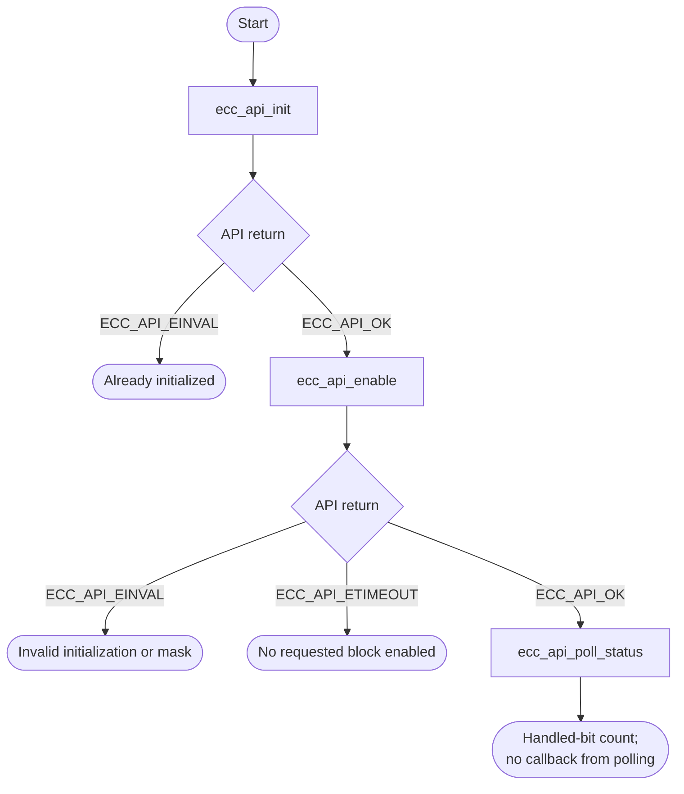
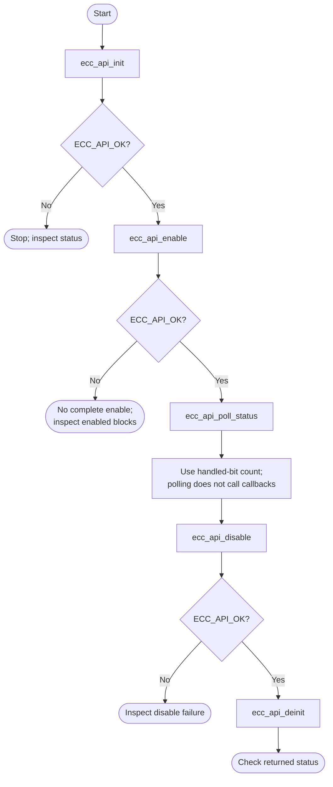

# ECC Bare-Metal API Guide

## Overview

The HPS system manager aggregates ECC status for on-chip RAM (OCRAM). External-memory (DDR) ECC injection is reached through a firmware service call instead. This API exposes two blocks: `ECC_API_BLOCK_OCRAM` and `ECC_API_BLOCK_DDR`.

This module enables ECC on the protected memory blocks, reports and counts single-bit and double-bit errors, and injects test errors so an application's error-handling path can be exercised deliberately.

Include [`ecc_api.h`](ecc_api.h). Initialize the module before enabling blocks or reading counters. Configuration, counters and callback registration are shared across callers.


## Quick-start API flow

These functions return `ECC_API_*` names, not errno. `ECC_API_EINVAL` is not `-EINVAL`. See [Before You Start](#before-you-start). Injection changes ECC state on purpose; do not use it on a live data path.



### Walkthrough

1. Initialize once. A second `ecc_api_init()` returns `ECC_API_EINVAL`.
2. Enable the blocks you need. Success means at least one block enabled, not that every bit in the mask did.
3. Poll or read the counters. A zero poll count is not a failed call.
4. Disable and deinitialize when finished.



Initialize, optionally register a callback, enable the blocks you need, then either let the interrupt path call your callback or poll and read the counters. Injection is for testing your error handling only. `ecc_api_enable()` succeeds if any requested block was enabled, so check each block you rely on, for example with `ecc_api_get_hw_sbe_count()`, which returns `ECC_API_EINVAL` for a block that is not enabled.

This module does **not** return errno values. Functions that return a status use the codes defined in [`ecc_api.h`](ecc_api.h):

| Code | Value | Meaning |
|---|---|---|
| `ECC_API_OK` | 0 | Success |
| `ECC_API_ERROR` | -1 | Any other failure reported by the driver |
| `ECC_API_EINVAL` | -2 | Not initialized, an unsupported or disabled block, or an invalid argument |
| `ECC_API_ETIMEOUT` | -3 | The driver reported an I/O failure. Despite the name, this also covers a request the firmware refused, not only a timeout |

Compare return values with these names, not with `-EINVAL` or `-EIO`.

### Public-header example

Poll enabled blocks without injecting a fault. Initialize ECC and enable the required blocks first. The call updates software
counters, clears handled status bits, and returns
the number of bits handled. It does not invoke the registered callback. Zero
also occurs when ECC is uninitialized.

```c
#include <stddef.h>
#include "ecc_api.h"

/* Initialize and enable the required blocks before polling.
 * Updates counters and clears handled status; no callback or injection. */
int32_t example_ecc_poll(uint32_t *single_bits, uint32_t *double_bits)
{
    if ((single_bits == NULL) || (double_bits == NULL)) {
        return ECC_API_EINVAL;
    }
    /* The return is a handled-bit count, which may be positive. */
    int32_t handled = ecc_api_poll_status(single_bits, double_bits);
    return handled;
}
```

A source copy is available as [`ecc_consumer.c`](../../docs/examples/ecc_consumer.c).
See the [example build instructions](../../docs/examples/README.md).

## Before You Start

- The module must be initialized before any other call, and a block must be enabled before an error can be injected into it.
- `ecc_api_enable()`, `ecc_api_disable()`, `ecc_api_inject_block()` and `ecc_api_get_hw_sbe_count()` accept only OCRAM. The counter and clear calls accept OCRAM and DDR. Any other block ID or mask bit returns `ECC_API_EINVAL`.
- The external-memory (DDR) path goes through a firmware service call, so they need Trusted Firmware-A running and permitting the operation.

## Public API Summary

| Function | Purpose | Returns |
|---|---|---|
| `ecc_api_init()` | Initializes the ECC module. | Returns 0 (`ECC_API_OK`) on success. Also returns `ECC_API_EINVAL` if already initialized. |
| `ecc_api_enable()` | Enables ECC on one or more on-chip blocks. | Returns 0 (`ECC_API_OK`) on success if at least one requested block was enabled. Also returns `ECC_API_EINVAL`, and `ECC_API_ETIMEOUT` if every requested block failed memory initialization. |
| `ecc_api_set_callback()` | Registers a callback for ECC events. The interrupt path calls it; `ecc_api_poll_status()` does not. | Returns 0 (`ECC_API_OK`) on success. This call always returns that value. |
| `ecc_api_get_sbe_count()` | Reads the software count of single-bit errors (SBE) for a block. | Returns the count on success, including 0. Returns `ECC_API_EINVAL` for an invalid block. |
| `ecc_api_get_dbe_count()` | Reads the software count of double-bit errors (DBE) for a block. | Returns the count on success, including 0. Returns `ECC_API_EINVAL` for an invalid block. |
| `ecc_api_get_hw_sbe_count()` | Reads a block's hardware single-bit error counter. | Returns the count on success, including 0. Returns `ECC_API_EINVAL` for an invalid or disabled block. |
| `ecc_api_get_serr_status()` | Reads the raw single-bit error status word. | No status code. Returns the raw 32-bit status word. |
| `ecc_api_get_derr_status()` | Reads the raw double-bit error status word. | No status code. Returns the raw 32-bit status word. |
| `ecc_api_poll_status()` | Handles pending ECC status bits without using interrupts. | Returns the number of status bits handled, including 0. Never negative. |
| `ecc_api_inject_block()` | Injects a single-bit or double-bit error into an enabled on-chip block. | Returns 0 (`ECC_API_OK`) on success. Also returns `ECC_API_EINVAL`. |
| `ecc_api_inject_ddr()` | Requests an error injection in external memory (DDR) through a firmware service call. See the constraint below. | Returns 0 (`ECC_API_OK`) on success. Also returns `ECC_API_EINVAL`, `ECC_API_ETIMEOUT`, and `ECC_API_ERROR`. |
| `ecc_api_inject_ddr_sbe()` | Calls `ecc_api_inject_ddr()` with a fixed single-bit syndrome and command. | Returns 0 (`ECC_API_OK`) on success. Same errors as `ecc_api_inject_ddr()`. |
| `ecc_api_inject_ddr_dbe()` | Calls `ecc_api_inject_ddr()` with a fixed double-bit syndrome and command. | Returns 0 (`ECC_API_OK`) on success. Same errors as `ecc_api_inject_ddr()`. |
| `ecc_api_clear_counters()` | Clears a block's software counters. | Returns 0 (`ECC_API_OK`) on success. Also returns `ECC_API_EINVAL` for an invalid block. |
| `ecc_api_block_name()` | Returns a short printable name for a block ID. | No status code. Returns a static string, or `"UNKNOWN"` for an invalid ID. Never NULL. |
| `ecc_api_disable()` | Disables ECC on one or more on-chip blocks. | Returns 0 (`ECC_API_OK`) on success. Also returns `ECC_API_EINVAL`. |
| `ecc_api_deinit()` | Shuts the ECC module down. | Returns 0 (`ECC_API_OK`) on success. Also returns `ECC_API_EINVAL` if not initialized. |

Public header: [`ecc_api.h`](ecc_api.h).


## Return values and error handling

Shared conventions: [`RETURN_VALUES.md`](../../RETURN_VALUES.md).

Compare with the names in `ecc_api.h`. Do not compare them with `-EINVAL` or `-EIO`.

| Code | Value | When this module uses it |
|---|---|---|
| `ECC_API_OK` | 0 | The call's success condition, which is not the same for every function. |
| `ECC_API_ERROR` | -1 | A driver status other than the ones mapped below. |
| `ECC_API_EINVAL` | -2 | Not initialized, an unsupported or disabled block, or an argument the call rejects. |
| `ECC_API_ETIMEOUT` | -3 | The driver returned `-EIO`. The name covers a refused firmware request as well as a timeout. |

| API / group | Return value | Meaning and exact triggering condition | Customer action / output validity |
|---|---|---|---|
| `ecc_api_init` | `ECC_API_OK` | The driver was not already initialized. | Later calls are allowed. |
| `ecc_api_init` | `ECC_API_EINVAL` | The driver is already initialized. | Do not treat this as a broken block. |
| `ecc_api_enable` | `ECC_API_OK` | At least one requested block was enabled. | Check each block you depend on. `ecc_api_get_hw_sbe_count()` returns `ECC_API_EINVAL` for a block that is not enabled. |
| `ecc_api_enable` | `ECC_API_EINVAL` | ECC is not initialized, the mask is 0, or the mask sets a bit other than OCRAM. | No block was enabled by this call. |
| `ecc_api_enable` | `ECC_API_ETIMEOUT` | Every requested block failed through the driver's `-EIO` path. | Do not assume any block in the mask is protected. |
| `ecc_api_poll_status` | count | Number of single-bit and double-bit status bits handled. Zero when ECC is not initialized or nothing was handled. | This call does not return a negative code. The out pointers are meaningful when the count is non-zero; do not treat zero as `ECC_API_OK` versus failure. |
| `ecc_api_deinit` | `ECC_API_EINVAL` | ECC is not initialized. | Nothing was released. |
| Inject calls | `ECC_API_OK` / `ECC_API_EINVAL` | OK only when ECC is initialized and the block and error type are accepted. | Injection is a deliberate fault. |

## Real-Hardware Validation

### `ecc_selftest`

> **Destructive.** The command injects single-bit and double-bit errors into the on-chip RAM (OCRAM) ECC block and reads the fixed OCRAM address `0x00010000`. A double-bit injection leaves uncorrectable data at that address. It takes no address argument. In an `OCRAM` build, the image itself runs from on-chip RAM, so do not run it unless you know that address is unused by your image.

```text
ecc_selftest [all|ocram_sbe|ocram_dbe|status]
```

| Property | Value |
|---|---|
| Options | `ocram_sbe` / `ocram_dbe`: inject one single-bit / double-bit error into OCRAM. `status`: print the raw status words and the OCRAM and DDR counters (no injection). |
| Extra peripheral | None beyond the target board. |
| Pass criterion | No single verdict line. The `[ECC][PASS] inject ...` lines only mean the injection call returned success; they do not check that the error was detected. Look for the `ECC: poll handled <n> event(s)` lines after each injection, or use `ecc_bist`, which checks detection |

Source: [`examples/ecc/ecc_selftest.c`](../../examples/ecc/ecc_selftest.c)

### `ecc_bist`

> **Destructive.** Same OCRAM injection and fixed address as `ecc_selftest`.

```text
ecc_bist [all|ocram_sbe|ocram_dbe]
```

| Property | Value |
|---|---|
| Extra peripheral | None beyond the target board. |
| Pass criterion | The command's own output ends with `[ECC_BIST][PASS] OCRAM ECC BIST complete`. The console then adds `DONE` and its own `RESULT :` line, which is not a verdict. |
| Fail indication | `[ECC_BIST][FAIL] OCRAM ECC BIST incomplete`, preceded by a `[ECC_BIST][FAIL]` line naming the failed step |

Source: [`examples/ecc/ecc_selftest.c`](../../examples/ecc/ecc_selftest.c)

## Important Constraints

| Constraint | Application impact |
|---|---|
| Injection deliberately corrupts memory | A single-bit injection is corrected, but a double-bit injection leaves uncorrectable data at the target address. Inject only into memory that holds nothing you need. |
| External-memory injection is expected to be refused | The shipped example states that DDR injection through the firmware service call is not supported after the DDR handoff ([`ecc_selftest.c`](../../examples/ecc/ecc_selftest.c), usage text). Expect `ecc_api_inject_ddr()` to fail with `ECC_API_ETIMEOUT` on that boot path. |
| The polled path does not invoke the callback | Application code written around the callback will silently do nothing in a polled configuration. |
| Not supported: external-memory enable and status through this module | External-memory ECC is enabled and monitored through the [IOSSM module](../iossm/README.md). |
| One active instance | Module state is held in file-scope objects, so one initialization is active at a time. There is no internal locking. |

## Troubleshooting

| Symptom | Likely area | What to try |
|---|---|---|
| Enabling ECC times out | OCRAM memory initialization | The OCRAM ECC memory initialization did not complete. Read the raw status with `ecc_selftest status`. |
| `ecc_api_inject_block()` returns `ECC_API_EINVAL` | Block not enabled, or not initialized | Call `ecc_api_init()` and enable ECC on the block before injecting into it. |
| A registered callback never fires while polling detects errors | Expected behaviour | The polled path does not invoke the callback. Read the counters instead when using polling. |
| External-memory (DDR) injection fails while OCRAM works | Firmware permission | That path needs a firmware service call the firmware layer must permit. The on-chip blocks are reached by direct register access and do not. |

## Related Documentation

- [`ecc_api.h`](ecc_api.h) - public API declarations and types.
- [`examples/ecc/ecc_selftest.c`](../../examples/ecc/ecc_selftest.c) - example source for `ecc_selftest` and `ecc_bist`.
- [`README.md`](../../README.md) - board bring-up, boot modes, UART and the first console session.
- [`IOSSM`](../iossm/README.md) - related module.
- [`SEU`](../seu/README.md) - related module.
- [`GIC`](../gic/README.md) - related module.
