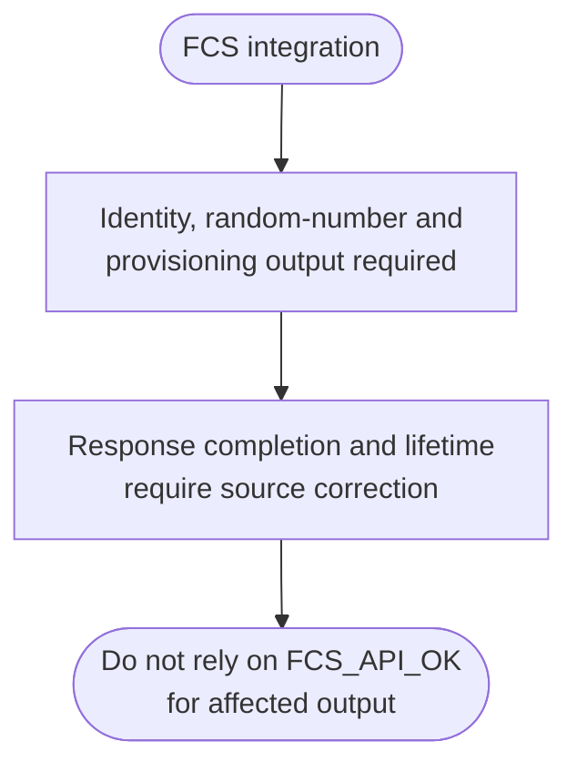

# FCS Bare-Metal API Guide

> **Integration blocked in this snapshot.** The identity, random-number,
> provisioning and session-close paths inspect stack response storage before
> the API drains pending mailbox responses. The mailbox layer can still hold
> a pointer to that storage after the driver call returns. The random-number
> path also fails to propagate a nonzero firmware response status on one path.
> `FCS_API_OK` therefore does not establish valid output on these paths. Source
> correction and validation are required before relying on this interface.

## Overview

FCS is the device's cryptographic service. It is hosted by the SDM and reached over the same mailbox path as other device-management commands.

This module reads device identity values, opens and closes a cryptographic session, obtains random numbers from the device's generator, and reads provisioning data.

The public declarations are in [`fcs_api.h`](fcs_api.h). Initialization and session calls share module state. Review the integration blocker above before using any generated prototype or example.


## Quick-start API flow

Status codes are `FCS_API_*`, not errno. The API maps mailbox status `0x85` to a security denial on selected calls; the code alone does not identify the device provisioning state. See [Before You Start](#before-you-start) for the DDR buffers these calls require.



### Walkthrough

1. Initialize. `FCS_API_ERROR` here means the client open failed.
2. Read identity only after init. NULL outputs return `FCS_API_INVALID_PARAM` and are not written.
3. Open a session only if you need random numbers. Provisioning has no session argument. `FCS_API_SECURITY_DENIED` is not a reason to retry.
4. Close every session you opened. `fcs_api_deinit()` does not close them.

The affected response paths cannot be used as a verified integration sequence
until completion, buffer lifetime and firmware-status propagation are corrected.

The intended sequence is initialization, identity reads and, when needed, a session for random-number requests. The response-handling defects above prevent this sequence from serving as a validated integration example. `fcs_api_deinit()` does not close sessions.

This module does **not** return errno values. Status codes are defined in [`fcs_api.h`](fcs_api.h):

| Code | Value | Meaning |
|---|---|---|
| `FCS_API_OK` | 0 | Wrapper reports success; affected output validity remains blocked as described above |
| `FCS_API_ERROR` | -1 | Mailbox, firmware or driver failure |
| `FCS_API_INVALID_PARAM` | -3 | A NULL pointer or an out-of-range argument |
| `FCS_API_NOT_INITED` | -4 | `fcs_api_init()` has not succeeded |
| `FCS_API_SECURITY_DENIED` | -5 | The API maps mailbox status 0x85 to this value; confirm the refusal reason with the firmware and device-security owner |

## Before You Start

- Trusted Firmware-A must be running and providing the mailbox service. This module shares the same mailbox client as the general mailbox module.
- Session access depends on the device and firmware security policy. A refusal is not sufficient evidence of a particular provisioning state; confirm that state before drawing a security conclusion.
- `fcs_api_get_provision_data()` passes your buffer's address directly to the firmware, which writes the data into it. The buffer must be at least 1024 bytes (`FCS_PROV_DATA_MAX_SIZE`) regardless of the size you pass in, cache-line aligned, and in external memory (DDR) that the firmware accepts; the shipped example uses DDR at `0x83800000`. The driver invalidates the cache over the buffer itself.
- The FCS driver uses fixed external-memory buffers at `0x83000000` (input) and `0x83400000` (output); `fcs_api_open_session()` and `fcs_api_get_random_number()` have the firmware write their responses at `0x83400000`. Keep your own data out of `0x83000000`-`0x837FFFFF`.
- Session identifiers are 16 bytes (`FCS_UUID_SIZE`). A random-number request can return at most 4084 bytes (`FCS_RNG_MAX_SIZE`).

## Public API Summary

These rows describe the current return mapping. For identity, random-number,
provisioning and session-close calls, a zero result does not resolve the
completion and output-validity defect described at the start of this guide.

| Function | Purpose | Returns |
|---|---|---|
| `fcs_api_init()` | Opens the mailbox and security clients. | Returns 0 (`FCS_API_OK`) on success. Also returns `FCS_API_ERROR`. |
| `fcs_api_get_chip_id()` | Reads the device chip ID from the SDM. | Returns 0 (`FCS_API_OK`) on success. Also returns `FCS_API_INVALID_PARAM`, `FCS_API_NOT_INITED`, and `FCS_API_ERROR`. |
| `fcs_api_get_jtag_idcode()` | Reads the JTAG IDCODE from the SDM. | Returns 0 (`FCS_API_OK`) on success. Same errors as `fcs_api_get_chip_id()`. |
| `fcs_api_open_session()` | Opens a cryptographic session and writes its 16-byte identifier. At most 6 sessions can be open at once. | Returns 0 (`FCS_API_OK`) on success. Also returns `FCS_API_INVALID_PARAM`, `FCS_API_NOT_INITED`, `FCS_API_SECURITY_DENIED`, and `FCS_API_ERROR`. A seventh open returns `FCS_API_ERROR`. |
| `fcs_api_get_random_number()` | Fills a buffer with random bytes from the SDM generator, within an open session. | Returns 0 (`FCS_API_OK`) on success. Also returns `FCS_API_INVALID_PARAM`, `FCS_API_NOT_INITED`, and `FCS_API_ERROR`. |
| `fcs_api_close_session()` | Closes a session. | Returns 0 (`FCS_API_OK`) on success. Also returns `FCS_API_INVALID_PARAM`, `FCS_API_NOT_INITED`, and `FCS_API_ERROR`. A 0x85 refusal is reported as `FCS_API_ERROR` here. |
| `fcs_api_get_provision_data()` | Reads the device's provisioning data into a caller buffer (see Before You Start for buffer rules). | Returns 0 (`FCS_API_OK`) on success. Same errors as `fcs_api_open_session()`. |
| `fcs_api_poll_drain()` | Collects any pending mailbox responses. Does not require `fcs_api_init()`. | Returns the number of responses collected, including 0. Never negative. |
| `fcs_api_deinit()` | Closes the clients. Does not close open sessions. | Returns 0 (`FCS_API_OK`) on success. |

Public header: [`fcs_api.h`](fcs_api.h).


## Return values and error handling

Shared conventions: [`RETURN_VALUES.md`](../../RETURN_VALUES.md).

| Code | Value | Meaning |
|---|---|---|
| `FCS_API_OK` | 0 | The wrapper reports a zero driver result. It does not establish valid output on the affected response paths. |
| `FCS_API_ERROR` | -1 | Mailbox, firmware, or driver failure that is not one of the codes below. |
| `FCS_API_NO_RESPONSE` | -2 | Defined, and not what the current calls return for the paths in `fcs_api.c`. |
| `FCS_API_INVALID_PARAM` | -3 | A NULL pointer or a size outside the range that function checks. |
| `FCS_API_NOT_INITED` | -4 | `fcs_api_init()` has not succeeded. |
| `FCS_API_SECURITY_DENIED` | -5 | The mailbox returned 0x85. Used by `fcs_api_open_session()` and `fcs_api_get_provision_data()`. `fcs_api_close_session()` reports 0x85 as `FCS_API_ERROR` instead. |

| API / group | Return value | Meaning and exact triggering condition | Customer action / output validity |
|---|---|---|---|
| `fcs_api_init` | Returns 0 (`FCS_API_OK`) on success. | The client open succeeded, or the module was already initialized. | Later calls are allowed. |
| `fcs_api_init` | `FCS_API_ERROR` | The client open failed. | Do not send a command. |
| Identity and session calls | `FCS_API_NOT_INITED` | `g_fcs_inited` is false. | Call `fcs_api_init()` first. Outputs were not written. |
| `fcs_api_get_chip_id` | `FCS_API_INVALID_PARAM` | `chip_low` or `chip_high` is NULL. | Neither word is valid. |
| `fcs_api_get_jtag_idcode` | `FCS_API_INVALID_PARAM` | `jtag_idcode` is NULL. | The output is not valid. |
| `fcs_api_open_session` | `FCS_API_INVALID_PARAM` | `uuid_out` is NULL. | No session id. |
| `fcs_api_open_session` | `FCS_API_SECURITY_DENIED` | The mailbox status is 0x85. | Do not retry. The device refused the session. |
| `fcs_api_get_random_number` | `FCS_API_INVALID_PARAM` | `uuid` or `rand_buf` is NULL, or the size is 0 or greater than `FCS_RNG_MAX_SIZE`. | The buffer is not a random result. |
| `fcs_api_get_provision_data` | `FCS_API_SECURITY_DENIED` | The mailbox status is 0x85. | The buffer is not provisioning data. |
| `fcs_api_close_session` | `FCS_API_INVALID_PARAM` | `uuid` is NULL. | The session is still open. |
| `fcs_api_deinit` | Returns 0 (`FCS_API_OK`) on success. | The module was not initialized, or `fcs_deinit()` returned 0. The not-initialized path does not call the driver. | |
| `fcs_api_deinit` | `FCS_API_ERROR` | `fcs_deinit()` returned non-zero. The local flag is cleared first. | A later `fcs_api_init()` is required before another command. |

## Example limitations

### `fcs_selftest`

Does not erase, program or reset anything. One side effect: if the device refuses to open a session, the command writes 1 KiB at the fixed DDR address `0x83800000` while reading the provisioning data. That address is in external memory, so the command is meant for `DDR` builds.

```Text
fcs_selftest
```

| Property | Value |
|---|---|
| What it does | Initializes, reads the chip ID and JTAG IDCODE, opens a session, reads random bytes, closes the session and deinitializes. If the session is refused, it reads the provisioning data instead and skips the session steps. |
| Extra peripheral | None beyond the target board. |
| Pass criterion | The command's own output ends with `=== FCS demo: N/N step(s) PASS ===` with both numbers equal. On a device that refuses sessions, the line ends with `(1 expected security skip(s))`, and the skipped steps print `[FCS][INFO] ... skipped`. The console then adds `DONE` and its own `RESULT :` line, which is not a verdict. |

Source: [`examples/fcs/fcs_selftest.c`](../../examples/fcs/fcs_selftest.c)

## Important Constraints

| Constraint | Application impact |
|---|---|
| Requires Trusted Firmware-A | Unavailable in a build without the firmware-mediated mailbox path. |
| At most 6 open sessions | The driver's session table holds 6 entries; a further open returns `FCS_API_ERROR`. Close each session when finished. |
| Deinitialization abandons open sessions | `fcs_api_deinit()` clears the session table without closing the sessions on the SDM. Close them first. |
| Not supported: encryption, decryption, signing and key-derivation operations | The driver layer implements a much larger command set than the public API exposes. Only identity, session, random-number and provisioning calls are reachable through the public interface. |
| One active instance | Module state is held in file-scope objects, so one initialization is active at a time. There is no internal locking; serialize access yourself. |

## Troubleshooting

| Symptom | Likely area | What to try |
|---|---|---|
| Initialization fails | Mailbox client | The shared mailbox client could not be acquired. Confirm the firmware layer providing it is present in this boot path. |
| `fcs_api_open_session()` returns `FCS_API_SECURITY_DENIED` | Device security state | Expected on a device whose owner security configuration does not permit sessions. Identity reads still work. |
| Any call returns `FCS_API_NOT_INITED` | Initialization | Call `fcs_api_init()` first and check that it returned `FCS_API_OK`. |

## Related Documentation

- [`fcs_api.h`](fcs_api.h) - public API declarations and types.
- [`examples/fcs/fcs_selftest.c`](../../examples/fcs/fcs_selftest.c) - example source for `fcs_selftest`.
- [`README.md`](../../README.md) - board bring-up, boot modes, UART and the first console session.
- [`SDM Mailbox`](../mailbox/README.md) - related module.
- [`SEU`](../seu/README.md) - related module.
