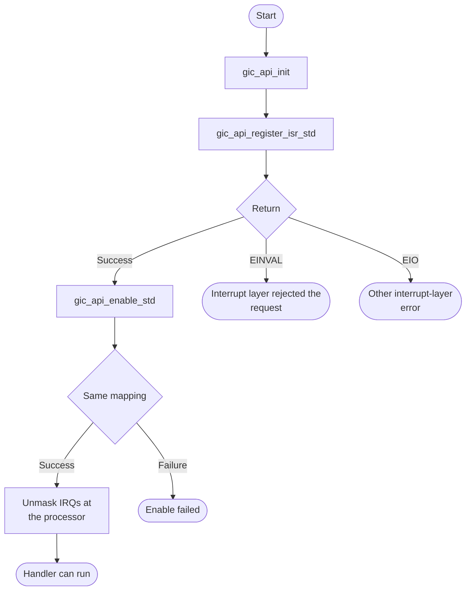
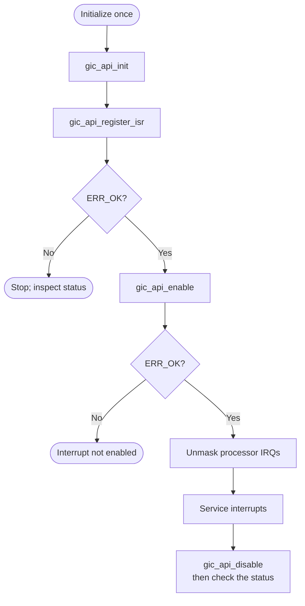

# GIC Bare-Metal API Guide

## Overview

The GIC is the Arm GICv3-architecture interrupt controller. It routes interrupts from peripherals and from other processors to a processor core, using a distributor for shared interrupts and a per-core redistributor. Three interrupt types are used below: SGI (software-generated interrupt, IDs 0 to 15), PPI (private peripheral interrupt, per core) and SPI (shared peripheral interrupt, from peripherals). In this guide SPI always means shared peripheral interrupt, not the SPI serial bus.

This module initializes the interrupt controller, attaches a handler to an interrupt, enables or disables it, and sends software-generated interrupts between cores.

Include [`gic_api.h`](gic_api.h). Initialization and handler registration affect the shared interrupt controller and the calling core; later calls take interrupt IDs rather than a module handle.


## Quick-start API flow

Initialize the GIC before registering handlers. `gic_api_init()` returns no status. The `*_std` functions return errno-style codes. The functions without `_std` return `socfpga_interrupt_err_t` (`ERR_OK` on success). See [Before You Start](#before-you-start). A handler does not run until IRQs are unmasked at the processor.



### Walkthrough

1. Call `gic_api_init()` once. It cannot report failure.
2. Register the handler before enabling the interrupt, so a pending event does not hit the default handler.
3. Enable with `gic_api_enable_std()` if you want errno-style returns. `-EINVAL` means the interrupt layer rejected the id, type, mode, target, or callback. `-EIO` is any other error from that layer.
4. Unmask interrupts at the processor. The GIC call does not do that.



Initialize once, register the handler before enabling the interrupt so that a pending event never reaches the default handler, enable it, and make sure interrupts are unmasked at the processor. [`gic_selftest.c`](../../examples/gic/gic_selftest.c) shows the complete sequence, including the processor-side unmasking for each exception level.

### Public-header example

Register a callback before enabling its interrupt. Initialize the GIC once first, and unmask IRQs at the processor afterward. The callback and context must remain valid while the interrupt can fire.

```c
#include "gic_api.h"

/* Initialize once before calling this helper. Unmask IRQs at the CPU after
 * registration and enable. Keep callback and context alive while enabled. */
int32_t example_gic_enable(uint32_t irq, uint8_t priority,
                           socfpga_interrupt_callback_t callback, void *context)
{
    int32_t rc = gic_api_register_isr_std(irq, callback, context);
    if (rc != 0) {
        return rc;
    }
    rc = gic_api_enable_std(irq, priority);
    return rc;
}
```

The same source is available as [`gic_consumer.c`](../../docs/examples/gic_consumer.c). See the [example build instructions](../../docs/examples/README.md).

## Before You Start

- The startup code does not initialize the GIC; call `gic_api_init()` first. At EL3 (exception level 3, an `OCRAM` image) it programs the distributor; below EL3 (a `DDR` image started by TF-A) it leaves the distributor to the earlier firmware and configures only the redistributor and the processor interface.
- On Agilex 5 `OCRAM` builds, `gic_api_init()` also opens the interrupt controller's address window through the CCU before the first register access. Call it before any other function in this module.
- Interrupts must be unmasked at the processor for a handler ever to run. Enabling an interrupt at the controller is necessary but not sufficient.

## Public API Summary

| Function | Purpose | Returns |
|---|---|---|
| `gic_api_init()` | Initializes the GIC for the calling core. Failures are not reported. | No return value. |
| `gic_api_enable()` | Enables an SGI, PPI or SPI with the given priority (see the priority constraint). SPIs are routed to core 0 and configured as level-sensitive. | Returns `ERR_OK` (0) on success, or an `ERR_*` code for an out-of-range ID. |
| `gic_api_register_isr()` | Registers a callback and caller context for an interrupt ID. | Returns `ERR_OK` (0) on success, or an `ERR_*` code. |
| `gic_api_trigger_sgi()` | Sends an SGI to the cores selected by `cpu_mask` (one bit per core in cluster 0). | Returns `ERR_OK` (0) on success, or an `ERR_*` code. |
| `gic_api_init_std()` | Calls `gic_api_init()`. | Returns 0 even if initialization failed. |
| `gic_api_enable_std()` | Same as `gic_api_enable()`, returning an errno value. | Returns 0 on success, or `-EINVAL` |
| `gic_api_disable_std()` | Same as `gic_api_disable()`, returning an errno value. | Returns 0 on success, or `-EINVAL` |
| `gic_api_register_isr_std()` | Same as `gic_api_register_isr()`, returning an errno value. | Returns 0 on success, or `-EINVAL` |
| `gic_api_trigger_sgi_std()` | Same as `gic_api_trigger_sgi()`, returning an errno value. | Returns 0 on success, or `-EINVAL` |
| `gic_api_disable()` | Disables an interrupt. IDs below 31 are SGI or PPI interrupts. IDs 32 to 1019 are SPIs. ID 31 is rejected. | Returns `ERR_OK` (0) on success, or an `ERR_*` code. |

The non-`_std` functions return `socfpga_interrupt_err_t` codes (`ERR_OK` on success; `ERR_SGI_ID`, `ERR_PPI_ID`, `ERR_SPI_ID` or `ERR_INTERRUPT_CALLBACK` on failure). The `_std` variants map the listed errors to `-EINVAL`; their default mapping
is `-EIO` for any other interrupt-layer code.


Public header: [`gic_api.h`](gic_api.h).

## Return values and error handling

Shared conventions: [`RETURN_VALUES.md`](../../RETURN_VALUES.md).

| API / group | Return value | Meaning and exact triggering condition | Customer action / output validity |
|---|---|---|---|
| `gic_api_init` | No return value. | Calls `interrupt_init_gic()` and returns no status. | There is no failure code. |
| `gic_api_init_std` | `0` | Calls `gic_api_init()` and returns 0. | Same as the void init. It does not report a hardware failure. |
| `gic_api_enable`, `gic_api_disable`, `gic_api_register_isr`, `gic_api_trigger_sgi` | `ERR_OK` or another `socfpga_interrupt_err_t` | The interrupt layer's own code, not errno. | Compare with `ERR_OK` and the `ERR_*` names, not with `-EINVAL`. |
| `gic_api_enable_std`, `gic_api_disable_std`, `gic_api_register_isr_std`, `gic_api_trigger_sgi_std` | `0` | The interrupt layer returned `ERR_OK`. | The requested enable, disable, registration, or SGI was accepted. |
| Those `*_std` calls | `-EINVAL` | The interrupt layer returned `ERR_SPI_ID`, `ERR_SPI_TYPE`, `ERR_SPI_MODE`, `ERR_SPI_TARGET`, `ERR_INTERRUPT_CALLBACK`, `ERR_PPI_ID`, or `ERR_SGI_ID`. | The request was rejected. The previous handler or enable state is unchanged by this wrapper. |
| Those `*_std` calls | `-EIO` | Any other `socfpga_interrupt_err_t`. | The interrupt layer failed for a reason this wrapper does not name. |

## Hardware checks and limitations

### `gic_selftest`

Does not erase or reset anything, but it changes interrupt routing and unmasks interrupts at the processor for the rest of the session, and it re-runs GIC initialization. Included in both `OCRAM` and `DDR` builds.

```text
gic_selftest
```

| Property | Value |
|---|---|
| What it does | Initializes the GIC, registers a handler, enables and triggers an SGI, and checks that the handler ran |
| Extra peripheral | None beyond the target board. |
| Pass criterion | The last line is `RESULT : 2 of 2 tests passed  -  SELF-TEST PASSED`. Each test also prints its own `PASS`, which alone is not the verdict |

Source: [`examples/gic/gic_selftest.c`](../../examples/gic/gic_selftest.c)

## Important Constraints

| Constraint | Application impact |
|---|---|
| Single core only on Agilex 5 and Agilex 3 | In every build mode, the driver uses redistributor 0 only, so SGI and PPI configuration from any core targets core 0's redistributor. It also programs the SGI/PPI group registers from software copies that start at zero, because reads of that redistributor can stall on these devices, so group settings made by earlier firmware are overwritten. |
| Distributor ownership depends on the exception level | At EL3 the driver programs the distributor; below EL3 it leaves the distributor to earlier firmware and configures only the redistributor and the processor interface. |
| An unhandled interrupt can hang the system | The default handler can spin forever, so enabling an interrupt without a handler turns a stray event into a hang. Register the handler first. |
| Enabling an interrupt for an unclocked peripheral can cause a storm | Bring the peripheral out of reset and clock it before enabling its interrupt. |
| Priority uses 4 bits | The driver shifts `priority` left by 4 bits and keeps 8 bits, so only values 0 to 15 are meaningful (0 is the highest priority) and higher bits are discarded: for example, 0x80 becomes the highest priority. On Agilex 5 and Agilex 3, SGI and PPI priorities may also be lowered to stay below the processor's priority mask. |
| Shared peripheral interrupts go to core 0, level-sensitive | `gic_api_enable()` routes every SPI to core 0 and configures it as level-sensitive. |
| Global, unlocked state | Driver state is global and has no locking; use this module from one core only. |

## Troubleshooting

| Symptom | Likely area | What to try |
|---|---|---|
| An enabled interrupt never reaches its handler | Processor masking, group or routing configuration | Enabling at the controller is not enough: interrupts must also be unmasked at the processor, and the interrupt's group and routing must match the privilege level the image runs at. |
| A bus abort on the first interrupt controller access | Address window not opened | Call `gic_api_init()` before any other GIC function; on Agilex 5 `OCRAM` builds it opens the controller's address window first. |
| The system hangs when an interrupt fires | No handler registered | The default handler for an unregistered interrupt can spin. Register a handler for every interrupt you enable. |
| Registering or enabling an interrupt is rejected | Interrupt number | SGIs are 0 to 15. Check PPI and SPI numbers against the ranges defined in the driver header [`socfpga_interrupt.h`](../../drivers/gic/socfpga_interrupt.h). |
| A high-priority value behaves as the highest priority | Priority encoding | Only the low 4 bits of `priority` are used; pass 0 to 15. |

## Related Documentation

- [`gic_api.h`](gic_api.h) - public API declarations and types.
- [`examples/gic/gic_selftest.c`](../../examples/gic/gic_selftest.c) - example source for `gic_selftest`.
- [`README.md`](../../README.md) - board bring-up, boot modes, UART and the first console session.
- [`CCU`](../ccu/README.md) - related module.
- [`Timer`](../timer/README.md) - related module.
- [`DMA`](../dma/README.md) - related module.
