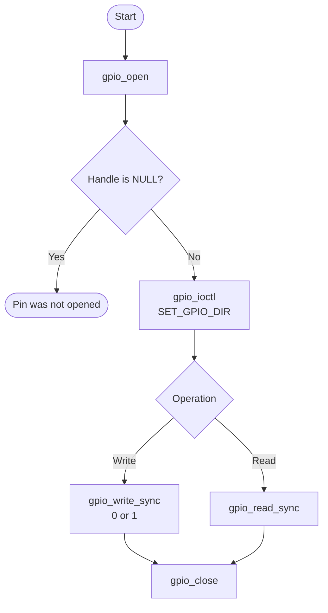

# GPIO Bare-Metal API Guide

## Overview

The HPS provides two GPIO controller banks. The current implementation opens one pin at a time, sets its
direction, reads the pad state, and drives an output. Use polling in this
revision; the interrupt callback path does not deliver the stored callback.

This guide describes [`gpio_api.c`](gpio_api.c) and the types in
[`socfpga_gpio.h`](../../drivers/gpio/socfpga_gpio.h).
The declarations in [`gpio_api.h`](gpio_api.h) are not yet aligned with that
implementation: `gpio_open()` is implemented as a handle-returning function,
`gpio_set_callback()` returns `void`, and the handle, callback and control-command
types differ. The call flow below describes the source behavior. It is not a
compilable example against the current public header. Confirm the corrected
public declarations before integrating GPIO into an application.

## Quick-start API flow

### Walkthrough

1. Select a pin using the board schematic and pinmux configuration.
2. Open the pin and check for NULL. The implementation does not return errno
   from `gpio_open()` or use an output-handle parameter.
3. Pass the address of a `gpio_dir_t` value to `gpio_ioctl()`. Passing the
   direction value as a pointer cast is not supported.
4. Check every read and write return. Use a read result only when the call
   returns 0. Pass only 0 or 1 to writes.
5. Close the handle and check the return. A failed close can leave it open.

## Before You Start

- The pad must already be muxed to GPIO. This module checks pinmux but does not
  configure it.
- Opening a pin reads its bank's reset state and releases reset if necessary.
  The Reset Manager must be accessible. This call does not configure a clock.
- Pin identifiers in the current driver are `GPIO0_PIN0` onward: values 0 to 23
  select GPIO0 and 24 to 47 select GPIO1. Obtain the physical signal mapping
  from the board schematic; this repository does not map pins to board LEDs,
  buttons or connectors.
- Keep each handle under one owner's control. Do not reuse it after close or
  call control functions concurrently with close.

## Public API Summary

The following table describes the implemented functions. The current public
header must be aligned before it can serve as their compilation contract.

| Function | Implemented behavior | Return |
|---|---|---|
| `gpio_open(pin)` | Validates the pin, pinmux, ownership and bank reset, then opens its descriptor | Returns a handle on success. Returns NULL on failure. |
| `gpio_ioctl(handle, cmd, buf)` | Reads or changes direction or interrupt configuration through a pointer argument | Returns 0 on success, or `-EINVAL`. |
| `gpio_set_callback(handle, callback, param)` | Stores a callback with signature `void callback(uint8_t state, void *param)` and caller context | No return value. A NULL handle is ignored. |
| `gpio_write_sync(handle, state)` | Writes the output data bit; the direction must already be output | Returns 0 on success, or `-EINVAL`. |
| `gpio_read_sync(handle, &state)` | Samples the pad level, including on an output pin | Returns 0 on success, or `-EINVAL`. |
| `gpio_close(handle)` | Disables an active interrupt configuration and marks the descriptor closed | Returns 0 on success, or `-EINVAL`. |

## Return values and error handling

Shared conventions: [`RETURN_VALUES.md`](../../RETURN_VALUES.md).

| API / group | Failure condition | Application action |
|---|---|---|
| `gpio_open()` returns NULL | Pin is out of range, not muxed to GPIO, already open, or its reset status/release failed | Do not use a handle; check pinmux, ownership and Reset Manager access |
| Read/write returns `-EINVAL` | Handle is NULL or closed; read also rejects a NULL output pointer | Open first; do not use a failed read's output |
| `gpio_ioctl()` returns `-EINVAL` | Handle or argument is NULL, command is unknown, or interrupt configuration is rejected | Check command and pointer type; use only a live handle |
| `gpio_close()` returns `-EINVAL` | Handle is NULL or closed, or disabling its interrupt failed | A failure during interrupt cleanup leaves the descriptor open |
| `gpio_set_callback()` | No status is returned; NULL handle is ignored | Registration does not establish a working interrupt path in this revision |

## API Notes

### Control arguments

| Command in the implementation | Object passed by address |
|---|---|
| `SET_GPIO_DIR` | `gpio_dir_t`: `GPIO_DIR_IN` or `GPIO_DIR_OUT` |
| `SET_GPIO_INT` | `gpio_int_t`: `GPIO_INT_NONE`, `GPIO_INT_RISING`, `GPIO_INT_FALLING`, `GPIO_INT_LOW` or `GPIO_INT_HIGH` |
| `GET_GPIO_DIRECTION` | `uint8_t` output |
| `GET_GPIO_INT` | `gpio_int_t` output |

`gpio_ioctl()` and `gpio_set_callback()` check for a NULL handle but do not
check whether the descriptor is open. Use them only between a successful open
and close. Invalid direction values are not rejected by `gpio_ioctl()`.

### Reading and driving a pin

Set direction before writing. A return of 0 means the write reached the data
register, not that the pad reached the desired electrical level. Read the pad
and compare with the expected level, then measure the board signal when
validating hardware. Values other than 0 or 1 are shifted without masking and
can alter neighbouring output bits.

### Interrupt callbacks

The handle stores the callback in a descriptor array local to `gpio_api.c`.
The interrupt handler uses a different array local to its own source file.
Consequently registration does not deliver the callback. Poll with
`gpio_read_sync()` until the interrupt path is corrected.

## Hardware checks and limitations

### Board pin exercise

After the public declarations have been aligned, select a board signal that can
be safely driven or sampled. For an output, set output direction, drive 0 and 1,
read back each pad level, and confirm the physical levels with the board's
measurement setup. For an input, apply known low and high levels and confirm
both readings. Check every call and close the handle afterward. These steps
require the board pin mapping and electrical limits from the kit documentation.

### `gpio_selftest`

The example is built into DDR images, but in this release it initializes the
handle to NULL, never calls `gpio_open()`, ignores the failed operations, and
prints an uninitialized read variable. It does not exercise GPIO hardware, and
`GPIO value:` is not a pass criterion. Use the board pin exercise above
instead.

Source: [`examples/gpio/gpio_selftest.c`](../../examples/gpio/gpio_selftest.c).

## Important Constraints

| Constraint | Application impact |
|---|---|
| Public declarations and implementation differ | Confirm the corrected public header before integration |
| Interrupt callbacks are not delivered | Poll the pad |
| Only values 0 and 1 are valid writes | Other values can change adjacent pins |
| One pin per operation | There is no atomic multi-pin write |
| No debounce programming | Debounce in the application or use a clean input signal |
| No board signal mapping | Use the board schematic and pinmux setup |
| `gpio_selftest` uses a NULL handle | Its printed value does not validate hardware |

## Troubleshooting

| Symptom | Check |
|---|---|
| `gpio_open()` returns NULL | Pin range, pinmux, existing ownership, then Reset Manager access |
| Read or write returns `-EINVAL` | Handle was successfully opened and has not been closed; read output pointer is non-NULL |
| Output level does not change | Direction is output, pad is muxed to GPIO, and board wiring permits the selected level |
| Multiple transitions for one event | Input cleanliness and application debounce |
| Callback never runs | Use polling; callback storage is not shared with the interrupt handler in this revision |

## Related Documentation

- [`gpio_api.c`](gpio_api.c) - current implementation.
- [`socfpga_gpio.h`](../../drivers/gpio/socfpga_gpio.h) - implemented pin, direction and command types.
- [`gpio_api.h`](gpio_api.h) - public declarations; these differ from the implementation in this release.
- [`README.md`](../../README.md) - board bring-up, boot modes and UART.
- [GIC](../gic/README.md) and [Reset Manager](../rst_mngr/README.md) guides.
