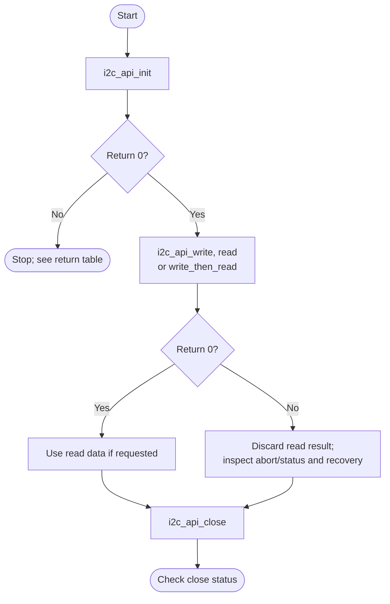
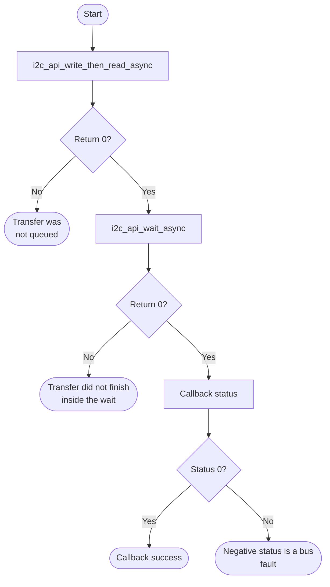

# I2C Bare-Metal API Guide

## Overview

I2C is the Synopsys DesignWare I2C controller. The HPS provides several instances; each drives one two-wire bus with a clock line (SCL) and a data line (SDA).

This module operates one I2C bus as a controller (master), targeting one device address at a time. It handles the register-style access pattern most I2C peripherals use -- write a register index, then read its contents -- as a single combined transfer, and it derives bus timing from the live peripheral clock rather than from a hard-coded divisor.

Include [`i2c_api.h`](i2c_api.h). Initialize the controller and target address before transfers. The API retains one selected controller for subsequent calls.


## Quick-start API flow

One bus context is open at a time. `i2c_api_init()` returns `-ENOSYS` when the platform base is 0; `i2c_api_init_with_base()` is the alternative when you have an approved base. See [Before You Start](#before-you-start). After a synchronous transfer timeout, inspect controller status before attempting `i2c_api_recover()`. Recovery requires that no transfer is marked busy and cannot release a target that physically holds SDA low.



### Walkthrough

1. Initialize one instance. `-EBUSY` means a context is already open; close it before a second init.
2. Transfer. Check the return before using a read buffer.
3. On `-ETIMEDOUT`, read the abort source if that call returns 0, then recover. Do not recover on every error.
4. Close when finished.

This fragment demonstrates a combined register-index write and read: four bytes from register `0x00` at address `0x50`. Adapt the address, register width and transfer protocol to the target device's datasheet.

```C
#include <stdio.h>

#include "errno.h"
#include "i2c_api.h"

int i2c_read_register(uint32_t instance, uint16_t target,
                      uint8_t reg, uint8_t *out, size_t len)
{
    int32_t rc;

    /* 100 kHz standard mode. Timing is derived from the live input clock. */
    rc = i2c_api_init(instance, target, 100000U);
    if (rc != 0) {
        /* -ENODEV: no controller at that instance's base address.
         * -ERANGE: input clock too slow for the requested speed. */
        return (int)rc;
    }

    rc = i2c_api_write_then_read(&reg, 1U, out, len);
    if (rc != 0) {
        uint32_t abort = 0U;

        /* Inspect the controller's latched abort-source bits. */
        if (i2c_api_get_abort_source(&abort) == 0) {
            printf("i2c transfer failed rc=%d abort=0x%08X\n", (int)rc, abort);
        }
        if (rc == -ETIMEDOUT) {
            (void)i2c_api_recover();
        }
    }

    (void)i2c_api_close();
    return (int)rc;
}
```

This follows [`i2c_selftest.c`](../../examples/i2c/i2c_selftest.c), which uses the same transfer calls.

## Before You Start

- The Clock Manager must report a non-zero I2C input clock. Bus timing is derived from it, so an unclocked instance fails initialization instead of running at an unknown speed.
- The instance's pins must be muxed to I2C and the bus must have pull-up resistors. Both are board design properties, not software settings.
- A target device must be fitted for the transfer operations to do anything. Controller-only phases need no external target, but still require an accessible, configured controller.

## Public API Summary

| Function | Purpose | Returns |
|---|---|---|
| `i2c_api_init()` | Opens an I2C instance by index, targets a device address, and programs bus timing for the requested SCL frequency. | Returns 0 on success; `-EBUSY`, `-EINVAL`, `-ENODEV`, `-ENOSYS`, `-ERANGE`, `-ETIMEDOUT` |
| `i2c_api_init_with_base()` | Opens an instance at a caller-supplied base address instead of one the platform layer knows about. | Returns 0 on success; `-EBUSY`, `-EINVAL`, `-ENODEV`, `-ERANGE`, `-ETIMEDOUT` |
| `i2c_api_probe()` | Reports whether a device acknowledges at the given address. | Returns 0 on success; `-EAGAIN`, `-EBUSY`, `-EINVAL`, `-EIO`, `-ENXIO`, `-EPROTO`, `-ETIMEDOUT` |
| `i2c_api_write()` | Writes a buffer to the current target address as a single transfer. | Returns 0 on success; `-EAGAIN`, `-EBUSY`, `-EINVAL`, `-EIO`, `-ENXIO`, `-EPROTO`, `-ETIMEDOUT` |
| `i2c_api_set_target()` | Retargets the open instance at a different device address without a full re-initialization. | Returns 0 on success; `-EBUSY`, `-EINVAL`, `-ETIMEDOUT` |
| `i2c_api_write_async()` | Queues a write that is serviced by `i2c_api_wait_async()`. | returns after queuing; Returns 0 on success; `-EBUSY`, `-EINVAL` |
| `i2c_api_read()` | Reads bytes from the current target address as a single transfer. | Returns 0 on success; `-EAGAIN`, `-EBUSY`, `-EINVAL`, `-EIO`, `-ENXIO`, `-EPROTO`, `-ETIMEDOUT` |
| `i2c_api_write_then_read()` | Performs a write followed by a read as one combined transfer, keeping the bus between the two phases. | Returns 0 on success; `-EAGAIN`, `-EBUSY`, `-EINVAL`, `-EIO`, `-ENXIO`, `-EPROTO`, `-ETIMEDOUT` |
| `i2c_api_get_status()` | Returns the controller's raw status register value. | Returns 0 on success; `-EINVAL` |
| `i2c_api_get_info()` | Reports the controller identity, the live input clock, the programmed SCL high and low counts and the FIFO depths for the open instance. | Returns 0 on success; `-EINVAL` |
| `i2c_api_get_abort_source()` | Returns the controller's latched abort-source bitmap for the most recent failed transfer. | Returns 0 on success; `-EINVAL` |
| `i2c_api_read_async()` | Queues a read that is serviced by `i2c_api_wait_async()`. | returns after queuing; Returns 0 on success; `-EBUSY`, `-EINVAL` |
| `i2c_api_write_then_read_async()` | Queues a combined transfer (repeated START) that is serviced by `i2c_api_wait_async()`. | returns after queuing; Returns 0 on success; `-EBUSY`, `-EINVAL`, `-EPROTO` |
| `i2c_api_wait_async()` | Services the queued transfer from the calling context until it completes or the time limit expires. Blocking. The transfer result is delivered through the callback. | 0 (nothing outstanding or completed); `-EINVAL` (nothing open); `-ETIMEDOUT` |
| `i2c_api_recover()` | Aborts, disables and re-enables the controller to return it to idle, when no transfer is in progress. It does not clock SCL to free a target that holds SDA low. | Returns 0 on success; `-EBUSY` (a transfer is marked in progress); `-EINVAL`; `-ETIMEDOUT` |
| `i2c_api_close()` | Closes the open instance and releases the module's context. | Returns 0 on success; `-EINVAL`, `-EBUSY`, `-ETIMEDOUT` |
| `i2c_api_deinit()` | Identical to `i2c_api_close()`, provided for naming consistency. | Same results as `i2c_api_close()`. |

Public header: [`i2c_api.h`](i2c_api.h).


## Return values and error handling

Shared conventions: [`RETURN_VALUES.md`](../../RETURN_VALUES.md).

Transfer calls can also return `-EAGAIN`, `-EBUSY`, `-EIO`, `-ENXIO`, or `-EPROTO` from the controller layer. Those codes mean the lower layer rejected or aborted the transfer; this page does not collapse them into one action. On any non-zero transfer return, do not use the read buffer as valid data.

| API / group | Return value | Meaning and exact triggering condition | Customer action / output validity |
|---|---|---|---|
| `i2c_api_init` | `-ENOSYS` | The platform base helper returned 0. | Use `i2c_api_init_with_base()` only with an approved base. |
| `i2c_api_init`, `i2c_api_init_with_base` | `-EBUSY` | `i2c_api_handle` is already non-NULL. | The existing context stays. |
| `i2c_api_init`, `i2c_api_init_with_base` | `0` | The controller opened. | Writes and reads are allowed. |
| `i2c_api_init` | `-EINVAL`, `-ENODEV`, `-ERANGE`, `-ETIMEDOUT` | Returned from the driver during open. | No usable handle. The exact driver check is the callee's. |
| Write, read, write-then-read, probe, set_target, recover, close | `-EINVAL` | `i2c_api_handle` is NULL. | The call did not touch the bus. |
| Those transfer calls | `0` | The driver finished the operation. | Read buffers are valid only on this return. |
| Those transfer calls | `-ETIMEDOUT` | The driver's wait expired. | Bus state may be mid-transfer. `i2c_api_recover()` is the cleanup this module provides. |
| `i2c_api_get_status`, `i2c_api_get_info`, `i2c_api_get_abort_source` | `-EINVAL` | The handle is NULL, or the output pointer is rejected by the driver. | Do not read the output. |
| Async start calls | `-EBUSY` | A transfer is already queued. | The new buffer was not queued. |
| `i2c_api_wait_async` | `-ETIMEDOUT` | The timeout argument expired. The parameter is in microseconds where the prototype says `timeout_us`. | The async buffer is not a finished transfer. |

## API Notes

The integration notes below cover call order and hardware constraints. See the public header for complete parameter and per-function return contracts.

### `i2c_api_init()`

Opens an I2C instance by index, targets a device address, and programs bus timing for the requested SCL (Serial Clock line of an I2C bus) frequency.

Call this once, before any transfer. Close the instance before you open a different one.

It can also return `-EINVAL`, `-ENODEV`, `-ERANGE`, `-ETIMEDOUT` from the layer below.

> `-ENODEV` means no DesignWare controller answered at the instance's base address, which distinguishes an absent or unclocked instance from a healthy bus with no target on it.

> `-ERANGE` means the input clock is too slow to meet the timing minimums of the resolved speed mode. The bus is left unconfigured rather than run out of specification.

### `i2c_api_init_with_base()`

Opens an instance at a caller-supplied base address instead of one the platform layer knows about.

Use this when your build has no base-address macro for the instance you need, or when the controller is at an address the platform does not list.

It can also return `-EINVAL`, `-ENODEV`, `-ERANGE`, `-ETIMEDOUT` from the layer below.

### `i2c_api_probe()`

Reports whether a device acknowledges at the given address.

To scan a bus during bring-up, or to confirm a device is present before starting a transfer sequence.

It can also return `-EAGAIN`, `-EBUSY`, `-EIO`, `-ENXIO`, `-EPROTO`, `-ETIMEDOUT` from the layer below.

> `-ENXIO` means the target address was not acknowledged. `-ETIMEDOUT` means a controller wait expired. Neither code identifies a unique hardware cause. Check the address, target power, pinmux, pull-ups and controller clock before retrying.

### `i2c_api_write()`

Writes a buffer to the current target address as a single transfer.

To send a command or a register index plus data, when you do not need to read anything back in the same transfer.

It can also return `-EAGAIN`, `-EBUSY`, `-EIO`, `-ENXIO`, `-EPROTO`, `-ETIMEDOUT` from the layer below.

> `-ENXIO` means the target did not acknowledge its address. An absent device can cause this result, but the code alone does not prove that the bus is configured correctly.

### `i2c_api_set_target()`

Retargets the open instance at a different device address without a full re-initialization.

When talking to several devices on one bus. It is cheaper than closing and re-opening, and it leaves the programmed bus timing alone.

It can also return `-EBUSY`, `-ETIMEDOUT` from the layer below.

### Queued (asynchronous) transfers

The queued calls take a callback and a context pointer, and `i2c_api_wait_async()` takes a time limit in microseconds:

```C
#include "i2c_api.h"   /* declares the following */

int32_t i2c_api_write_async(const uint8_t *buffer, size_t length,
                            socfpga_i2c_callback_t callback, void *context);
int32_t i2c_api_read_async(uint8_t *buffer, size_t length,
                           socfpga_i2c_callback_t callback, void *context);
int32_t i2c_api_write_then_read_async(const uint8_t *tx_buffer, size_t tx_length,
                                      uint8_t *rx_buffer, size_t rx_length,
                                      socfpga_i2c_callback_t callback, void *context);
int32_t i2c_api_wait_async(uint32_t timeout_us);

/* Callback type, from drivers/i2c/socfpga_i2c.h (included by i2c_api.h). */
typedef void (*socfpga_i2c_callback_t)(socfpga_i2c_handle_t handle,
                                       int32_t status, void *context);
```



Queue the transfer with a callback, then call `i2c_api_wait_async()`, which performs the transfer and calls your callback with the transfer status. Check the callback's `status`, not only the return value of `i2c_api_wait_async()`. The `i2c_selftest` ASYNC phase uses this sequence.

### `i2c_api_write_async()`

Queues a write; `i2c_api_wait_async()` performs it.

**Queued.** Returns before the transfer runs. The controller interrupt is not connected in this release, so the transfer makes progress only inside `i2c_api_wait_async()`. Keep the buffers valid until the callback reports completion.

It can also return `-EBUSY` from the layer below.

### `i2c_api_read()`

Reads bytes from the current target address as a single transfer.

When the device returns data without needing a register index first. For the far more common register-read pattern use `i2c_api_write_then_read()`.

It can also return `-EAGAIN`, `-EBUSY`, `-EIO`, `-ENXIO`, `-EPROTO`, `-ETIMEDOUT` from the layer below.

### `i2c_api_write_then_read()`

Performs a write followed by a read as one combined transfer, keeping the bus between the two phases.

For the standard register-read pattern: send the register index, then read its contents. This is the call most device drivers built on this module will use.

It can also return `-EAGAIN`, `-EBUSY`, `-EIO`, `-ENXIO`, `-EPROTO`, `-ETIMEDOUT` from the layer below.

### `i2c_api_get_status()`

Returns the controller's raw status register value.

For low-level diagnosis when a transfer behaves unexpectedly.

### `i2c_api_get_info()`

Reports the controller identity, the live input clock, the programmed SCL high and low counts and the FIFO depths for the open instance.

During bring-up, to confirm the controller is present and clocked and that the timing the driver computed matches the frequency you asked for. This is the first check the shipped self-test makes.

### `i2c_api_get_abort_source()`

Returns the controller's latched abort-source bitmap for the most recent failed transfer.

Immediately after a transfer fails, to establish why. The bitmap distinguishes an address NACK (Negative acknowledge, an I2C target failing to acknowledge a byte) from a data NACK, from arbitration loss, and reports how many queued bytes were flushed.

### `i2c_api_read_async()`

Queues a read; `i2c_api_wait_async()` performs it.

**Queued.** Returns before the transfer runs. The controller interrupt is not connected in this release, so the transfer makes progress only inside `i2c_api_wait_async()`. Keep the buffers valid until the callback reports completion.

It can also return `-EBUSY` from the layer below.

### `i2c_api_write_then_read_async()`

Queues a combined transfer that holds the bus across a repeated START; `i2c_api_wait_async()` performs it.

**Queued.** Returns before the transfer runs. The controller interrupt is not connected in this release, so the transfer makes progress only inside `i2c_api_wait_async()`. Keep the buffers valid until the callback reports completion.

It can also return `-EBUSY`, `-EPROTO` from the layer below.

### `i2c_api_wait_async()`

Services an outstanding queued transfer from the calling context until it completes or the time limit expires.

**Blocking.** Returns 0 when nothing is outstanding or the transfer completed, `-EINVAL` when no instance is open, and `-ETIMEDOUT` when the limit expires. The transfer's own result (for example a NACK) is delivered through the callback, not through this return value.

> After `-ETIMEDOUT` the transfer stays marked in progress. There is no cancel call: `i2c_api_recover()`, `i2c_api_close()` and new transfers return `-EBUSY` until it completes.

### `i2c_api_recover()`

Aborts, disables and re-enables the controller to return it to idle.

After a transfer fails, before retrying. It refuses to run while a queued transfer is still marked in progress, and it does not generate SCL pulses, so it cannot free a target that is holding the data line (SDA) low; reset or power-cycle that target instead.

### `i2c_api_close()`

Closes the open instance and releases the module's context.

Call this when you are finished with the bus, or before you open a different instance.

### `i2c_api_deinit()`

Identical to `i2c_api_close()`, provided for naming consistency; same return values.

## Real-Hardware Validation

The self-test has nine phases. Controller-only phases need no external target. Phases that require a target can report `SKIP` when none is fitted; skipped phases add no validation coverage.

### `i2c_selftest`

> **Writes to external devices.** When you give an address, the write-readback phase writes a test pattern to register `[reg8]` of that device and then makes a best-effort restore. If a P3T temperature sensor is detected, its configuration and threshold registers are rewritten and restored. Do not name an EEPROM, a power-management IC or a clock device.

```Text
i2c_selftest [instance] [7bit_addr] [reg8] [len] [bus_hz]
```

| Property | Value |
|---|---|
| Needs attached hardware | None for phases 1 to 3 and 8. Phases 4 to 7 need an I2C target on the bus; phase 6 runs only when you pass an address. Phase 9 needs an NXP P3T-series temperature sensor |
| Pass criterion | The last line is `RESULT : <p> of <t> tests passed, <s> skipped  -  SELF-TEST PASSED`. It reads `PASSED` when no phase failed, even if phases were skipped, so check the skipped count |

It runs 9 checks in order:

1. **I2C CONTROLLER** - Establishes that a controller exists, is clocked and out of reset, and reports what the driver programmed into it.
2. **I2C SCL TIMING** - The SCL counts must track the requested frequency and still honour the specification minimum high time, at both standard and fast speed.
3. **I2C BUS SCAN** - The bare-metal equivalent of i2cdetect.
4. **I2C REGISTER READ** - Register read from the address the caller gave, or the first one the scan found. *(skipped when no suitable device is fitted)*
5. **I2C WRITE NACK** - Exercises the standalone write path against an address the scan proved is empty. *(skipped when no suitable device is fitted)*
6. **I2C WRITE READBACK** - The equivalent of i2cset followed by i2cget. *(skipped when no suitable device is fitted)*
7. **I2C ASYNC TRANSFER** - Runs the same combined transfer through the queued engine and requires it to match the synchronous path. *(skipped when no suitable device is fitted)*
8. **I2C BUS RECOVERY** - A terminated transfer must leave the controller recoverable to idle.
9. **I2C P3T SENSOR** - Read and write exercise against an NXP P3T-series temperature sensor, if one is attached to the bus. *(skipped when none is found)*

5 of them report `SKIP` rather than `FAIL` when the hardware they need is absent. `SKIP` is not a pass: the step did not run. Read the per-check result and not only the summary line.

Source: [`examples/i2c/i2c_selftest.c`](../../examples/i2c/i2c_selftest.c)

## Important Constraints

| Constraint | Application impact |
|---|---|
| Controller mode only | The HPS cannot be addressed as an I2C target through this module. |
| One open instance at a time | Talking to devices on two different buses means closing one instance and opening the other; they cannot be held open simultaneously. |
| The asynchronous path is not interrupt-delivered | Completion is not driven by the interrupt controller, because the I2C interrupt is not routed to it. An application using the asynchronous calls must service the engine itself, as the shipped self-test does. |
| Not supported: target (slave) mode | The module operates only as a bus controller. |
| 7-bit addresses in the self-test only | The API supports 10-bit target addresses (0x080 to 0x3FF), but `i2c_selftest` accepts only 7-bit addresses. |
| Not supported: more than one open instance at a time | Module state is a single file-scope context. Close the current instance before opening another. |

## Troubleshooting

| Symptom | Likely area | What to try |
|---|---|---|
| `i2c_api_init()` returns `-ENODEV` | Instance presence or clocking | No DesignWare controller answered at that instance's base address. Check the instance index against the platform base addresses, and confirm the controller is clocked and out of reset. |
| `i2c_api_init()` returns `-ERANGE` | Bus speed versus input clock | The I2C input clock is too slow to meet the timing minimums for the speed you requested. Request a lower frequency, or raise the peripheral clock. |
| Every probe returns `-ETIMEDOUT` | Bus or controller setup | A controller wait expired. Check pinmux, pull-ups, target power, the controller clock and controller status before retrying. |
| A transfer returns `-ENXIO` | Device address | The target did not acknowledge the address. Check the address, target power and bus configuration before retargeting with `i2c_api_set_target()`. |
| Transfers fail repeatedly after one timed out | Wedged bus | Inspect controller status, confirm no transfer is marked busy, then use `i2c_api_recover()` if recovery is appropriate. If a target is holding the data line (SDA) low, recovery cannot free it: reset or power-cycle that target. |

## Related Documentation

- [`i2c_api.h`](i2c_api.h) - public API declarations and types.
- [`examples/i2c/i2c_selftest.c`](../../examples/i2c/i2c_selftest.c) - example source for `i2c_selftest`.
- [`README.md`](../../README.md) - board bring-up, boot modes, UART and the first console session.
- [`I3C`](../i3c/README.md) - related module.
- [`SPI`](../spi/README.md) - related module.
