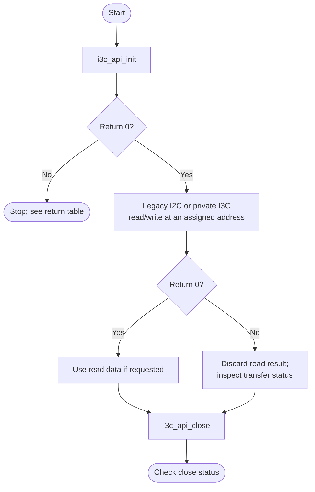
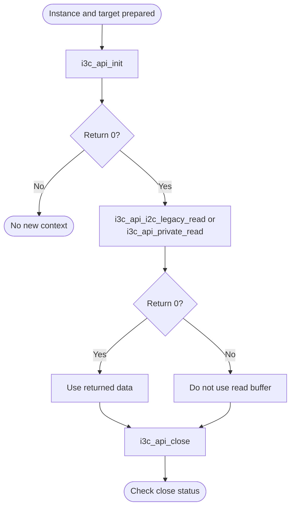

# I3C Bare-Metal API Guide

## Overview

I3C is the Synopsys DesignWare I3C controller. I3C is the successor to I2C and keeps backward compatibility with it, so one controller can drive both I3C and legacy I2C devices on the same bus.

This module opens an I3C controller, reports its capabilities, and performs legacy I2C transfers, private I3C transfers, or a raw command-queue operation.

Include [`i3c_api.h`](i3c_api.h). Initialize one controller before reading its capabilities or transferring data. Later calls use that selected controller until it is closed.


## Quick-start API flow

Only one controller instance can be open. Legacy I2C and private I3C transfers are different calls. See [Before You Start](#before-you-start).



### Walkthrough

1. Initialize instance 0 or 1. `-EBUSY` means close the current context first.
2. Pick the transfer that matches the device. A legacy call does not assign an I3C dynamic address.
3. On a non-zero transfer return, do not use the read buffer.
4. Close.



Open one instance, then talk to legacy I2C devices or to I3C devices that already hold a dynamic address, and close it. See [`i3c_api.h`](i3c_api.h) for the full parameter lists and [`i3c_selftest.c`](../../examples/i3c/i3c_selftest.c) for a complete sequence.

## Before You Start

- Instances 0 and 1 are defined on every supported platform. `i3c_api_init()` returns `-ENOSYS` for any other index; `i3c_api_init_with_base()` accepts an explicit base address instead.
- The driver does not program the bus timing registers; the controller's reset values are used, so the bus rate is not configurable through this module.
- A target device must be on the bus. For a private I3C transfer the device must already hold a dynamic address, because this module cannot assign one.

## Public API Summary

| Function | Purpose | Returns |
|---|---|---|
| `i3c_api_init()` | Initializes a platform I3C instance with legacy-I2C compatibility enabled and hot-join disabled. | Returns 0 on success; `-EBUSY`, `-EINVAL`, `-ENOSYS`, `-ETIMEDOUT` |
| `i3c_api_init_with_base()` | Initializes the singleton I3C API using an explicit MMIO base address. | Returns 0 on success; `-EBUSY`, `-EINVAL`, `-ETIMEDOUT` |
| `i3c_api_i2c_legacy_write()` | Writes bytes to a legacy I2C target through the active I3C controller. | Returns 0 on success; `-EINVAL`, `-EIO`, `-ETIMEDOUT` |
| `i3c_api_private_write()` | Performs an I3C private write to a target identified by its dynamic address. | Returns 0 on success; `-EINVAL`, `-EIO`, `-ETIMEDOUT` |
| `i3c_api_get_status()` | Reads the status value from the active I3C controller. | Returns 0 on success; `-EINVAL` |
| `i3c_api_get_hw_capability()` | Reads the hardware-capability value reported by the active I3C controller. | Returns 0 on success; `-EINVAL` |
| `i3c_api_i2c_legacy_read()` | Reads bytes from a legacy I2C target through the active I3C controller. | Returns 0 on success; `-EINVAL`, `-EIO`, `-ETIMEDOUT` |
| `i3c_api_private_read()` | Performs an I3C private read from a target identified by its dynamic address. | Returns 0 on success; `-EINVAL`, `-EIO`, `-ETIMEDOUT` |
| `i3c_api_raw_transfer()` | Executes a caller-supplied I3C transfer synchronously on the active controller. | Returns 0 on success; `-EBUSY`, `-EINVAL`, `-EIO`, `-ETIMEDOUT` |
| `i3c_api_close()` | Deinitializes the active I3C instance and clears the singleton handle after a successful close. | Returns 0 on success; `-EINVAL` |
| `i3c_api_deinit()` | Alias of i3c_api_close() for callers using init/deinit naming. | Same results as `i3c_api_close()`. |

Public header: [`i3c_api.h`](i3c_api.h).


## Return values and error handling

Shared conventions: [`RETURN_VALUES.md`](../../RETURN_VALUES.md).

| API / group | Return value | Meaning and exact triggering condition | Customer action / output validity |
|---|---|---|---|
| `i3c_api_init` | `-ENOSYS` | The platform base is 0. | Use `i3c_api_init_with_base()` with an approved base. |
| `i3c_api_init`, `i3c_api_init_with_base` | `-EBUSY` | `i3c_api_handle` is already non-NULL. | The open context stays. |
| Those init calls | `0` | The controller opened. | Transfers are allowed. |
| Those init calls | `-EINVAL`, `-ETIMEDOUT` | Returned by the driver during open. | No usable context. |
| Legacy and private read/write | `-EINVAL` | No valid open handle; address exceeds 0x7F; length is zero or exceeds `SOCFPGA_I3C_MAX_DATA_WORDS * 4`; or the selected non-empty buffer is NULL. | No successful transfer. Use read data only on 0. |
| Those transfers | `0` | The driver completed the transfer. | Read data is valid. |
| Those transfers | `-EIO`, `-ETIMEDOUT` | The transfer layer reported a failure or an expired wait. | Do not use the read buffer. |
| `i3c_api_get_status`, `i3c_api_get_hw_capability` | `-EINVAL` | No valid open handle, or the output pointer is NULL. | Outputs are not valid. |
| `i3c_api_raw_transfer` | `-EINVAL` | No valid open handle; descriptor is NULL; a TX/RX length exceeds the driver limit; or a non-empty direction has a NULL buffer. | No successful raw transfer. |
| `i3c_api_raw_transfer` | `-EBUSY`, `-EIO`, `-ETIMEDOUT` | The driver rejected or failed the descriptor. | Do not assume the queue completed. |
| `i3c_api_close`, `i3c_api_deinit` | `-EINVAL` | The handle is NULL. | Nothing was closed. |

## Real-Hardware Validation

### `i3c_selftest`

Non-destructive: reads controller status and capability, then performs a legacy-I2C read and a private I3C read. Included only in `DDR` builds.

```text
i3c_selftest [instance] [addr] [len]
```

| Property | Value |
|---|---|
| Arguments | `addr` is used both as the legacy-I2C target address and as the dynamic address for the private read; `len` is 1 to 32 bytes |
| Needs attached hardware | Test 1 needs none. Tests 2 and 3 need a legacy-I2C target at `addr` and an I3C target that already holds `addr` as its dynamic address |
| Pass criterion | The per-test result lines `[I3C_I2C_XFER][PASS]` and `[I3C_PRIV_XFER][PASS]`. **Do not rely on the `PASS` lines after each test or the final `SELF-TEST PASSED` line**: the example prints them even when a transfer fails |

Source: [`examples/i3c/i3c_selftest.c`](../../examples/i3c/i3c_selftest.c)

## Important Constraints

| Constraint | Application impact |
|---|---|
| Cannot assign a dynamic address | I3C devices are reachable only if something else assigned their dynamic address first, so private transfers require an address assigned outside this API. |
| Synchronous transfers only | Interrupts are disabled at initialization, so a transfer occupies the processor until it finishes or times out. |
| One open instance at a time | Two I3C buses cannot be held open simultaneously. |
| The shipped example reports success unconditionally | Its summary line prints a passing result even when an individual transfer failed. Read the per-phase output rather than the summary. |

## Troubleshooting

| Symptom | Likely area | What to try |
|---|---|---|
| `i3c_api_init()` returns `-ENOSYS` | Instance index | Only instances 0 and 1 exist. |
| Initialization returns `-EBUSY` | Instance already open | Close the open instance first; only one may be open at a time. |
| A transfer returns `-ETIMEDOUT` | No device, or bus not driven | Nothing responded within the poll budget. Check the device is fitted and that the bus has pull-ups and correct pin configuration. |
| A private I3C transfer fails while a legacy I2C transfer works | Dynamic address not assigned | A private transfer needs the device to hold a dynamic address already. This module cannot assign one, so use the legacy I2C path or assign the address elsewhere. |
| A transfer returns `-EIO` | Device or bus error | The device responded with an error status. Check the address and the command against the device's documentation. |

## Related Documentation

- [`i3c_api.h`](i3c_api.h) - public API declarations and types.
- [`examples/i3c/i3c_selftest.c`](../../examples/i3c/i3c_selftest.c) - example source for `i3c_selftest`.
- [`README.md`](../../README.md) - board bring-up, boot modes, UART and the first console session.
- [`I2C`](../i2c/README.md) - related module.
