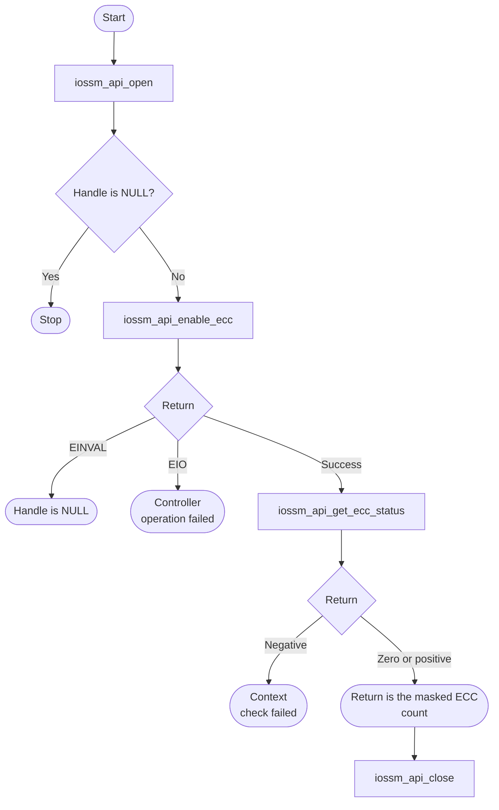
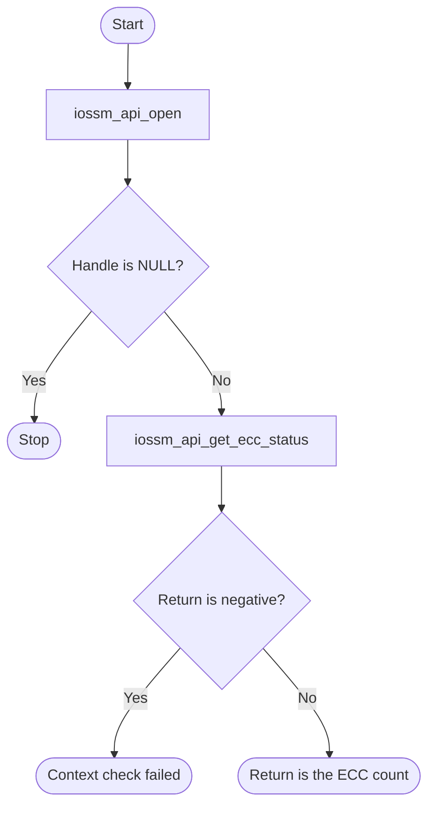

# IOSSM Bare-Metal API Guide

## Overview

IOSSM is the I/O Subsystem Manager interface to the external memory controller. This API sends controller commands through memory-mapped registers.

This module opens a memory-controller instance, enables or disables ECC on external memory, reads and clears its error status, and can inject single-bit and double-bit errors at a chosen external-memory address. It also offers bounds-checked 64-bit reads and writes to external memory.

Include [`iossm_api.h`](iossm_api.h). Open the required memory-controller instance and retain its handle. Close by instance index, as explained under Constraints and limitations.


## Quick-start API flow

`iossm_api_open()` returns a handle or NULL. Enabling ECC and injecting errors change memory-controller state. Injection is a test fault. See [Before You Start](#before-you-start).



### Walkthrough

1. Open by controller index. NULL means stop.
2. Enable ECC only when that memory should be protected. `-EIO` means the context is closed or the controller command did not report success.
3. Read status with `iossm_api_get_ecc_status()`. A return of 0 or a positive value is the masked error count (0 means no errors counted). A negative return is a failed call, not a count.
4. Close by index. Injection calls (`iossm_api_inject_sbe`, `iossm_api_inject_dbe`) write a fault at the address you pass; they are not part of normal status collection.



Open a memory-controller instance, enable ECC, poll its error status and clear errors as needed, then close it by index. Every command waits for the controller without a timeout. See [`iossm_api.h`](iossm_api.h) for the exact parameters and [`iossm_selftest.c`](../../examples/iossm/iossm_selftest.c) for a complete sequence.

## Before You Start

- External memory must already be initialized and usable. This module operates on a trained memory interface; it does not bring one up.
- Injection and memory-access addresses must be 8-byte aligned and inside a fixed 4 GiB window starting at `0x80000000`, or they are rejected. The check does not reflect the fitted memory size and does not protect this image, which also runs from that window in a `DDR` build.
- Every IOSSM command waits for the controller without a timeout. If the controller never answers, the call does not return.

## Public API Summary

| Function | Purpose | Returns |
|---|---|---|
| `iossm_api_open()` | Opens an IOSSM instance and prepares it for subsequent operations. | Returns a handle on success. Returns NULL on failure. |
| `iossm_api_set_callback()` | Register a callback invoked when the IOSSM IRQ fires. | No return value. |
| `iossm_api_mem_write64()` | Writes a 64-bit word to an external-memory (DDR) address after checking alignment and range. | Returns 0 (`IOSSM_API_MEM_OK`) on success. Also returns `IOSSM_API_MEM_ERANGE` and `IOSSM_API_MEM_EALIGN` (module codes, not errno values). |
| `iossm_api_get_ecc_status()` | Read the current ECC error count. | Returns the error count on success, including 0. Also returns `-EINVAL` and `-EIO`. |
| `iossm_api_get_err_type()` | Get the error type for a specific entry in the ECC error array. | Returns the error-type field on success. Also returns `-EINVAL` and `-EIO`. |
| `iossm_api_get_err_addr()` | Get the address offset for a specific ECC error entry. | Returns the address offset on success. Also returns `-EINVAL` and `-EIO`. |
| `iossm_api_enable_ecc()` | Enable ECC on the instance. | Returns 0 on success; `-EINVAL`, `-EIO` |
| `iossm_api_disable_ecc()` | Disable ECC on the instance. | Returns 0 on success; `-EINVAL`, `-EIO` |
| `iossm_api_clear_ecc_errors()` | Clears the requested IOSSM status, event, or pending condition. | Returns 0 on success; `-EINVAL`, `-EIO` |
| `iossm_api_mask_interrupt()` | Updates the requested IOSSM mask configuration. | Returns 0 on success; `-EINVAL`, `-EIO` |
| `iossm_api_ack_interrupt()` | Acknowledge (clear) one or more ECC interrupt sources. | Returns 0 on success; `-EINVAL`, `-EIO` |
| `iossm_api_inject_sbe()` | Injects a single-bit ECC error at an external-memory address. Overwrites the 8 bytes at that address. | Returns 0 on success; `-EINVAL`; `-EIO` (not open, address rejected, or command failed) |
| `iossm_api_inject_dbe()` | Injects a double-bit ECC error at an external-memory address. Overwrites the 8 bytes at that address. | Returns 0 on success; `-EINVAL`; `-EIO` (not open, address rejected, or command failed) |
| `iossm_api_mem_read64()` | Reads a 64-bit word from an external-memory address after checking alignment and range. | Returns 0 (`IOSSM_API_MEM_OK`) on success. Also returns `-EINVAL` (NULL pointer), `IOSSM_API_MEM_ERANGE`, and `IOSSM_API_MEM_EALIGN`. |
| `iossm_api_close_handle()` | Releases an IOSSM instance by handle. In this release it can fail with `-EINVAL` or close a different instance; use `iossm_api_close()` instead. | Returns 0 on success; `-EINVAL`, `-EIO` |
| `iossm_api_close()` | Releases an IOSSM instance by index. Recommended over `iossm_api_close_handle()`. | Returns 0 on success; `-EINVAL`, `-EIO` |

Public header: [`iossm_api.h`](iossm_api.h).


## Return values and error handling

Shared conventions: [`RETURN_VALUES.md`](../../RETURN_VALUES.md).

| API / group | Return value | Meaning and exact triggering condition | Customer action / output validity |
|---|---|---|---|
| `iossm_api_open` | handle or NULL | NULL means the index was not opened. This call does not return errno. | Do not pass NULL to later calls. |
| Enable, disable, clear, mask, ack, inject | `-EINVAL` | `handle` is NULL. | No controller operation. |
| Those calls | `0` | The handle was accepted and the controller command reported success. | The operation completed. |
| Those calls | `-EIO` | The context is closed, or the controller response did not report success. | A closed context is rejected before the command. Otherwise, a command may already have been issued; do not assume the previous state or memory contents were restored. |
| `iossm_api_get_ecc_status` | `-EINVAL` | `handle` is NULL. | There is no separate output pointer. |
| `iossm_api_get_ecc_status` | `>= 0` | The masked ECC count register. `0` means the count is zero. | The return value is the count, not a success flag plus an output. |
| `iossm_api_get_err_type` | `-EINVAL` or `>= 0` | NULL handle, or the error-type field. | A negative return is the context check. A non-negative return is the type field. |
| `iossm_api_get_err_addr` | `-EINVAL` or a register value | NULL handle, or the offset register cast to `int32_t`. | A register value with the high bit set is indistinguishable from an error code. Do not treat every negative return as "no address". |
| `iossm_api_set_callback` | No return value. | No status. | A NULL handle is ignored. With a non-NULL handle the middleware stores the handler, including NULL; registration is not evidence of interrupt delivery. |
| `iossm_api_mem_read64` | `-EINVAL` | `out_value` is NULL. | No memory read. |
| `iossm_api_mem_read64`, `iossm_api_mem_write64` | `IOSSM_API_MEM_ERANGE` | The entire 8-byte access does not fit the fixed DDR window. | No memory access; a non-NULL read output is unchanged. |
| Those memory calls | `IOSSM_API_MEM_EALIGN` | The address is not 8-byte aligned. Range is checked first. | No memory access; the read output is unchanged. |
| Those memory calls | `IOSSM_API_MEM_OK` (0) | The checked load or store completed. | The read output contains the 64-bit word, or the write has overwritten 8 bytes. |
| `iossm_api_close`, `iossm_api_close_handle` | `-EINVAL` or `-EIO` | The lower layer rejected the handle or the close failed. | Do not use the handle after a 0 return. |

## Real-Hardware Validation

### `ddr_selftest` (related command)

`ddr_selftest` does not use this module's API; it is listed here because it exercises the same external memory.

> **Destructive.** The command runs memory tests that overwrite **16 MiB of external memory at `0x83000000`**. In an Agilex 5 `OCRAM` build it first runs DDR initialization itself; if that is not supported in the current configuration, it tests an on-chip RAM region instead. It is included in Agilex 5 `OCRAM` builds and in `DDR` builds. Agilex 3 `OCRAM` builds omit it, because that image does not initialize DDR before the test writes `0x83000000`.

```text
ddr_selftest
```

| Property | Value |
|---|---|
| Extra peripheral | None beyond the target board. |
| Pass criterion | The last line is `RESULT : 4 of 4 tests passed  -  SELF-TEST PASSED` |

Source: [`examples/ddr/ddr_selftest.c`](../../examples/ddr/ddr_selftest.c)

### `iossm_demo`

> **Destructive.** The command writes 64 bytes at the fixed external-memory address `0x90000000` and injects single-bit and double-bit ECC errors at the fixed address `0xA0000000`. These addresses cannot be changed from the command line. It is included only in `DDR` builds.

| Property | Value |
|---|---|
| API functions it calls | `iossm_api_open()` -> `iossm_api_enable_ecc()` -> `iossm_api_mem_write64()` -> `iossm_api_mem_read64()` -> `iossm_api_get_ecc_status()` -> `iossm_api_inject_sbe()` -> `iossm_api_ack_interrupt()` -> `iossm_api_inject_dbe()` (listed in the order they appear in the source, not necessarily the order of a successful run) |
| Extra peripheral | None beyond the target board. |
| Pass criterion | No overall verdict; the command's own output always ends with `=== IOSSM Demo complete ===`. Each step prints `[PASS]` or `[FAIL]`; the run passes when no `[FAIL]` line appears. The console then adds `DONE` and its own `RESULT :` line, which is not a verdict. |

Source: [`examples/iossm/iossm_selftest.c`](../../examples/iossm/iossm_selftest.c)

## Important Constraints

| Constraint | Application impact |
|---|---|
| Injection corrupts external memory at the target address | A double-bit injection can leave uncorrectable data. Reserve the complete target range outside live code, data and firmware buffers before injection. The example's fixed addresses do not prove that such a reservation exists; do not run `iossm_demo` until the board memory map establishes it. |
| One open handle per instance | A second open of the same instance fails. |
| No command timeout | Every IOSSM command waits for the controller without a timeout. |
| One shared interrupt, double-bit errors only | Both instances register the same double-bit-error interrupt, so opening the second instance replaces the first one's callback context, and correctable (single-bit) events do not call the callback. |
| Does not initialize external memory | Every operation assumes a trained interface; this module cannot bring memory up. |

## Troubleshooting

| Symptom | Likely area | What to try |
|---|---|---|
| Opening an instance returns NULL | Instance index or state | Either the index is out of range for this platform, or that instance is already open. One context exists per instance. |
| Enabling ECC returns `-EIO` | Memory controller response | The controller answered with a failure status. If the controller does not answer at all, the call does not return. |
| An address is rejected as out of range or misaligned | Address arguments | Use an 8-byte-aligned address inside the window. The memory-access calls report `IOSSM_API_MEM_ERANGE` and `IOSSM_API_MEM_EALIGN` separately; the injection calls report either as `-EIO`. |
| An injected error is not reported | ECC not enabled | Enable ECC before injecting; without it there is nothing to detect the error. |

## Related Documentation

- [`iossm_api.h`](iossm_api.h) - public API declarations and types.
- [`examples/ddr/ddr_selftest.c`](../../examples/ddr/ddr_selftest.c) - example source for `ddr_selftest`.
- [`examples/iossm/iossm_selftest.c`](../../examples/iossm/iossm_selftest.c) - example source for `iossm_demo`.
- [`README.md`](../../README.md) - board bring-up, boot modes, UART and the first console session.
- [`ECC`](../ecc/README.md) - related module.
- [`CCU`](../ccu/README.md) - related module.
