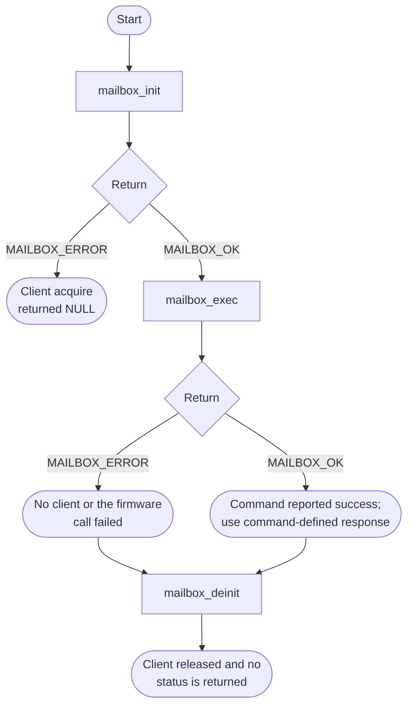
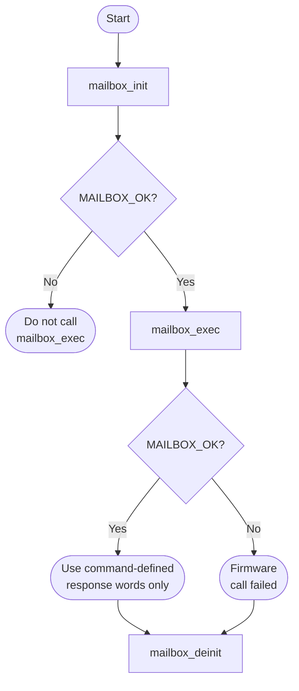

# SDM Mailbox Bare-Metal API Guide

## Overview

Commands reach the Secure Device Manager -- the device's configuration and security controller -- through a mailbox. From bare-metal that mailbox is reached through a firmware service call rather than by writing the mailbox registers directly.

This module sends a Secure Device Manager command and waits for its response, which the firmware layer places in a caller-supplied memory buffer. It is the general-purpose path for device-management commands that no dedicated module wraps.

Include [`mailbox_api.h`](mailbox_api.h). Acquire the shared mailbox client with `mailbox_init()` before sending commands, then release the module reference with `mailbox_deinit()`.


## Quick-start API flow

Codes are `MAILBOX_OK` and `MAILBOX_ERROR`, not errno. `MAILBOX_NO_RESPONSE` is defined and is not returned by this synchronous implementation. See [Before You Start](#before-you-start) for the DDR buffer rule.



### Walkthrough

1. Initialize. `MAILBOX_ERROR` means no client slot; do not call `mailbox_exec()`.
2. Place argument and response buffers in DDR at or above the address TF-A accepts, as [Before You Start](#before-you-start) describes. A buffer in your program image makes `mailbox_exec()` return `MAILBOX_ERROR`.
3. On `MAILBOX_OK`, interpret only the response fields defined by that command. `resp_words` is buffer capacity, not a returned length; the API does not report how many words firmware filled.
4. `mailbox_deinit()` is `void`.



Acquire the client, send each command with an argument array and a response buffer in DDR, then release the module's reference. This is the sequence [`mailbox_selftest.c`](../../examples/mailbox/mailbox_selftest.c) uses, for example `mailbox_exec(MAILBOX_CMD_GET_IDCODE, NULL, 0U, resp, 1U)` with `resp` at `0x82100000`.

### Public-header example

Read the device ID into caller-owned DDR storage. Reserve at least one 32-bit response word above the TF-A buffer limit described below. Use the word only on `MAILBOX_OK`; a stack variable in this image does not satisfy the buffer-placement rule.

```c
#include <stddef.h>
#include "mailbox_api.h"

/* response must be a reserved, firmware-accessible DDR buffer of at least
 * one uint32_t. See the module guide for the TF-A address restrictions. */
int32_t example_mailbox_id(uint32_t *response)
{
    int32_t rc;
    if (response == NULL) {
        return MAILBOX_ERROR;
    }
    rc = mailbox_init();
    if (rc != MAILBOX_OK) {
        return rc;
    }
    rc = mailbox_exec(MAILBOX_CMD_GET_IDCODE, NULL, 0U, response, 1U);
    mailbox_deinit();
    return rc; /* response is usable only when rc == MAILBOX_OK */
}
```

The same source is available as [`mailbox_consumer.c`](../../docs/examples/mailbox_consumer.c). See the [example build instructions](../../docs/examples/README.md).

## Before You Start

- Trusted Firmware-A (TF-A) must be running. Each command is sent as a TF-A SiP (Silicon Provider, the Arm vendor-specific secure-monitor call range) service request; this module has no register-level fallback. In practice that means a `DDR` build started by TF-A, not an `OCRAM` image.
- **Buffer placement.** Use reserved, firmware-accessible DDR that meets the platform limit below. For the TF-A revision named in [README step 4](../../README.md#4-build-tf-a-and-pack-the-ddr-image):

  | Platform | Argument-buffer lower boundary |
  |---|---|
  | Agilex 5 | `0x82000000` |
  | Agilex 3 | `0x800F0000` |

  A boundary alone does not establish accessibility or ownership. Reserve enough memory for the command arguments and response, and avoid the occupied ranges in the [root memory map](../../README.md#ddr-addresses-used-by-this-software). In the documented Agilex 5 DDR layout, ordinary image, static and stack storage is below `0x82000000` and may be rejected for firmware payloads. The shipped example uses `0x82100000` for its response buffer.
- Commands without arguments (`args` NULL, `arg_words` 0) do not submit an argument-buffer address. The API does not return the number of response words actually written.

## Public API Summary

| Function | Purpose | Returns |
|---|---|---|
| `mailbox_init()` | Acquires a mailbox client slot. It does not contact the firmware. | Returns 0 (`MAILBOX_OK`) on success. Also returns `MAILBOX_ERROR` if no client slot is free. |
| `mailbox_exec()` | Sends a Secure Device Manager (SDM) mailbox command through TF-A and blocks until it returns. | Returns 0 (`MAILBOX_OK`) on success. Also returns `MAILBOX_ERROR` if `mailbox_init()` has not succeeded or the request fails. `MAILBOX_NO_RESPONSE` is not returned. |
| `mailbox_deinit()` | Drops this module's reference to the client. The shared client stays open for reuse. | No return value. |

Public header: [`mailbox_api.h`](mailbox_api.h).


## Return values and error handling

Shared conventions: [`RETURN_VALUES.md`](../../RETURN_VALUES.md).

| API / group | Return value | Meaning and exact triggering condition | Customer action / output validity |
|---|---|---|---|
| `mailbox_init` | `MAILBOX_OK` (0) | `mbox_client_acquire()` returned a non-NULL handle. | The client is held. The SDM has not been queried. |
| `mailbox_init` | `MAILBOX_ERROR` (-1) | The acquire returned NULL. | Do not call `mailbox_exec()`. |
| `mailbox_exec` | `MAILBOX_ERROR` | `g_handle` is NULL, or `mbox_send_command()` returned non-zero. | `resp` is not a successful response. A common cause is an argument buffer below the TF-A limit. |
| `mailbox_exec` | `MAILBOX_OK` | The send returned 0. | Response storage may have been written. The number of words written is not a return value. |
| `mailbox_exec` | `MAILBOX_NO_RESPONSE` | Not returned by this implementation. | Do not wait for this code. |
| `mailbox_deinit` | No return value. | Releases the client and clears the handle. | No status. Safe to call when you are done; it does not report a firmware error. |

## Hardware checks and limitations

### `mailbox_selftest`

Non-destructive: sends the NOOP, GET_IDCODE and CONFIG_STATUS query commands. It writes the responses to the fixed DDR address `0x82100000`. Included only in `DDR` builds.

```text
mailbox_selftest
```

| Property | Value |
|---|---|
| Extra peripheral | None beyond the target board. |
| Pass criterion | `[MBOX][PASS] NOOP`, `[MBOX][PASS] GET_IDCODE` and `[MBOX][PASS] CONFIG_STATUS` lines appear. `[MBOX] init OK` is printed before any command is sent and is not a pass signal |

Source: [`examples/mailbox/mailbox_selftest.c`](../../examples/mailbox/mailbox_selftest.c)

## Important Constraints

| Constraint | Application impact |
|---|---|
| Requires Trusted Firmware-A | There is no register-level fallback, so this module is unavailable in a build that runs without that firmware layer. |
| TF-A decides which commands it accepts | Whether a command is accepted on this path depends on the TF-A release in use; check that release. |
| Firmware payload buffers must meet the platform boundary | Agilex 5 uses `0x82000000`; the named TF-A revision uses `0x800F0000` for Agilex 3. Reserve firmware-accessible DDR rather than relying on the address threshold alone. |
| One client, blocking dispatch | Each call blocks inside TF-A until the SDM responds; this module has no timeout of its own. Module state is a single client with no locking. |

## Troubleshooting

| Symptom | Likely area | What to try |
|---|---|---|
| Initialization fails | Mailbox client | No client slot was free. Initialization does not contact TF-A, so a missing TF-A shows up only at the first `mailbox_exec()`. |
| `mailbox_exec()` returns `MAILBOX_ERROR` | Buffer placement, or firmware acceptance | Check argument-buffer placement against the platform boundary above, its reserved size and firmware accessibility. Also confirm that the running TF-A revision accepts the command; `MAILBOX_ERROR` does not identify a unique cause. |

## Related Documentation

- [`mailbox_api.h`](mailbox_api.h) - public API declarations and types.
- [`examples/mailbox/mailbox_selftest.c`](../../examples/mailbox/mailbox_selftest.c) - example source for `mailbox_selftest`.
- [`README.md`](../../README.md) - board bring-up, boot modes, UART and the first console session.
- [`FCS`](../fcs/README.md) - related module.
- [`SEU`](../seu/README.md) - related module.
