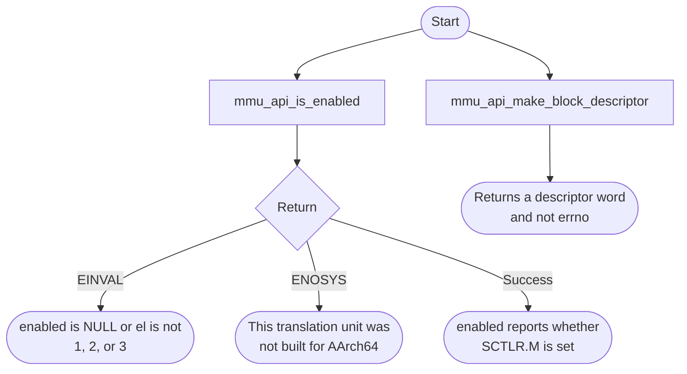

# MMU Bare-Metal API Guide

## Overview

The MMU is the Arm memory management unit inside the processor. It translates the addresses software uses into physical addresses and applies memory attributes and access permissions.

This module reports whether address translation is currently enabled at a given privilege level, and builds a block translation-table entry from a physical address and a set of attributes. It is a reporting and entry-construction interface, not a translation-configuration interface.

Include [`mmu_api.h`](mmu_api.h). Calls either read the requested exception level or construct an entry from their arguments. Neither operation installs a translation table.


## Quick-start API flow

The two calls are independent. `mmu_api_is_enabled()` reports whether the SCTLR.M bit is set at one exception level. `mmu_api_make_block_descriptor()` only builds a descriptor word; it does not write a table. See [Before You Start](#before-you-start).



### Walkthrough

1. Call `mmu_api_is_enabled()` with EL 1, 2, or 3 and a non-NULL `bool` output pointer.
2. On `0`, read `*enabled`. False means the MMU bit is clear.
3. Build a descriptor only when you are filling a table yourself. The returned word is data, not a status.

```C
#include <stdbool.h>
#include <stdint.h>
#include "mmu_api.h"

/* Illustrative. Not run on a board. */
int32_t mmu_el1_on(bool *on)
{
    return mmu_api_is_enabled(1U, on);
}
```

## Before You Start

- Whether translation is on when your code runs depends on the boot path. Query it rather than assuming: an image entered as a later-stage payload may inherit translation already enabled by earlier firmware, while an image starting from on-chip memory typically runs with it off.
- Pass an EL of 1, 2 or 3 to the status query, and no higher than the level the image is running at (an `OCRAM` image runs at EL3; for a `DDR` image, check with the `el` console command). Querying a higher level causes a processor exception rather than an error return.

## Public API Summary

| Function | Purpose | Returns |
|---|---|---|
| `mmu_api_is_enabled()` | Reports whether stage-1 address translation is enabled at the requested exception level. | Returns 0 on success; `-EINVAL` for a NULL `enabled` output or a level other than 1, 2 or 3 |
| `mmu_api_make_block_descriptor()` | Builds a 64-bit Armv8-A translation-table block descriptor from an address and memory attributes. Block alignment is not checked, and attribute fields wider than their bit fields are truncated. | No status code. Returns the descriptor value. |

Public header: [`mmu_api.h`](mmu_api.h).


## Return values and error handling

Shared conventions: [`RETURN_VALUES.md`](../../RETURN_VALUES.md).

| API / group | Return value | Meaning and exact triggering condition | Customer action / output validity |
|---|---|---|---|
| `mmu_api_is_enabled` | `0` | Built for AArch64, `enabled` is non-NULL, and `exception_level` is 1, 2, or 3. | `*enabled` reflects SCTLR.M at that level. |
| `mmu_api_is_enabled` | `-EINVAL` | `enabled` is NULL, or the level is not 1, 2, or 3. | Do not read `*enabled`. |
| `mmu_api_is_enabled` | `-ENOSYS` | The file was compiled without `__aarch64__`. On that path a NULL `enabled` still returns `-EINVAL` first. | `*enabled` is set false only when the pointer was non-NULL. Do not treat that as a live MMU reading. |
| `mmu_api_make_block_descriptor` | `uint64_t` | The packed descriptor from the arguments. No range check is visible in the API wrapper. | The return is the descriptor, not a success code. Writing it into a table is a separate step this function does not perform. |

## Hardware checks and limitations

### `mmu_selftest`

Non-destructive: reads whether translation is enabled.

```Text
mmu_selftest [el]
```

| Property | Value |
|---|---|
| Default | EL1, which is usually not the level the image runs at. Pass the current level, shown by the `el` console command; do not pass a higher one |
| Extra peripheral | None beyond the target board. |
| Pass criterion | Prints `MMU EL<n>: enabled` or `MMU EL<n>: disabled`; either is a valid result |

Source: [`examples/mmu/mmu_selftest.c`](../../examples/mmu/mmu_selftest.c)

## Important Constraints

| Constraint | Application impact |
|---|---|
| Reporting and construction only | You cannot enable, disable or reconfigure address translation through this module. Nothing you build with it takes effect on its own. |
| Block entries only | Fine-grained page mappings cannot be built with this call. |

## Troubleshooting

| Symptom | Likely area | What to try |
|---|---|---|
| The status query returns `-EINVAL` | Exception level argument | Pass 1, 2 or 3. |
| A processor exception occurs during the status query | Exception level too high | The level passed is higher than the one the image runs at. Pass the current level or lower. |
| A constructed entry has no effect | Expected behaviour | Constructing an entry does not install it. This module cannot activate translation; the entry must be placed in a table that active translation uses. |

## Related Documentation

- [`mmu_api.h`](mmu_api.h) - public API declarations and types.
- [`examples/mmu/mmu_selftest.c`](../../examples/mmu/mmu_selftest.c) - example source for `mmu_selftest`.
- [`README.md`](../../README.md) - board bring-up, boot modes, UART and the first console session.
- [`SMMU`](../smmu/README.md) - related module.
- [`CCU`](../ccu/README.md) - related module.
