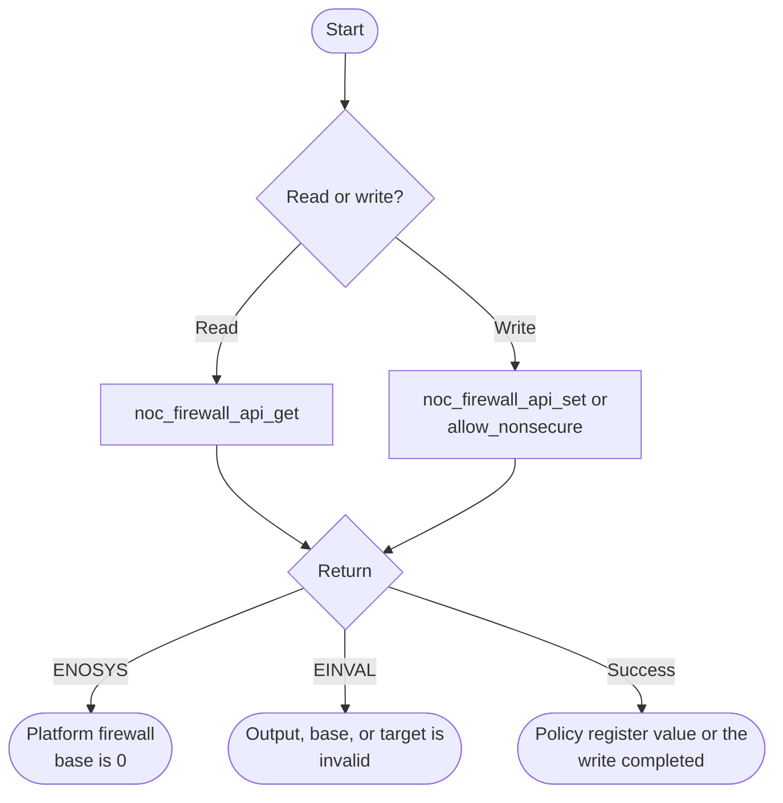

# NoC Firewall Bare-Metal API Guide

## Overview

The NoC firewall holds the security policy registers that decide which bus masters may reach each HPS peripheral and each bridge across the on-chip interconnect.

This module reads and writes a peripheral's interconnect security policy, and offers a convenience call that opens a peripheral to non-secure masters. Use it only to apply the platform's approved security policy. A zero register
read or an access fault alone does not establish that a firewall change is needed.

Include [`noc_firewall_api.h`](noc_firewall_api.h). Calls read or write the selected policy register directly; no open or initialization call is required.


## Quick-start API flow

Reading a policy and writing a policy are different operations. A write, including `noc_firewall_api_allow_nonsecure()`, changes device security state and does not save the previous value. Do this only for a target in the approved platform security configuration. See [Before You Start](#before-you-start).



The `_with_base` calls skip the `-ENOSYS` check and return `-EINVAL` for a zero base or a NULL output.

### Walkthrough

1. Read the current policy with `noc_firewall_api_get()` and keep your own copy if you may need to restore it. This API does not restore it.
2. Write only the value your platform configuration allows. `noc_firewall_api_allow_nonsecure()` is not a general debug step.
3. On Agilex 5 and Agilex 3, `noc_firewall_api_get()` is the call to use. `-ENOSYS` means the firewall base macro was missing or zero. See [Return values](#return-values-and-error-handling).

```C
#include <stdint.h>
#include "noc_firewall_api.h"

/* Illustrative. Not run on a board. Read-only. */
int32_t fw_read(socfpga_noc_firewall_target_t target, uint32_t *value)
{
    return noc_firewall_api_get(target, value);
}
```

## Before You Start

- The Agilex 5 and Agilex 3 builds define the firewall base address, so the three calls without a base argument are the ones to use.
- Understand what you are changing before you change it. This module alters system security policy. Writing a restrictive policy to the console UART or to a bridge can prevent your own code from reaching that peripheral afterwards, and the symptom is a hang or a bus fault on the next access rather than an error return. The API does not save or restore policy. Obtain the approved previous or intended policy before writing; use readback only where the target supports reads. Some firewall registers can stall on read (see Important Constraints); a stalled access can require a board reset.

## Public API Summary

| Function | Purpose | Returns |
|---|---|---|
| `noc_firewall_api_set_with_base()` | Writes one 32-bit policy value for a target, using a caller-supplied base address. | Returns 0 on success; `-EINVAL` |
| `noc_firewall_api_get_with_base()` | Reads a target's 32-bit policy value, using a caller-supplied base address. | Returns 0 on success; `-EINVAL` |
| `noc_firewall_api_get()` | Reads a target's 32-bit policy value. | Returns 0 on success; `-EINVAL`, `-ENOSYS` |
| `noc_firewall_api_set()` | Writes one 32-bit policy value for a target. | Returns 0 on success; `-EINVAL`, `-ENOSYS` |
| `noc_firewall_api_allow_nonsecure()` | Writes a fixed policy value that opens the target to non-secure masters (write-only; nothing is read back). | Returns 0 on success; `-EINVAL`, `-ENOSYS` |
| `noc_firewall_api_allow_nonsecure_with_base()` | Same as `noc_firewall_api_allow_nonsecure()`, with a caller-supplied base address. | Returns 0 on success; `-EINVAL` |

Public header: [`noc_firewall_api.h`](noc_firewall_api.h).


## Return values and error handling

Shared conventions: [`RETURN_VALUES.md`](../../RETURN_VALUES.md).

| API / group | Return value | Meaning and exact triggering condition | Customer action / output validity |
|---|---|---|---|
| `noc_firewall_api_get`, `noc_firewall_api_set`, `noc_firewall_api_allow_nonsecure` | `-ENOSYS` | `SOCFPGA_NOC_FIREWALL_BASE` is absent or 0. The driver is not called. | No register access. Policy is unchanged. |
| `noc_firewall_api_get`, `noc_firewall_api_get_with_base` | `-EINVAL` | `value` is NULL, `base_address` is 0, or the target offset is greater than `NOC_FIREWALL_TCU_BASE_OFST`. | `*value` is not written. |
| Those get calls | `0` | The register was read. | `*value` is the raw policy word. |
| `noc_firewall_api_set`, `noc_firewall_api_set_with_base`, both allow-nonsecure calls | `-EINVAL` | The base is 0 or the target offset fails the same validate check. | No write. |
| Those set calls | `0` | The policy word was written. | The previous policy is gone unless you saved it yourself. Allow-nonsecure writes the driver's allow value for that target, not a value you pass. |

## Hardware checks and limitations

### `noc_selftest`

> **Changes device security state.** The command writes the allow-non-secure firewall policy for the console UART (UART0), the NoC probe registers and I2C0. The previous policy is not saved or restored. It also enables the NoC probe error logger and clears any latched interconnect error, so read and save a latched error first if you need it. It does not erase or reset anything.

```Text
noc_selftest
```

| Property | Value |
|---|---|
| What it does | Three firewall writes (UART0, NoC probe, I2C0), then reads the probe ID, checks for a latched error, and clears the error latch |
| Extra peripheral | None beyond the target board. |
| Pass criterion | The last line is `RESULT : 6 of 6 tests passed  -  SELF-TEST PASSED` |

This command is shared with the [NoC Probe guide](../noc_probe/README.md).

Source: [`examples/noc/noc_selftest.c`](../../examples/noc/noc_selftest.c)

## Important Constraints

| Constraint | Application impact |
|---|---|
| No policy restore | The module does not save the previous value, so a wrong write cannot be undone unless you read and kept the original yourself. |
| A wrong policy fails silently and breaks later accesses | The write succeeds; the consequence appears as a hang or a bus fault on the next access to that peripheral. Change one target at a time. |
| Some targets may not be readable | The shipped example notes that reading some firewall registers can stall, so `noc_firewall_api_allow_nonsecure()` is write-only and the example avoids reads. You cannot always confirm a policy by reading it back. |

## Troubleshooting

| Symptom | Likely area | What to try |
|---|---|---|
| A call returns `-ENOSYS` | Firewall base macro | The base macro was missing or zero. Agilex 5 and Agilex 3 builds define it. See [Return values](#return-values-and-error-handling). |
| A peripheral's registers read back as zero although it is clocked | Interconnect policy | Check the target's approved security configuration and the caller's security state. Change policy only when that configuration requires it; do not open access as a generic workaround. |
| The console dies immediately after a policy write | Console peripheral restricted | A restrictive policy on the console UART cuts off your own output. Recovery needs a reset, because there is no restore call and no way to report the problem. |
| A policy read never returns | Stalling aperture | Stop accessing that aperture and use the platform recovery procedure. A stalled read does not justify an allow-nonsecure write; any later write must follow the approved security configuration. |

## Related Documentation

- [`noc_firewall_api.h`](noc_firewall_api.h) - public API declarations and types.
- [`examples/noc/noc_selftest.c`](../../examples/noc/noc_selftest.c) - example source for `noc_selftest`.
- [`README.md`](../../README.md) - board bring-up, boot modes, UART and the first console session.
- [`NoC Probe`](../noc_probe/README.md) - related module.
- [`HPS-to-FPGA Bridge`](../bridge/README.md) - related module.
