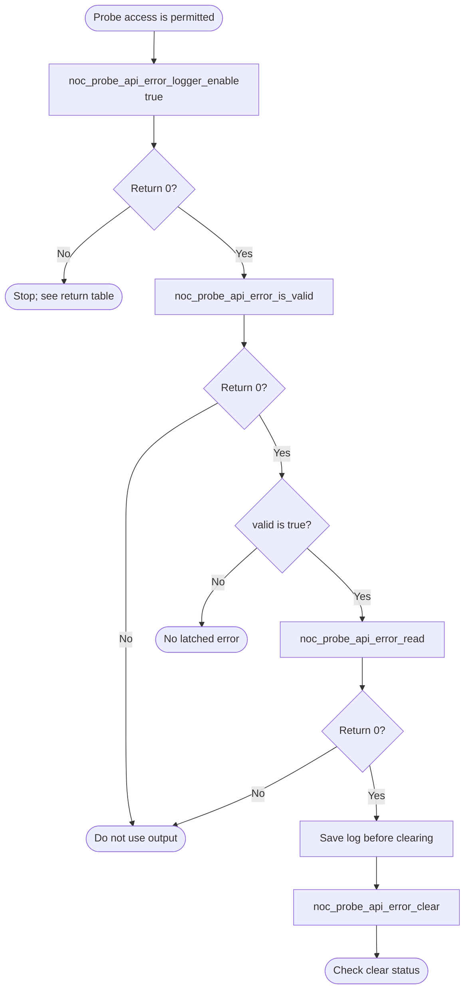

# NoC Probe Bare-Metal API Guide

## Overview

The NoC probe is the on-chip interconnect's diagnostic block. Its error logger latches the details of a failed bus transaction: the address, the operation and which master issued it.

This module reads the probe's identity, enables its error logger, reports whether an error has been latched, reads the latched details and clears them. It is how you find out which access caused an interconnect fault.

Include [`noc_probe_api.h`](noc_probe_api.h). Each call uses the platform probe base or an explicit base address. There is no open or close call.

## Quick-start API flow

The Agilex 5 and Agilex 3 builds define `SOCFPGA_NOC_PROBE_BASE`, so the calls without `_with_base` are the ones to use. Access prerequisites are in [Before You Start](#before-you-start).

Reading the identity and servicing the error logger are independent. You do not have to read the ID before using the logger. The logger sequence below is the one to follow when you need a captured fault.



### Walkthrough

1. Confirm the core can reach the probe. On Agilex 5 and Agilex 3 the calls without `_with_base` are the ones to use. `-ENOSYS` means the probe base macro was missing or zero. Do not invent a base. If the access never returns, the firewall or the clock/reset state is the place to look, not a missing status code. Changing firewall policy is a security-configuration decision; see [Before You Start](#before-you-start).
2. Optionally call `noc_probe_api_read_id()`. On success, `*core_id` is the endpoint/core identification register. A successful ID read does not mean the logger is empty or that traffic is healthy.
3. Call `noc_probe_api_error_logger_enable(true)`. Success means the fault-enable bit was written. It does not clear a latch that is already set.
4. Call `noc_probe_api_error_is_valid(&valid)`. Check the return value before reading `valid`. If the return is 0 and `valid` is false, this logger has nothing latched. That is the end of the capture path. It does not prove that no other probe, firewall, or master has a fault.
5. If the return is 0 and `valid` is true, call `noc_probe_api_error_read()`. On success the structure holds raw ERRLOG words. This API does not decode bit fields. The structure names them as: `errlog0` address\[31:0\], `errlog1` address\[63:32\], `errlog3` opcode and size, `errlog4` route/source id, `errlog5` protection attributes, `errlog6` burst type and length, `errlog7` additional flags. There is no `errlog2` member. Keep your own copy; the next step discards the hardware copy.
6. Call `noc_probe_api_error_clear()` only after that copy is stored. Success writes the clear bit. The latch, including the details, is gone from the hardware. `noc_probe_api_error_read()` does not clear.

`noc_probe_api_error_read()` does not look at the valid flag. If you call it while `valid` is false, a return of 0 still copies the current registers, and those words are not a latched fault. Interpret the structure only after a successful validity check that set `valid` to true.

The same ordering applies to the `_with_base` functions. A `base_address` of 0 returns `-EINVAL` and does not touch the block. A NULL output pointer returns `-EINVAL` and is not written.

```C
#include <stdbool.h>
#include <stddef.h>
#include <stdint.h>
#include "noc_probe_api.h"

/* Illustrative. Compile and link for your target; not run on a board. */
int32_t noc_capture_latched_error(socfpga_noc_probe_error_log_t *saved)
{
    bool valid = false;
    int32_t rc;

    if (saved == NULL) {
        return -EINVAL;
    }

    rc = noc_probe_api_error_logger_enable(true);
    if (rc != 0) {
        return rc;
    }

    rc = noc_probe_api_error_is_valid(&valid);
    if (rc != 0) {
        return rc;
    }
    if (!valid) {
        return 0;
    }

    rc = noc_probe_api_error_read(saved);
    if (rc != 0) {
        return rc;
    }

    return noc_probe_api_error_clear();
}
```

The snippet's `return 0` when `valid` is false means "the call sequence finished and nothing was latched", not "the SoC is healthy". `saved` is filled only after `noc_probe_api_error_read()` returns 0.

## Before You Start

- The platform build must define the probe base address, or you must supply one to a `_with_base` call.
- The interconnect firewall must permit this master to reach the probe registers. A blocked access can hang or fault, and these functions cannot report that as `-EACCES` or any other code. If your approved platform security configuration requires a policy change before the probe is reachable, that change is made with the [NoC Firewall](../noc_firewall/README.md) API for the approved targets only. Opening a target to non-secure masters is not a general troubleshooting step, and these probe calls do not save or restore a policy.

## Public API Summary

| Function | Purpose | Returns |
|---|---|---|
| `noc_probe_api_read_id()` | Reads the identification register at the platform base. | Returns 0 on success and writes `*core_id`. Also returns `-ENOSYS` and `-EINVAL`. See [Return values](#return-values-and-error-handling). |
| `noc_probe_api_read_id_with_base()` | Same read at `base_address`. | Returns 0 on success, or `-EINVAL` for a zero base or a NULL `core_id`. |
| `noc_probe_api_error_logger_enable()` | Writes the fault-enable bit at the platform base. | Returns 0 on success; does not clear an existing latch. `-ENOSYS` if the default base is missing. |
| `noc_probe_api_error_logger_enable_with_base()` | Same control at `base_address`. | Returns 0 on success; `-EINVAL` if `base_address` is 0. |
| `noc_probe_api_error_is_valid()` | Sets `*valid` from the latched-error flag. | Returns 0 on success; check the return before reading `*valid`. |
| `noc_probe_api_error_is_valid_with_base()` | Same check at `base_address`. | Returns 0 on success; `-EINVAL` if the base is 0 or `valid` is NULL. |
| `noc_probe_api_error_read()` | Copies ERRLOG words. Does not clear the latch and does not check the valid flag. | Returns 0 on success; interpret the structure only when a prior validity check returned true. |
| `noc_probe_api_error_read_with_base()` | Same copy at `base_address`. | Returns 0 on success; `-EINVAL` if the base is 0 or `log` is NULL. |
| `noc_probe_api_error_clear()` | Clears the valid latch at the platform base. | Returns 0 on success; call only after saving a capture you need. |
| `noc_probe_api_error_clear_with_base()` | Same clear at `base_address`. | Returns 0 on success; `-EINVAL` if `base_address` is 0. |

Public header: [`noc_probe_api.h`](noc_probe_api.h).

## Return values and error handling

Shared conventions: [`RETURN_VALUES.md`](../../RETURN_VALUES.md).

On success (`0`) the call performed its register access. On failure it did not write the output pointer, and a default-base `-ENOSYS` does not perform the access. A `_with_base` `-EINVAL` for a zero base does not perform the access either.

| API / group | Return value | Meaning and exact triggering condition | Customer action / output validity |
|---|---|---|---|
| `noc_probe_api_read_id`, `noc_probe_api_error_is_valid`, `noc_probe_api_error_read`, `noc_probe_api_error_logger_enable`, `noc_probe_api_error_clear` | `0` | The platform base is non-zero and the matching driver check passed. Enable wrote the fault-enable bit. Clear wrote the clear bit. The read calls stored their results. | ID: use `*core_id` as the identification register only. Valid: read `*valid` — false means this logger has no latched error, not that the system is healthy. Read: use `*log` only if you already observed `valid == true`. |
| Same default-base group | `-ENOSYS` | `SOCFPGA_NOC_PROBE_BASE` is not defined, or the base helper returned 0. The driver is not called. | Use the matching `_with_base` function with an approved base. Outputs are unchanged. The latch is unchanged. |
| `noc_probe_api_read_id`, `noc_probe_api_error_is_valid`, `noc_probe_api_error_read` | `-EINVAL` | The output pointer is NULL (`core_id`, `valid`, or `log`). Checked in the driver before the register read. | Do not use the output. Pass a real object. |
| `noc_probe_api_read_id_with_base`, `noc_probe_api_error_is_valid_with_base`, `noc_probe_api_error_read_with_base` | `0` | `base_address` is non-zero and the output pointer is non-NULL. The register access completed. | Same interpretation as the default-base success row. |
| Those three `_with_base` reads | `-EINVAL` | `base_address` is 0, or the output pointer is NULL. | No register read. The output is not written. |
| `noc_probe_api_error_logger_enable_with_base`, `noc_probe_api_error_clear_with_base` | `0` | `base_address` is non-zero. Enable wrote 1 or 0 to the fault-enable bit from the `enable` argument. Clear wrote the clear mask. | Enable does not clear a latch that was already set. Clear discards the latched details; keep your copy. |
| Those two `_with_base` controls | `-EINVAL` | `base_address` is 0. `enable` is not range-checked. | No write. The latch is unchanged. |
| Any of these calls | no return | The address was accepted by software, then the load or store did not complete (firewall, clock, or reset). | There is no status code to branch on. Do not "fix" this by opening targets to non-secure masters unless that is the approved policy for this platform. |

This public API does not return `-ETIMEDOUT`. It also does not expose the probe's statistic counters; those driver functions are not in `noc_probe_api.h`.

## Hardware checks and limitations

### `noc_selftest`

> **Changes device security state.** The command writes the allow-non-secure firewall policy for the console UART (UART0), the NoC probe registers and I2C0. The previous policy is not saved or restored. It also enables the NoC probe error logger and clears any latched interconnect error, so read and save a latched error first if you need it. It does not erase or reset anything.

```Text
noc_selftest
```

| Property | Value |
|---|---|
| What it exercises | Three firewall writes (UART0, NoC probe, I2C0), then reads the probe ID, enables the logger, checks for a latched error, prints ERRLOG words when one is present, and clears the error latch |
| What it does not prove | That the SoC is free of interconnect faults. A validity result of false only means this logger had nothing latched at that moment. The firewall writes are not a template for application code. |
| Extra peripheral | None beyond the target board. |
| Pass criterion | The last line is `RESULT : 6 of 6 tests passed  -  SELF-TEST PASSED`. Unlike the CCU self-test, this command counts a step as passed only when its return value is 0. |

This command is shared with the [NoC Firewall guide](../noc_firewall/README.md).

How to check the flow on a running image without relying on that command: call the sequence in [Quick-start API flow](#quick-start-api-flow) from your application and branch on the return value and on `valid`. You do not need to force a bus fault to confirm the calls return.

Source: [`examples/noc/noc_selftest.c`](../../examples/noc/noc_selftest.c)

## Important Constraints

| Constraint | Application impact |
|---|---|
| Error logger only | The public API exposes the error logger and the identification register. Statistic counters exist in the driver and are not part of this interface. |
| This API polls | These functions read or write registers and return. They do not register an interrupt handler. Whether the probe hardware can raise an interrupt is outside this interface; software that uses this API has to read the valid flag. |
| Access may depend on interconnect policy | The diagnostic block you need after a bus fault may itself be blocked. That failure is a hang or a fault, not a return code. |

## Troubleshooting

| Symptom | Likely area | What to try |
|---|---|---|
| A default-base call returns `-ENOSYS` | Probe base macro | The base macro was missing or zero. Agilex 5 and Agilex 3 builds define it. See [Return values](#return-values-and-error-handling). |
| A call never returns, or the core faults | Interconnect firewall, clock, or reset | The API cannot report this. Check that the approved security configuration allows this master to reach the probe. Do not open arbitrary targets to non-secure masters as a workaround. |
| `noc_probe_api_error_is_valid()` returns 0 and `*valid` is false | This logger | No error is latched here. That is not evidence that the rest of the device is healthy, and it is not a reason to inject a fault. |
| `*valid` is true | A transaction was latched | Read the log, save it, then clear. Clearing first drops the only copy the hardware held. |

## Related Documentation

- [`RETURN_VALUES.md`](../../RETURN_VALUES.md) - shared return-value conventions.
- [`noc_probe_api.h`](noc_probe_api.h) - public API declarations and types.
- [`examples/noc/noc_selftest.c`](../../examples/noc/noc_selftest.c) - example source for `noc_selftest`.
- [`README.md`](../../README.md) - board bring-up, boot modes, UART and the first console session.
- [`NoC Firewall`](../noc_firewall/README.md) - related module.
- [`CCU`](../ccu/README.md) - related module.
