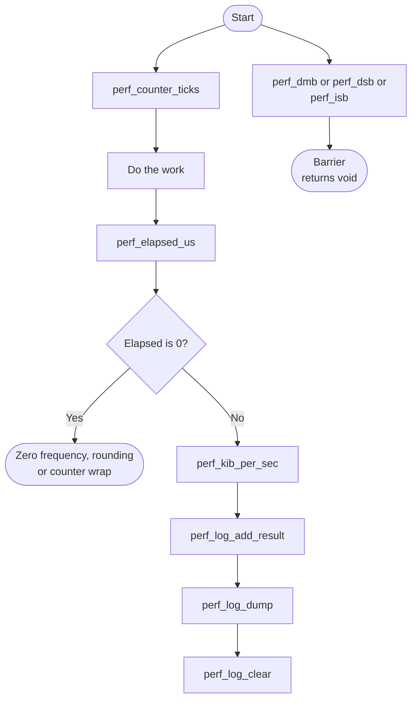

# Performance Monitoring Bare-Metal API Guide

## Overview

Measurements come from the Arm architectural counters built into every processor core: a frequency register and a continuously running physical counter. No SoC peripheral timer and no performance-monitoring unit is involved.

This module timestamps code, converts elapsed counter ticks into microseconds or nanoseconds, computes throughput and latency figures from a byte count and an elapsed time, and records results in a small in-memory log that can be dumped from the console.

Include [`perf_api.h`](perf_api.h). Counter and conversion calls need no initialization. The log is shared module state; coordinate access when several callers record or clear results.


## Quick-start API flow

Most of this module returns data or returns `void`. There is no errno on the counter and log calls. See [Before You Start](#before-you-start).



### Walkthrough

1. Sample `perf_counter_ticks()` around the work. Subtract with `perf_elapsed_us()` or `perf_elapsed_ns()`.
2. A zero elapsed result can mean a zero counter frequency, an interval rounded down to zero, or a counter sample earlier than `start_ticks`. Check the frequency and measurement interval before interpreting it.
3. `perf_kib_per_sec()` and `perf_mbps_x1000()` guard against a zero `elapsed_us` by returning 0. Zero can also result from a zero byte count or integer rounding; it is not a separate error status.
4. The log overwrites its oldest entry when full. `perf_log_count()` returns the number of stored entries.

```C
#include <stdint.h>
#include "perf_api.h"

/* Illustrative. Not run on a board. */
uint64_t perf_span_us(void)
{
    uint64_t t0 = perf_counter_ticks();
    return perf_elapsed_us(t0);
}
```

## Before You Start

- The processor's counter frequency register must have been programmed by the firmware that started this image. If it reads zero, every conversion silently returns zero, so check the reported frequency before trusting any measurement.
- The API itself needs no attached hardware. Only the SD card subcommands of the example `perf_selftest` need an SD card.

## Public API Summary

| Function | Purpose | Returns |
|---|---|---|
| `perf_log_dump()` | Prints the in-memory performance log. | No return value. |
| `perf_print_result_status()` | Prints one normalized throughput line with an explicit status, and stores it. | No return value. |
| `perf_counter_hz()` | Returns the Arm architectural counter frequency in hertz. | No status code. Returns the frequency in hertz, or 0 if firmware did not program it. |
| `perf_counter_ticks()` | Reads the current Arm architectural physical counter. | No status code. Returns the tick count. |
| `perf_ticks_to_us()` | Converts architectural counter ticks to microseconds. | No status code. Returns microseconds, truncated. |
| `perf_ticks_to_ns()` | Converts architectural counter ticks to nanoseconds. | No status code. Returns nanoseconds. Overflows on long intervals (see constraints). |
| `perf_elapsed_us()` | Returns the elapsed time in microseconds since a previously sampled counter value. | No status code. Returns truncated microseconds; 0 can indicate rounding, zero frequency or a counter earlier than the start value. |
| `perf_elapsed_ns()` | Returns the elapsed time in nanoseconds since a previously sampled counter value. | No status code. Returns nanoseconds; 0 can indicate rounding, zero frequency or a counter earlier than the start value. Long intervals can overflow. |
| `perf_kib_per_sec()` | Calculates throughput in KiB/s from a byte count and an elapsed time in microseconds. | No status code. Returns KiB/s, or 0 when the elapsed time is 0. |
| `perf_mbps_x1000()` | Calculates throughput in megabits per second, multiplied by 1000 (12345 means 12.345 Mbit/s). | No status code. Returns the scaled value, or 0 when the elapsed time is 0. |
| `perf_log_add_result()` | Adds one throughput result into the in-memory performance log ring. | No return value. |
| `perf_log_add_latency()` | Adds one latency result into the in-memory performance log ring. | No return value. |
| `perf_log_clear()` | Discards every entry in the in-memory log and prints `[PERF][LOG] cleared`. | No return value. |
| `perf_log_count()` | Returns the number of entries currently stored in the in-memory log. | No status code. Returns the entry count, including 0. |
| `perf_print_result()` | Prints one normalized throughput line and stores it in the performance log. | No return value. |
| `perf_print_latency_result()` | Prints one normalized latency line and stores it in the performance log. | No return value. |
| `perf_dmb()` | Executes a Data Memory Barrier (DMB SY) around a benchmark window. | No return value. |
| `perf_dsb()` | Executes a full-system Data Synchronization Barrier (DSB SY). | No return value. |
| `perf_isb()` | Executes an Instruction Synchronization Barrier (ISB). | No return value. |

Public header: [`perf_api.h`](perf_api.h).


## Return values and error handling

Shared conventions: [`RETURN_VALUES.md`](../../RETURN_VALUES.md).

These functions do not use `-EINVAL`, `-ENOSYS`, or `-ETIMEDOUT`.

| API / group | Return value | Meaning and exact triggering condition | Customer action / output validity |
|---|---|---|---|
| `perf_counter_ticks`, `perf_counter_hz`, `perf_ticks_to_us`, `perf_ticks_to_ns` | `uint64_t` | The converted or sampled count. | The return is the data. There is no separate status. |
| `perf_elapsed_us`, `perf_elapsed_ns` | `0` | The sample went backwards, the counter frequency is zero, or the converted interval rounds down to zero. Arithmetic wrap can also affect large inputs. | Do not treat 0 as a measured empty interval without checking that case. |
| `perf_elapsed_us`, `perf_elapsed_ns` | non-zero | The elapsed conversion of a forward counter delta. | The unit is the function name: microseconds or nanoseconds. |
| `perf_kib_per_sec`, `perf_mbps_x1000` | `0` | `elapsed_us` is 0, bytes is 0, or integer division truncates the rate to zero. Arithmetic overflow can also corrupt the result. | Zero carries no separate error status; check inputs and units. |
| `perf_log_count` | `uint32_t` | How many rows are stored. | Zero means the log is empty. |
| `perf_log_add_result`, `perf_log_add_latency`, `perf_log_clear`, `perf_log_dump`, `perf_print_*`, `perf_dmb`, `perf_dsb`, `perf_isb` | No return value. | No status. | A print or a barrier cannot report failure. |

## Example source and limitations

### `perf_selftest`

> **Not in any build.** `perf_selftest` is excluded from every build configuration in [`examples/CMakeLists.txt`](../../examples/CMakeLists.txt), so `help` does not list it. Its source is provided as an example of using this module's calls.
>
> **Destructive if you enable it.** Its source writes to an SD card and to external memory while measuring throughput. Read [`perf_selftest.c`](../../examples/perf/perf_selftest.c) and choose the regions it touches before adding it to a build.

| Property | Value |
|---|---|
| API functions it calls | `perf_counter_hz()` -> `perf_counter_ticks()` -> `perf_elapsed_us()` -> `perf_print_latency_result()` -> `perf_dsb()` -> `perf_log_dump()` -> `perf_log_clear()` -> `perf_print_result()` (listed in the order they appear in the source, not necessarily the order of a successful run) |
| Needs attached hardware | an SD card, for the `sdmmc` subcommands only |

Source: [`examples/perf/perf_selftest.c`](../../examples/perf/perf_selftest.c)

## Important Constraints

| Constraint | Application impact |
|---|---|
| Elapsed time only | You cannot attribute a slow operation to cache misses or to any other processor event with this module; it tells you how long, not why. |
| Failures present as zero, not as an error | A missing counter frequency yields plausible-looking zero measurements. Always check the reported frequency before trusting results. |
| Several self-test subcommands overwrite storage or memory | If you enable `perf_selftest`: its SD card `rw` subcommand overwrites the blocks it measures, and its memory subcommands write external memory starting at `0x80500000` by default, which lies inside this image's own data region in a `DDR` build. Pass explicit addresses outside `0x80200000`-`0x81300000` and outside any data you need. |
| Single global result log | Results are kept in one in-memory log shared by all callers; the calls are not re-entrant. |
| Nanosecond conversions overflow on long intervals | The `_ns` conversions multiply the tick count by 10^9 in 64 bits, so they overflow for intervals longer than about 2^64 / (10^9 × counter frequency) seconds (about 184 s at 100 MHz). Use the microsecond variants for long intervals. |

## Troubleshooting

| Symptom | Likely area | What to try |
|---|---|---|
| The reported counter frequency is zero | Firmware counter setup | The processor's counter frequency register was never programmed. Every conversion will return zero until it is; this is a firmware configuration problem, not a measurement problem. |
| Every elapsed time reads zero | Counter frequency, or a very short interval | Check the reported frequency first. If it is non-zero, the interval may be shorter than 1 µs, which the microsecond conversions truncate to zero; use the nanosecond variants. |
| A latency subcommand reports fewer loops than requested | Loop cap | The self-test caps its loop count deliberately. The reported count is the one actually run. |

## Related Documentation

- [`perf_api.h`](perf_api.h) - public API declarations and types.
- [`examples/perf/perf_selftest.c`](../../examples/perf/perf_selftest.c) - example source for `perf_selftest`.
- [`README.md`](../../README.md) - board bring-up, boot modes, UART and the first console session.
- [`Timer`](../timer/README.md) - related module.
