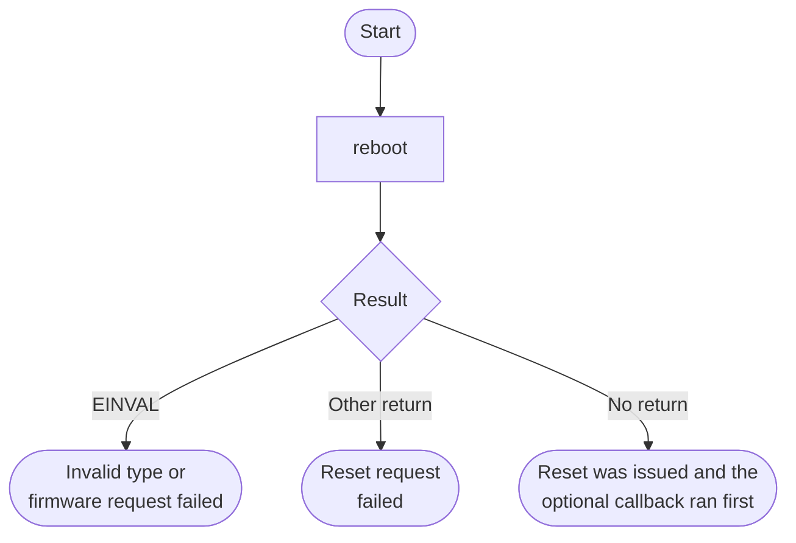

# Reboot Manager Bare-Metal API Guide

## Overview

A reboot is requested from the EL3 firmware (TF-A) with a PSCI (Arm Power State Coordination Interface) call: SYSTEM_RESET for a cold reboot and SYSTEM_RESET2 for a warm reboot. The firmware performs the reset.

This module requests a cold or a warm system reboot, with an optional callback that runs immediately before the request is issued so an application gets one last chance to flush state.

Include [`reboot_mngr_api.h`](reboot_mngr_api.h). Pass the reboot type, optional callback and caller data to `reboot()`. The callback runs immediately before the reset request; an accepted reboot does not return.


## Quick-start API flow

> **Resets the device.** `reboot()` does not return on success: the call issues a cold or warm reset. There is no separate init.



### Walkthrough

1. Finish your own flush of state before the call, or pass a callback that does it. The callback runs immediately before the reset request.
2. Pass `REBOOT_COLD` or `REBOOT_WARM` only.
3. If the function returns, the reset did not happen. Do not assume RAM contents or peripheral state survived a failed attempt.

```C
#include "reboot_mngr_api.h"

/* Illustrative. Not run on a board. This resets the device. */
int32_t reboot_cold(void)
{
    return reboot(REBOOT_COLD, 0, 0);
}
```

## Before You Start

- TF-A must be running at EL3, which is the case in the `DDR` boot flow from the [top-level README](../../README.md). In an `OCRAM` image there is no EL3 firmware: the call is taken by this image's own exception vectors and ends in an unhandled-exception report instead of a reboot or an error code.

## Public API Summary

| Function | Purpose | Returns |
|---|---|---|
| `reboot()` | Runs the optional callback, then requests a cold or warm reboot. Does not return on success. | Does not return on success. Returns `-ENOTSUP` if the firmware does not implement the request, and `-EINVAL` for an invalid type, invalid parameters, or any other firmware status (the raw status is printed on the console). |

Public header: [`reboot_mngr_api.h`](reboot_mngr_api.h).


## Return values and error handling

Shared conventions: [`RETURN_VALUES.md`](../../RETURN_VALUES.md).

| API / group | Return value | Meaning and exact triggering condition | Customer action / output validity |
|---|---|---|---|
| `reboot` | `-EINVAL` | `type` is not `REBOOT_COLD` and not `REBOOT_WARM`. | No callback is stored and `reboot_mngr_do_reboot()` is not called. |
| `reboot` | non-zero from `reboot_mngr_set_callback()` | The matching branch stored the callback, then the set-callback call returned non-zero. | Reset was not requested. |
| `reboot` | value from `reboot_mngr_do_reboot()` | The callback was registered and the reset request returned. | The device did not reset. Do not retry in a loop. |
| `reboot` | No return value. Does not return. | The reset request was issued. | Execution continues only after the following boot. |

## Real-Hardware Validation

### `reboot_mngr_selftest`

> **Destructive: reboots the board.** The command requests a warm reboot with a callback. The interactive session ends. Do not rely on RAM or peripheral state being preserved across reset. It prints `Triggering cold reboot (no callback)...`, but the cold reboot call is disabled in the example; only the warm reboot is issued.

```Text
reboot_mngr_selftest
```

| Property | Value |
|---|---|
| Extra peripheral | None beyond the target board. |
| Pass criterion | The board resets. Whether it boots back to the prompt depends on how the board was configured: an FPGA configuration loaded over JTAG may need to be programmed again (README step 9). If the request fails, the command returns and prints `Warm reboot failed (rc=<code>)` |

Source: [`examples/reboot_mngr/reboot_mngr_selftest.c`](../../examples/reboot_mngr/reboot_mngr_selftest.c)

## Important Constraints

| Constraint | Application impact |
|---|---|
| A successful call never returns | Structure your code so nothing important follows the reboot call; only the failure path continues. |
| Requires TF-A at EL3 | In a `DDR` image whose firmware lacks the service, the call returns `-ENOTSUP`. In an `OCRAM` image, the call ends in an unhandled exception. |
| State across reset | Do not rely on RAM or peripheral state being preserved. Save required application state before requesting reset. |

## Troubleshooting

| Symptom | Likely area | What to try |
|---|---|---|
| The reboot call returns instead of rebooting | Firmware service | Any return means the request failed. `-ENOTSUP` means the firmware does not implement that reset type. |
| Output from the callback is cut off | Callback timing | The callback runs to completion before the reboot request, but console output or posted writes it started may not drain before the reset. Wait for them to complete inside the callback. |

## Related Documentation

- [`reboot_mngr_api.h`](reboot_mngr_api.h) - public API declarations and types.
- [`examples/reboot_mngr/reboot_mngr_selftest.c`](../../examples/reboot_mngr/reboot_mngr_selftest.c) - example source for `reboot_mngr_selftest`.
- [`README.md`](../../README.md) - board bring-up, boot modes, UART and the first console session.
- [`Reset Manager`](../rst_mngr/README.md) - related module.
- [`SDM Mailbox`](../mailbox/README.md) - related module.
