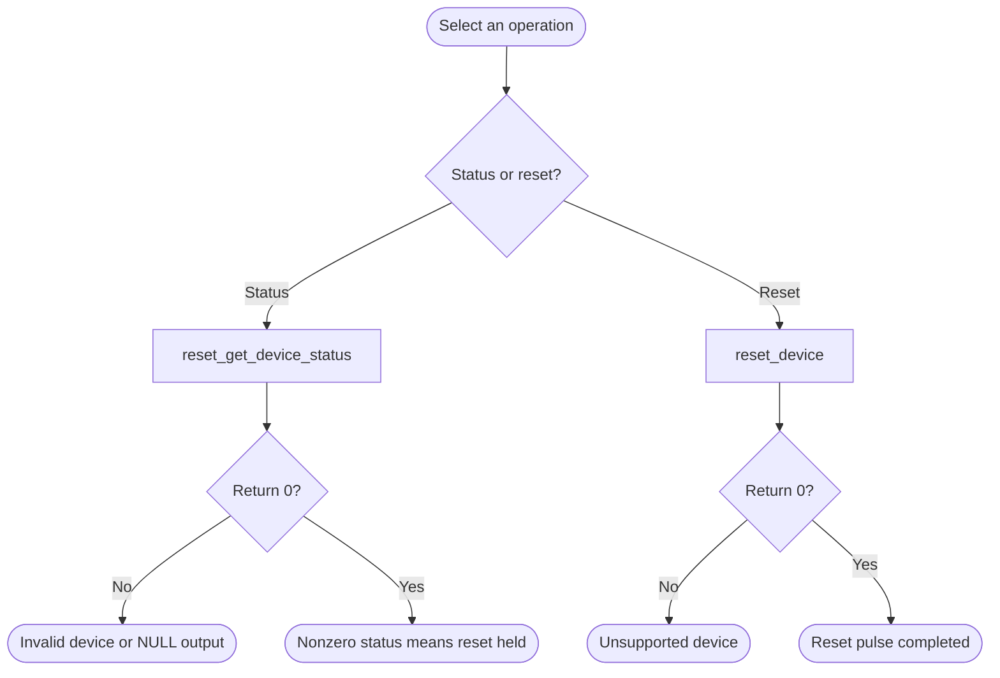

# Reset Manager Bare-Metal API Guide

## Overview

The Reset Manager holds the per-peripheral reset control bits for the HPS. Asserting a peripheral's bit holds that block in reset; deasserting it releases the block to run.

This module applies a reset pulse -- assert, delay, deassert -- to a peripheral, and reports whether a peripheral is currently held in reset. The public interface covers two devices; the driver beneath it knows the full peripheral set.

Include [`rst_mngr_api.h`](rst_mngr_api.h). Each call selects a device directly; no module initialization or handle is required.


## Quick-start API flow

`reset_device()` pulses reset: assert, a fixed delay, deassert. It is not a status read. The only device ids this layer accepts are `RST_DEV_UART0` and `RST_DEV_SDMMC`. See [Before You Start](#before-you-start).



### Walkthrough

1. Read status first if you need to know the current state. Check the return before reading `*status`.
2. Call `reset_device()` only for UART0 or SDMMC. Anything else is `-EINVAL` and does not touch the reset manager.
3. If `reset_device()` returns non-zero, read status again. Do not assume the peripheral is out of reset.

```C
#include <stdint.h>
#include "rst_mngr_api.h"

/* Illustrative. Not run on a board. */
int32_t uart0_in_reset(uint8_t *status)
{
    return reset_get_device_status(RST_DEV_UART0, status);
}
```

## Before You Start

- Do not reset the console UART while the console is in use. The shipped example deliberately skips it for that reason: resetting it silences the console and takes the interactive session with it.
- The Reset Manager registers must be reachable. On the on-chip-memory boot path the platform layer opens access to them during early initialization.

## Public API Summary

| Function | Purpose | Returns |
|---|---|---|
| `reset_get_device_status()` | Reports whether one of the two exposed blocks is held in reset. | Returns 0 on success; `-EINVAL` for an unsupported device or NULL pointer |
| `reset_device()` | Pulses reset (assert, busy-wait loop, deassert) on one of the two exposed blocks: UART0 or SD/MMC. | Returns 0 on success; `-EINVAL` for an unsupported device |

Public header: [`rst_mngr_api.h`](rst_mngr_api.h).


## Return values and error handling

Shared conventions: [`RETURN_VALUES.md`](../../RETURN_VALUES.md).

| API / group | Return value | Meaning and exact triggering condition | Customer action / output validity |
|---|---|---|---|
| `reset_device` | `-EINVAL` | `dev` is not `RST_DEV_UART0` or `RST_DEV_SDMMC`. | No reset pulse. |
| `reset_device` | `0` | `rstmgr_assert_reset()` and `rstmgr_deassert_reset()` both returned 0. The delay between them is 500 loop iterations for UART0 and 1000 for SDMMC. It is not a millisecond argument. | The peripheral was pulsed. |
| `reset_device` | other | The assert or the deassert call returned that code. Assert is attempted first. | If only deassert failed, the device may still be in reset. Read `reset_get_device_status()`. |
| `reset_get_device_status` | `-EINVAL` | `dev` is not one of the two ids. | `*status` is not valid. A NULL `status` is rejected by `rstmgr_get_reset_status()` when that function checks it. |
| `reset_get_device_status` | `0` | The status read completed. | `*status` is the held/released indication. Non-zero data is not a bad return. |

## Hardware checks and limitations

### `reset_mngr_selftest`

> **Destructive: resets peripherals.** The command pulses reset on the SD/MMC controller (it skips UART0 while the console is in use). Any SD/MMC configuration from earlier in the session is lost; initialize the SD/MMC module again before using it.

```Text
reset_mngr_selftest
```

| Property | Value |
|---|---|
| Extra peripheral | None beyond the target board. |
| Pass criterion | No overall verdict. No `reset failed` line appears, and the status line reads `SDMMC: RELEASED`. The command's own output ends with `Reset Manager Example Done`. The console then adds `DONE` and its own `RESULT :` line, which is not a verdict. |

Source: [`examples/reset_mngr/reset_mngr_selftest.c`](../../examples/reset_mngr/reset_mngr_selftest.c)

## Important Constraints

| Constraint | Application impact |
|---|---|
| Two devices only | Resetting any other peripheral needs the driver layer, which is not part of the customer interface. |
| Resetting a peripheral discards its driver configuration | Every driver whose block you reset must be re-initialized, or it will operate on power-on register values. |
| The delay between assert and deassert is a loop count | The real pulse width scales with processor speed rather than being a fixed duration. |

## Troubleshooting

| Symptom | Likely area | What to try |
|---|---|---|
| A reset call returns `-EINVAL` | Device identifier | Only the console UART and the SD/MMC controller are exposed. Other peripherals are not reachable through this API. |
| The console goes silent immediately after a reset call | Console UART was reset | Resetting the console UART destroys the console. Reset it only from code that re-initializes it afterwards, and not from an interactive session. |
| A peripheral stops working after being reset | Driver state | A reset returns the block to its power-on state and discards its configuration. Re-initialize the peripheral's driver after resetting it. |
| The status query still reports the block in reset | Deassert did not complete | Repeat the reset and re-read the status. |

## Related Documentation

- [`rst_mngr_api.h`](rst_mngr_api.h) - public API declarations and types.
- [`examples/reset_mngr/reset_mngr_selftest.c`](../../examples/reset_mngr/reset_mngr_selftest.c) - example source for `reset_mngr_selftest`.
- [`README.md`](../../README.md) - board bring-up, boot modes, UART and the first console session.
- [`Clock Manager`](../clk_mngr/README.md) - related module.
- [`Reboot Manager`](../reboot_mngr/README.md) - related module.
