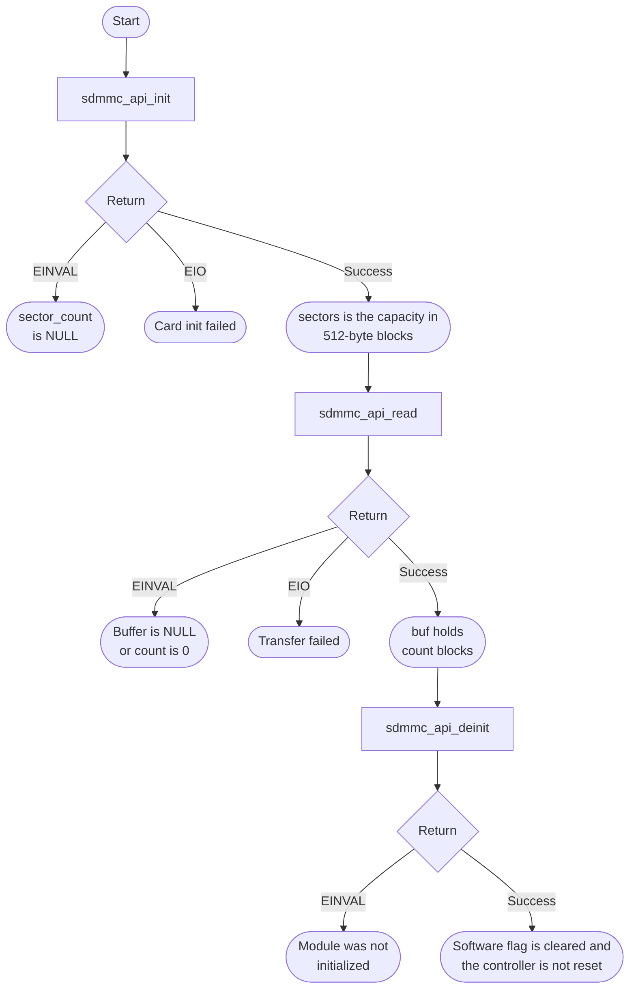
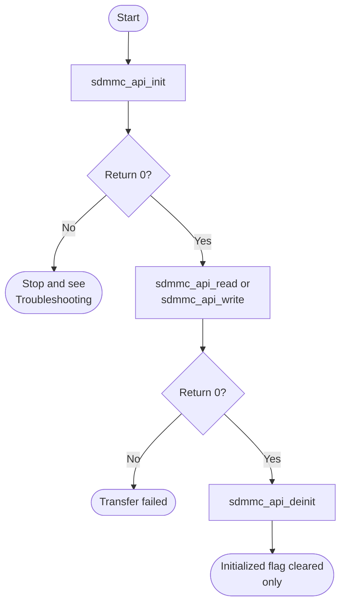

# SD/MMC Bare-Metal API Guide

## Overview

SDMMC is the Cadence SD/MMC host controller. It reaches the card through a shared physical-layer block and moves data with a descriptor-based DMA engine.

This module initializes an SD card, reports its capacity in 512-byte blocks, and reads or writes runs of blocks synchronously.

Include [`sdmmc_api.h`](sdmmc_api.h). Initialize the card and retain its sector count before block transfers. The API tracks one initialized flag and the driver keeps one card descriptor; calls take no handle.


## Quick-start API flow

Initialize, then read. A write destroys card data; keep it off the probe path. See [Before You Start](#before-you-start).



### Walkthrough

1. Initialize and keep the sector count. Do not read `*sectors` unless the return is 0.
2. Read only blocks inside the sector count from a successful init. Check every return. These calls do not compare the request with that count.
3. Call `sdmmc_api_write()` only for a reserved block range whose contents may be overwritten. It uses the same argument checks as read. Keep `block_count` at or below 20480.
4. Deinit clears the initialized flag only.



Initialize once and keep the sector count; then read or write runs of 512-byte blocks, checking each return value; deinitialize when finished. Deinitialization does not reset the controller.

```c
#include <stdint.h>
#include "sdmmc_api.h"

static uint8_t block_buf[SDMMC_API_BLOCK_SIZE] __attribute__((aligned(64)));

int32_t read_first_block(void)
{
    uint64_t sectors = 0U;
    int32_t rc = sdmmc_api_init(&sectors);
    if (rc != 0) {
        return rc;
    }
    rc = sdmmc_api_read(0U, 1U, block_buf);   /* read-only: block 0 */
    (void)sdmmc_api_deinit();
    return rc;
}
```

This fragment is illustrative: it follows the calls in [`sdmmc_selftest.c`](../../examples/sdmmc/sdmmc_selftest.c) but has not been compiled as a separate example.

## Before You Start

- An SD card must be inserted. The controller's card-detect bit can stay set with no card, so an empty slot is not reported directly: initialization fails later during card identification with `-EIO` and a driver message.
- No interrupt setup is needed: initialization registers an interrupt handler entry, but transfers complete by polling the controller, so `gic_api_init()` is not required.
- The shared physical-layer interface must be routed to SDMMC rather than to another peripheral. Where an earlier boot stage owns that selection, it must have made it before this module initializes.
- After that handoff, the SDMMC driver resets the controller and soft PHY and programs the SDMMC PHY/controller configuration itself. The platform clock tree must already be usable when this initialization runs.
- Use buffers that are aligned to the 64-byte cache line and a multiple of 64 bytes long, and keep no other data in the same cache lines. After a read, the driver invalidates the cache lines covering the buffer, which discards any other data that shares those lines.
- Exercising this module against real hardware needs an SD card. eMMC devices are not supported by this build (see Important Constraints).
- In the boot flow described in the [top-level README](../../README.md), the board boots from the same SD card this module accesses. Any write can make that card unbootable.
- Keep the transfer inside the sector count returned by a successful `sdmmc_api_init()`. The read and write calls do not check that limit.
- One call can transfer at most 20480 blocks (10 MiB). A larger count that still fits in a 32-bit byte length returns `-EIO`. `block_count * 512` is calculated in a 32-bit value, so a huge count can wrap instead of returning an error. Stay at or below 20480 blocks.

## Public API Summary

| Function | Purpose | Returns |
|---|---|---|
| `sdmmc_api_init()` | Initializes the SD/MMC path and returns the detected card capacity in 512-byte sectors. | Returns 0 on success; `-EINVAL`, `-EIO` |
| `sdmmc_api_write()` | Writes one or more 512-byte blocks synchronously. | Returns 0 on success; `-EINVAL`, `-EIO` |
| `sdmmc_api_read()` | Reads one or more 512-byte blocks synchronously. | Returns 0 on success; `-EINVAL`, `-EIO` |
| `sdmmc_api_is_ready()` | Reports the controller's card-present indication. | No status code. Returns the card-detect bit. See the note below. |
| `sdmmc_api_deinit()` | Clears the API-level initialized state. | Returns 0 on success; `-EINVAL` |

`sdmmc_api_read()` and `sdmmc_api_write()` do not check that `sdmmc_api_init()` succeeded; call it first and check its return value. Each read and write call prints one `[SDMMC API]` line on the console with the byte range it accesses.

`sdmmc_api_is_ready()` returns the controller's card-detect bit. The header notes that this bit can stay set when no card is present, so treat it as a hint, not proof that a card is usable; a successful `sdmmc_api_init()` is the reliable check.


Public header: [`sdmmc_api.h`](sdmmc_api.h).

## Return values and error handling

Shared conventions: [`RETURN_VALUES.md`](../../RETURN_VALUES.md).

| API / group | Return value | Meaning and exact triggering condition | Customer action / output validity |
|---|---|---|---|
| `sdmmc_api_init` | `-EINVAL` | `sector_count` is NULL. | No card init result. |
| `sdmmc_api_init` | `-EIO` | Card initialization failed. | `*sector_count` is not a capacity. |
| `sdmmc_api_init` | `0` | The card came up. | `*sector_count` is the number of 512-byte blocks. |
| `sdmmc_api_read`, `sdmmc_api_write` | `-EINVAL` | `buffer` is NULL or `block_count` is 0. | No transfer. A range past the card capacity is not rejected here. |
| `sdmmc_api_read`, `sdmmc_api_write` | `-EIO` | The controller transfer failed. | The buffer is not a complete transfer. A write may have partially programmed the card. |
| `sdmmc_api_is_ready` | `0` or `1` | `1` is the card-present indication; `0` means it is not detected. This bit can remain set without a card. | This is data, not status. It does not prove card initialization or usable media. |
| `sdmmc_api_deinit` | `-EINVAL` | `sdmmc_api_initialized` is false. | Nothing was cleared. |
| `sdmmc_api_deinit` | `0` | The initialized flag was cleared. | The controller is not given a reset pulse. |

## Real-Hardware Validation

### `sdmmc_selftest`

> **Destructive.** The command takes no arguments and always writes a test pattern to **blocks 0 and 1** (the first 1024 bytes) of the inserted card, then reads them back. Block 0 normally holds the card's partition table. On the boot card from the [top-level README](../../README.md) flow, this can make the card unbootable. Run it only with a card whose contents you do not need, and recreate the boot card afterwards (README step 5).

| Property | Value |
|---|---|
| API functions it calls | `sdmmc_api_init()` -> `sdmmc_api_write()` -> `sdmmc_api_read()` (listed in the order they appear in the source, not necessarily the order of a successful run) |
| Needs attached hardware | an SD card whose contents you do not need |
| Pass criterion | The output contains `[SDMMC][PASS] init` (the sector count and size printed on that line can be wrong, because the repository `printf` does not support the formats the example uses; the `[PASS]` prefix is the signal), `[SDMMC][PASS] wrote 2 blocks @ block 0`, `[SDMMC][PASS] read  2 blocks @ block 0` and `[SDMMC][PASS] verify  1024 bytes match pattern ...`, and no `[SDMMC][FAIL]` line |
| Fail indication | A line starting with `[SDMMC][FAIL]` names the step that failed (`init`, `write`, `read` or `verify`) |

Source: [`examples/sdmmc/sdmmc_selftest.c`](../../examples/sdmmc/sdmmc_selftest.c)

## Important Constraints

| Constraint | Application impact |
|---|---|
| SD cards only | The driver's device type is fixed to SD at compile time (`DEV_TYPE` in `drivers/sdmmc/socfpga_sdmmc.c`), so an eMMC device cannot be used with this build. |
| Deinitialize does not touch hardware | The controller stays configured and powered after the module reports itself deinitialized. |
| Writes are destructive to card contents | A write to a low block address can destroy a partition table or a boot image. Choose block addresses deliberately. Keep `block_addr + block_count` inside the sector count from init, and keep `block_count` at or below 20480. |
| Not supported: more than one card | Card state is a single file-scope descriptor in the driver. |

## Troubleshooting

| Symptom | Likely area | What to try |
|---|---|---|
| Initialization returns `-EIO` | Card presence, host setup or card protocol | Confirm a card is inserted and seated. If it is, the failure moved on to host setup or card initialization; the driver prints which stage failed. |
| A transfer times out | Card or physical-layer configuration | Check that the shared physical-layer interface is routed to SDMMC and that the card is not held busy by a previous operation. |
| Read data does not match what was written | Buffer alignment or block address | Confirm the buffer is 64-byte aligned and sized in whole cache lines, and that the block address and count are the ones you intended. |
| A large read or write returns `-EIO` | Request size | One call transfers at most 20480 blocks (10 MiB). Split a larger request. Also keep the range inside the sector count from init. The API does not check that limit, and a count large enough to wrap `block_count * 512` is not reported as an error. |
| A read or write returns `-EINVAL` | Arguments | Check for a NULL buffer or a zero block count. These calls do not detect a missing `sdmmc_api_init()`. |
| `sdmmc_api_deinit()` returns `-EINVAL` | State | The module was not initialized. |
| The board no longer boots from the SD card | Card contents | Block 0 or the boot partition was overwritten, for example by `sdmmc_selftest`. Recreate the card with README step 5. |

## Related Documentation

- [`sdmmc_api.h`](sdmmc_api.h) - public API declarations and types.
- [`examples/sdmmc/sdmmc_selftest.c`](../../examples/sdmmc/sdmmc_selftest.c) - example source for `sdmmc_selftest`.
- [`README.md`](../../README.md) - board bring-up, boot modes, UART and the first console session.
- [`ComboPHY`](../combophy/README.md) - related module.
- [`DMA`](../dma/README.md) - related module.
