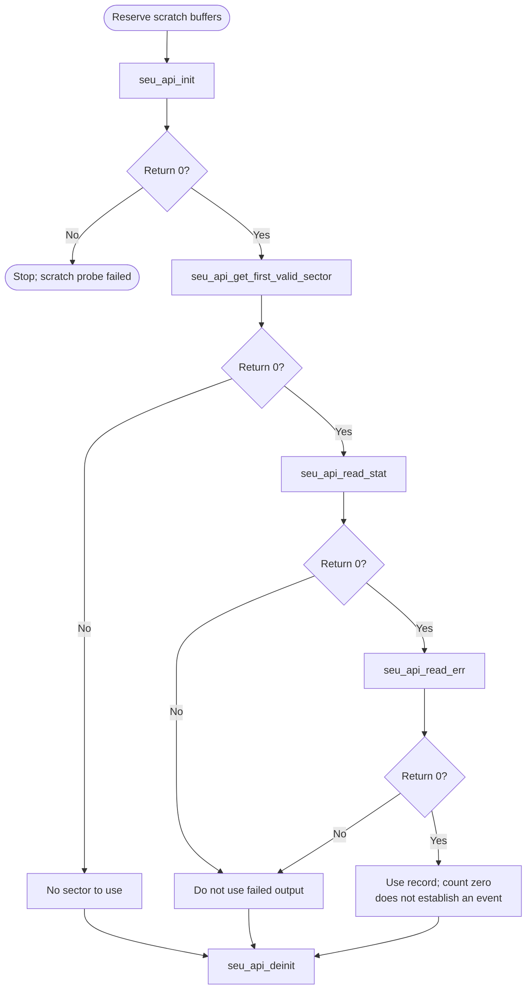

# SEU Bare-Metal API Guide

## Overview

SEU handling belongs to the Secure Device Manager, which continuously scrubs the FPGA configuration memory for single-event upsets -- bit flips caused by radiation -- and maintains a queue of the errors it finds.

This module reads the upset statistics and the error queue the Secure Device Manager maintains, and can inject test upsets so that an application's error-handling path can be exercised deliberately.

Include [`seu_api.h`](seu_api.h). Initialize before reading statistics or the error queue, then deinitialize when finished. Calls share the module context and fixed command buffer.


## Quick-start API flow

Read the sector statistics and the error queue. Injection functions create a test fault; they are not part of collecting the live queue. See [Before You Start](#before-you-start).



### Walkthrough

1. Initialize, then find a sector. `-ENODEV` means the probe found none; do not invent a sector number.
2. Read statistics and the error queue. Branch on the return before using the structure.
3. A callback registered with `seu_api_set_callback()` is not how this module delivers the queue. Poll `seu_api_read_err()`.
4. `seu_api_insert_safe_err()` and `seu_api_inject_fpga_ram_err()` inject faults. Call them only from a test.


Initialize, find a valid sector, read statistics and poll the error queue, then deinitialize. Injection calls are for testing only. See [`seu_selftest.c`](../../examples/seu/seu_selftest.c) for a complete sequence.

### Public-header example

Collect sector statistics and one error-queue entry without injecting a fault. Reserve the scratch buffers listed below. Use both output structures only on return 0; `event->err_cnt == 0` means the queue was empty. Reading the queue consumes an entry.

```c
#include <stddef.h>
#include "errno.h"
#include "seu_api.h"

/* Requires TF-A and a configured FPGA. init writes the scratch ranges listed
 * in the module guide. An error-queue read consumes one entry. No injection. */
int example_seu_snapshot(seu_api_stat_t *statistics, seu_api_err_data_t *event)
{
    uint8_t sector;
    int close_rc;
    int rc;
    if ((statistics == NULL) || (event == NULL)) {
        return -EINVAL;
    }
    rc = seu_api_init();
    if (rc != 0) {
        return rc;
    }
    rc = seu_api_get_first_valid_sector(8U, &sector);
    if (rc == 0) {
        rc = seu_api_read_stat(sector, statistics);
    }
    if (rc == 0) {
        rc = seu_api_read_err(event);
    }
    close_rc = seu_api_deinit();
    return rc != 0 ? rc : close_rc;
}
```

The same source is available as [`seu_consumer.c`](../../docs/examples/seu_consumer.c). See the [example build instructions](../../docs/examples/README.md).

## Before You Start

- Trusted Firmware-A must be running and providing the mailbox service that carries these commands.
- The FPGA must be configured and running. Until it is, the device rejects these commands as "not configured".
- The loaded FPGA design must have error injection enabled at build time for the injection calls to work. Statistics and error-queue reads do not require it.
- The driver uses two fixed external-memory (DDR) buffers for mailbox commands and responses: 64 bytes at `0x82100400` and 64 bytes at `0x82100500`. `seu_api_init()` writes test patterns there. Keep your own data out of these ranges.
- Calls block while the Secure Device Manager (SDM) is busy: each command is retried up to 40 times at 50 ms intervals (about 2 s).

## Public API Summary

| Function | Purpose | Returns |
|---|---|---|
| `seu_api_init()` | Initializes the SEU module and checks access to its fixed command buffer. | Returns 0 on success. Also returns `-EIO` when the scratch-buffer probe fails. |
| `seu_api_set_callback()` | Register a notification callback for SEU interrupt events. | Returns 0 on success; `-EINVAL` |
| `seu_api_get_first_valid_sector()` | Probes sector indices in turn and returns the first one the SDM accepts. Each probe is a blocking command. | Returns 0 on success; `-EINVAL`, `-ENODEV` |
| `seu_api_read_stat()` | Read SEU timing statistics for the given sector. | Returns 0 on success; `-EINVAL`, `-EIO` |
| `seu_api_read_err()` | Read one entry from the SDM SEU error queue. | Returns 0 on success; `-EINVAL`, `-EIO` |
| `seu_api_insert_safe_err()` | Injects a safe, correctable upset into the FPGA configuration RAM (CRAM). | Returns 0 on success; `-EINVAL`, `-EIO` |
| `seu_api_inject_fpga_ram_err()` | Asks the SDM to inject a single-bit or double-bit error into an FPGA-fabric memory of the given sector. | Returns 0 on success; `-EINVAL`, `-EIO` |
| `seu_api_deinit()` | Releases the SEU module. | Returns 0 on success. |

Public header: [`seu_api.h`](seu_api.h).


## Return values and error handling

Shared conventions: [`RETURN_VALUES.md`](../../RETURN_VALUES.md).

| API / group | Return value | Meaning and exact triggering condition | Customer action / output validity |
|---|---|---|---|
| `seu_api_set_callback` | `-EINVAL` | `cb` is NULL. | No callback is stored. |
| `seu_api_get_first_valid_sector` | `-EINVAL` | `out_sector` is NULL or `max_probe` is 0. | `*out_sector` is not valid. |
| `seu_api_get_first_valid_sector` | `-ENODEV` | No probed sector was valid. | Do not pass an uninitialized sector id onward. |
| `seu_api_get_first_valid_sector` | `0` | A sector was found. | `*out_sector` is valid. |
| `seu_api_read_stat` | `-EINVAL` | `out_stat` is NULL. | |
| `seu_api_read_stat` | `-EIO` | The status `op_state` is not 0. | Do not treat `*out_stat` as a successful sample. |
| `seu_api_read_err` | `-EINVAL` | `out_err` is NULL. | |
| `seu_api_read_err` | `-EIO` | The error-record `op_state` is not 0. | The queue record is not valid. |
| `seu_api_insert_safe_err` | `-EINVAL` | `params` is NULL; `count` is not 1 or 2; `injection_cycle` exceeds 2; either CRAM selector exceeds 0xF; or two injections select the same location. | No injection from this rejected call. |
| `seu_api_inject_fpga_ram_err` | `-EINVAL` or `-EIO` | `-EINVAL`: mode is not 1 or 2, or `ram_id` exceeds 0x1F. `-EIO`: driver is uninitialized or the firmware command failed. The sector is sent to firmware, not locally range-checked. | A non-zero return is not proof the RAM was unchanged if the command was issued. |
| `seu_api_init`, `seu_api_deinit` | `0` or the driver status | Init failure is reported as the driver's code. Deinit returns 0 in the current wrapper when it has nothing to undo. | |

## Real-Hardware Validation

### `seu_selftest`

> **Destructive: injects errors.** The command injects one safe configuration-RAM upset and one single-bit FPGA-fabric memory error into the first valid sector. Do not run it on a system whose upset monitoring would act on the injected events.

```text
seu_selftest
```

| Property | Value |
|---|---|
| Needs | A configured FPGA in user mode whose design has error injection enabled, and a `DDR` boot with TF-A |
| Pass criterion | No overall verdict line. The run passes when `[SEU][PASS] seu_api_insert_safe_err`, a `[SEU][PASS] SEU ... after <n> attempt(s)` detection line and `[SEU][PASS] seu_api_inject_fpga_ram_err` appear, and no `[SEU][FAIL]` line appears. `[SEU][WARN] No SEU reported` means the injected upset was not detected |

Source: [`examples/seu/seu_selftest.c`](../../examples/seu/seu_selftest.c)

## Important Constraints

| Constraint | Application impact |
|---|---|
| Polling only | A registered callback is never invoked in this release, so an application must poll for upsets rather than being notified. |
| Requires Trusted Firmware-A and a configured FPGA | Neither statistics nor injection work in a standalone image or before the FPGA is running. |
| Injection needs a bitstream built with error injection enabled | Injection cannot be used to validate an application against a production bitstream that lacks that option. |
| Fixed command and response buffer addresses | The driver uses DDR at `0x82100400` and `0x82100500` (64 bytes each); that memory must not be used for anything else. |
| Calls block | Each command can take up to about 2 s while the SDM is busy; probing several sectors multiplies that. |
| One active instance | Module state is held in file-scope objects, so one initialization is active at a time. There is no internal locking; serialize access yourself. |

## Troubleshooting

| Symptom | Likely area | What to try |
|---|---|---|
| Every call reports an invalid command | Firmware support | The SDM firmware does not implement these commands in this configuration. |
| Calls report the device as not configured | FPGA state | Load and start an FPGA design first. These commands operate on configuration memory that only exists once the device is configured. |
| Injection fails while statistics reads succeed | Bitstream build option | The loaded design does not have error injection enabled. Rebuild the FPGA design with that option to use the injection calls. |
| No sector responds | Sector probing | Every probed sector failed, which normally means the FPGA is not configured or the commands are not supported by the firmware. |
| The error queue is empty just after a successful injection | Scrub timing | The device's scrubber needs time to find the injected upset. Poll the queue rather than reading it once. |

## Related Documentation

- [`seu_api.h`](seu_api.h) - public API declarations and types.
- [`examples/seu/seu_selftest.c`](../../examples/seu/seu_selftest.c) - example source for `seu_selftest`.
- [`README.md`](../../README.md) - board bring-up, boot modes, UART and the first console session.
- [`SDM Mailbox`](../mailbox/README.md) - related module.
- [`FCS`](../fcs/README.md) - related module.
- [`ECC`](../ecc/README.md) - related module.
