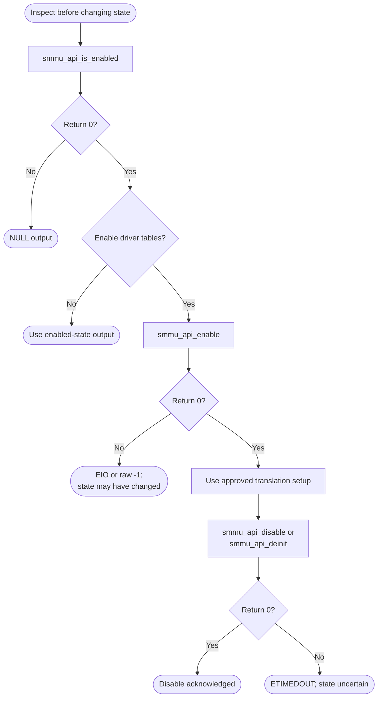

# SMMU Bare-Metal API Guide

## Overview

The SMMU is the Arm system memory management unit, version 3. It performs for non-processor bus masters what the processor's own memory management unit does for software: address translation and access control.

This module enables or disables the system memory management unit using a translation configuration built into the driver, reports whether it is enabled, and provides raw register access for diagnosis.

Include [`smmu_api.h`](smmu_api.h). Calls operate on the global SMMU configuration without a handle. Enabling installs the driver's fixed translation setup; it is a system configuration change.


## Quick-start API flow

Reading whether the SMMU is enabled is not the same as enabling it. `smmu_api_enable()` turns on translation for the built-in page tables and can change how later memory accesses are translated. See [Before You Start](#before-you-start).



### Walkthrough

1. Read `smmu_api_is_enabled()` if you only need the bit. Do not call enable for a status check.
2. Call `smmu_api_enable()` only when this system should translate through the driver's tables. `-EIO` means queue setup failed; a raw `-1` means the final enable acknowledgement failed. Either failure can follow register changes, so do not assume the previous configuration remains active.
3. `smmu_api_disable()` waits for the ack bits to clear. `-ETIMEDOUT` means they did not. Do not assume translation is off, and do not loop on a larger budget; this function has a fixed retry count.

```C
#include <stdbool.h>
#include "smmu_api.h"

/* Illustrative. Not run on a board. Does not enable translation. */
int32_t smmu_enabled(bool *on)
{
    return smmu_api_is_enabled(on);
}
```

## Before You Start

- Establish whether earlier firmware has already configured this controller before enabling it. Enabling rewrites the controller's tables and its enable bit, which disturbs any configuration already in place.
- The translation tables live in memory the controller reads directly, so they must be written back from the processor's caches before being activated. The driver does this itself.

## Public API Summary

| Function | Purpose | Returns |
|---|---|---|
| `smmu_api_enable()` | Writes the driver's fixed stream table and queues, then enables the SMMU. | Returns 0 on success; `-EIO`; `-1` if the enable is not acknowledged |
| `smmu_api_write_reg()` | Writes a 32-bit value to an SMMU register at the supplied offset from the SMMU base (`0x16000000`). The offset is not checked. | Returns 0 on success. This call always returns 0. |
| `smmu_api_read_reg()` | Reads a 32-bit SMMU register at the supplied offset from the SMMU base. The offset is not checked. | Returns 0 on success; `-EINVAL` for a NULL pointer |
| `smmu_api_is_enabled()` | Reads SMMU_CR0 and reports whether the SMMUEN bit is set. | Returns 0 on success; `-EINVAL` |
| `smmu_api_disable()` | Disables SMMU translation and driver-owned queues, then waits for CR0ACK to clear. | Returns 0 on success; `-ETIMEDOUT` |
| `smmu_api_deinit()` | Deinitializes the SMMU by calling the same hardware-disable path used by smmu_api_disable(). | Returns 0 on success; `-ETIMEDOUT` |

Public header: [`smmu_api.h`](smmu_api.h).


## Return values and error handling

Shared conventions: [`RETURN_VALUES.md`](../../RETURN_VALUES.md).

| API / group | Return value | Meaning and exact triggering condition | Customer action / output validity |
|---|---|---|---|
| `smmu_api_is_enabled` | `-EINVAL` | `enabled` is NULL. | Do not read `*enabled`. |
| `smmu_api_is_enabled` | `0` | `SMMU_CR0` was read. | `*enabled` is true only when `SMMU_CR0_SMMUEN_MASK` is set. False with return 0 means the bit is clear. |
| `smmu_api_enable` | `0` | Command queue, event queue, and the SMMU enable step all succeeded. | Address translation is on for the driver's tables. |
| `smmu_api_enable` | `-EIO` | Command/event queue setup or queue management failed. | Registers may already have changed; previous state is not restored. |
| `smmu_api_enable` | `SMMU_OP_FAIL` (-1) | The final enable acknowledgement exhausted its fixed retry budget. | Do not assume translation is enabled or the previous state restored. |
| `smmu_api_disable`, `smmu_api_deinit` | `0` | `SMMU_CR0ACK` enable bits read as clear before the retry count hit 0. | Translation owned by this driver was disabled. |
| `smmu_api_disable`, `smmu_api_deinit` | `-ETIMEDOUT` | The ack mask was still non-zero when `retry` reached 0. The budget is that fixed loop, not a caller argument. | Translation may still be enabled. |
| `smmu_api_read_reg` | `-EINVAL` | `value` is NULL. | |
| `smmu_api_read_reg` | `0` | The word at `SMMU_BASE_ADDR + offset` was read. The offset is not range-checked here. | `*value` is valid. A bad offset can fault instead of returning a code. |
| `smmu_api_write_reg` | `0` | The store was issued. There is no argument check. | The register was written. |

## Hardware checks and limitations

### `smmu_selftest`

Non-destructive: only reads whether the SMMU is enabled.

```Text
smmu_selftest
```

| Property | Value |
|---|---|
| Extra peripheral | None beyond the target board. |
| Pass criterion | Prints `SMMU: enabled` or `SMMU: disabled`; either is a valid result. `SMMU status failed: <code>` means the read failed |

Source: [`examples/smmu/smmu_selftest.c`](../../examples/smmu/smmu_selftest.c)

## Important Constraints

| Constraint | Application impact |
|---|---|
| The translation configuration is fixed in the driver | Enable sets up stream ID 0xA for translation (a 512 MiB window mapped to physical `0x80000000`) and stream IDs 1 to 9 for bypass. Stream ID 0 and IDs above 0xA get no prepared entry. You cannot describe your own masters or address ranges. |
| Raw register writes are unvalidated | The raw write entry point will put the controller into an inconsistent state if used carelessly, which can break every bus master at once. |
| No fault reporting | A translation fault does not surface through this module, so a faulting master is diagnosed indirectly. |
| One active instance | Module state is held in file-scope objects, so one initialization is active at a time. There is no internal locking; serialize access yourself. |

## Troubleshooting

| Symptom | Likely area | What to try |
|---|---|---|
| Enable returns `-EIO` or `-1` | Queue setup or enable acknowledge | A queue or the enable did not complete within its retry budget. Confirm the SMMU is clocked and out of reset; its base address is fixed in the driver. |
| A bus master starts faulting after enable | Stream configuration | Only stream ID 0xA is translated and IDs 1 to 9 bypass translation. A master using stream ID 0 or an ID above 0xA has no prepared entry. |
| Disable returns `-ETIMEDOUT` | Queues not drained | The controller did not acknowledge the change. Quiesce bus masters before disabling. |

## Related Documentation

- [`smmu_api.h`](smmu_api.h) - public API declarations and types.
- [`examples/smmu/smmu_selftest.c`](../../examples/smmu/smmu_selftest.c) - example source for `smmu_selftest`.
- [`README.md`](../../README.md) - board bring-up, boot modes, UART and the first console session.
- [`MMU`](../mmu/README.md) - related module.
- [`CCU`](../ccu/README.md) - related module.
- [`DMA`](../dma/README.md) - related module.
