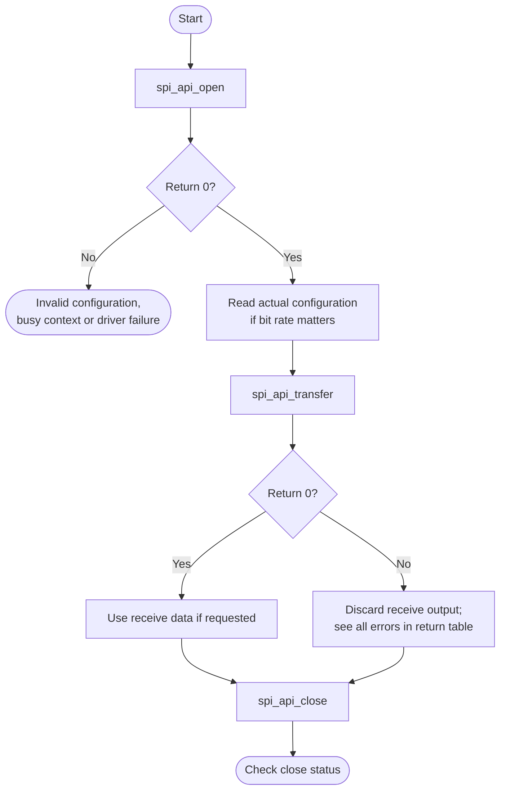
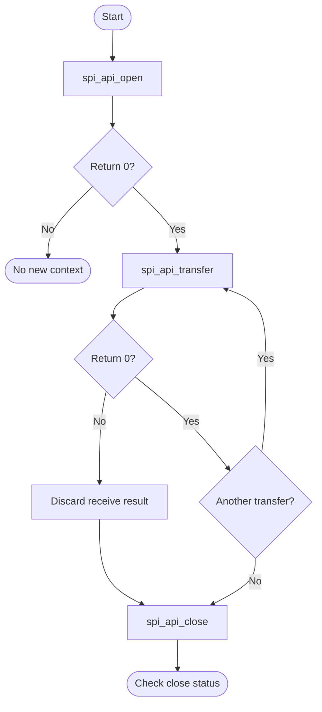

# SPI Bare-Metal API Guide

## Overview

SPI is the Synopsys DesignWare APB Synchronous Serial Interface, operated in controller (master) mode. The HPS provides two instances.

This module opens one SPI instance, configures its bit rate, transfer mode and chip-select, and performs blocking full-duplex transfers. It also offers an internal loopback self-check that needs no external device and no wiring.

Include [`spi_api.h`](spi_api.h). Open and configure one instance before transfers, then close it when finished. The API retains the selected instance rather than returning a handle.


## Quick-start API flow

One SPI context. The transfer is full duplex and blocking. See [Before You Start](#before-you-start).



### Walkthrough

1. Open with a config, or NULL for the defaults. `-EBUSY` means close the current instance first.
2. Read back the config if the bit rate matters.
3. Transfer. On any non-zero return, do not use `rx`.
4. Close.



Open one instance with a configuration (or `NULL` for the defaults), perform blocking full-duplex transfers, then close it. The achievable bit rate may differ from the request. Call `spi_api_get_config()` to read the programmed rate.

```c
#include <stdint.h>
#include "spi_api.h"

int32_t spi_read_id(uint8_t *rx, size_t n)    /* n <= sizeof(tx) */
{
    spi_api_config_t cfg = { .instance = 0U, .slave = 1U,
                             .speed_hz = 500000U, .mode = SPI_MODE0 };
    uint8_t tx[4] = { 0x9FU, 0U, 0U, 0U };    /* command byte for your device */
    int32_t rc = spi_api_open(&cfg);

    if (rc != 0) {
        return rc;
    }
    rc = spi_api_transfer(tx, rx, n);
    (void)spi_api_close();
    return rc;
}
```

This fragment is illustrative and has not been compiled as a separate example. The command byte depends on your SPI device.

## Before You Start

- The Clock Manager must report a non-zero rate for the SPI clock. The bit rate is derived from it, so an unclocked instance cannot be configured.
- The instance's pins must be muxed to SPI for any external transfer. The loopback check needs no pins and no external device.

## Public API Summary

| Function | Purpose | Returns |
|---|---|---|
| `spi_api_open()` | Opens and configures the selected SPI instance. | Returns 0 on success; `-EBUSY`, `-EINVAL`, `-EIO` |
| `spi_api_get_config()` | Returns the active SPI configuration, including the actual bit rate after rounding. | Returns 0 on success; `-EINVAL` (NULL pointer), `-ENODEV` (no instance open) |
| `spi_api_get_version()` | Reads the DesignWare SPI version register for an instance. | Returns 0 on success; `-EBUSY`, `-EINVAL`, `-EIO` |
| `spi_api_transfer()` | Performs a blocking SPI transfer on the active SPI instance. | Returns 0 on success; `-EBUSY`, `-EINVAL`, `-EIO`, `-ENODEV`, `-ETIMEDOUT` |
| `spi_api_loopback_test()` | Opens an instance, runs an internal loopback test in serial-loopback mode, and closes it again. | Returns 0 on success; `-EBUSY` (any instance already open), `-EINVAL`, `-EIO`, `-ETIMEDOUT` |
| `spi_api_close()` | Closes the active SPI instance, if one is open. | Returns 0 on success. On `-EBUSY` or `-EINVAL`, the API still forgets its saved handle. |

Public header: [`spi_api.h`](spi_api.h).


## Return values and error handling

Shared conventions: [`RETURN_VALUES.md`](../../RETURN_VALUES.md).

| API / group | Return value | Meaning and exact triggering condition | Customer action / output validity |
|---|---|---|---|
| `spi_api_open` | `-EBUSY` | `g_spi_handle` is already non-NULL. | The existing instance stays open. |
| `spi_api_open` | `-EIO` | The open left the handle NULL. | No instance. |
| `spi_api_open` | `0` | A handle was stored. | The programmed rate may not equal the requested rate. |
| `spi_api_transfer` | `-ENODEV` | `g_spi_handle` is NULL. | No clocks were toggled by this check. |
| `spi_api_transfer` | `-EINVAL` | `txbuf` is NULL, `nbytes` is 0, or `nbytes` is greater than `UINT16_MAX`. | `rxbuf` is untouched by this check. |
| `spi_api_transfer` | `-ETIMEDOUT` | The driver's wait expired. | The transfer is incomplete. Do not use `rxbuf` as a full response. |
| `spi_api_transfer` | `0` | The blocking transfer finished. | `rxbuf` bytes are valid when a receive buffer was passed. |
| `spi_api_get_config` | `-EINVAL` | `config` is NULL. | |
| `spi_api_get_config` | `-ENODEV` | The handle is NULL. | |
| `spi_api_get_version` | `-EINVAL` | `instance` is greater than 1 or `version` is NULL. | |
| `spi_api_get_version` | `-EBUSY` | A handle is open on a different instance than the one requested. | The open instance is left as it is. |
| `spi_api_loopback_test` | `-EINVAL` | `nbytes` is 0 or greater than `SPI_API_LOOPBACK_MAX_LEN`. | No loopback was started. |
| `spi_api_close` | `0` | The handle was NULL (nothing to close) or the close finished. | The instance is released. |
| `spi_api_close` | `-EBUSY` or `-EINVAL` | The driver rejected the close. `-EBUSY` means a transfer is still marked busy, so the driver does not release the instance. | The API still clears its saved handle. A later transfer returns `-ENODEV`. This call cannot be repeated to finish the close, because the handle is already gone. |

## Real-Hardware Validation

### `spi_selftest`

Non-destructive: the loopback uses the controller's internal serial-loopback mode, so no external device or wiring is needed. Included only in `DDR` builds.

```text
spi_selftest [instance 0..1] [slave 1..4] [len 1..256]
```

| Property | Value |
|---|---|
| What it does | Reads the controller version, runs the internal loopback, then queries the configuration. The third step always reports that no instance is open, because the loopback closes the instance it opened |
| Extra peripheral | None beyond the target board. |
| Pass criterion | `SPI<n> loopback PASS (<len> bytes, CS<k>)` appears. **Do not rely on the `PASS` lines after each test or on the final `SELF-TEST PASSED` line**: the example prints them even when a step fails. `SPI probe failed:` or `SPI loopback failed:` means the run failed |

Source: [`examples/spi/spi_selftest.c`](../../examples/spi/spi_selftest.c)

## Important Constraints

| Constraint | Application impact |
|---|---|
| One open instance at a time | Devices on both SPI controllers cannot be held open at once; a second open returns `-EBUSY`. Close one to use the other. If close returns `-EBUSY` or `-EINVAL`, the API has already forgotten the handle, so do not assume the controller was released. |
| Chip-selects are numbered from 1 | Valid values are 1 to 4. Passing 0 fails with `-EINVAL`. |
| The achievable bit rate can differ from the request | Divider rounding and limits affect the programmed rate; sufficiently low requests can produce a faster rate. Read the actual rate with `spi_api_get_config()` and check it against the target device's limits. |
| Synchronous transfers only | A long transfer occupies the processor for its full duration; there is no completion callback. |
| One active instance | Module state is held in file-scope objects, so one initialization is active at a time. There is no internal locking; serialize access yourself. |

## Troubleshooting

| Symptom | Likely area | What to try |
|---|---|---|
| Any open or version read returns `-EBUSY` | Instance already open | Only one instance may be open. Close it before opening another, or before reading a different instance's version. |
| Open returns `-EIO` | Controller or clock rate | The controller could not be opened, or the SPI clock rate could not be read or is zero. Confirm the clock tree is initialized. |
| The loopback check fails | Controller or clock | Loopback needs no external wiring, so a failure points at the controller itself, its clock or its reset state rather than at the board. |
| A configuration query returns `-ENODEV` | Not open | Open the instance first. Note that the loopback check opens and closes internally, so it deliberately leaves nothing open. |
| A chip-select is rejected with `-EINVAL` | Chip-select numbering | Chip-selects are numbered 1 to 4 in this API, not from 0. |

## Related Documentation

- [`spi_api.h`](spi_api.h) - public API declarations and types.
- [`examples/spi/spi_selftest.c`](../../examples/spi/spi_selftest.c) - example source for `spi_selftest`.
- [`README.md`](../../README.md) - board bring-up, boot modes, UART and the first console session.
- [`I2C`](../i2c/README.md) - related module.
