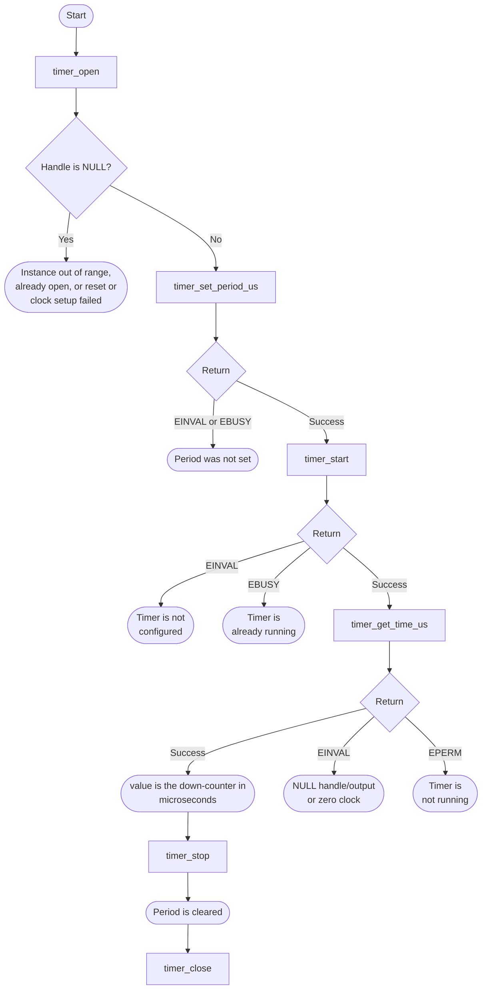
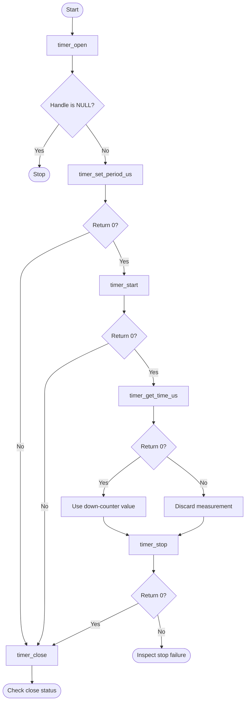

# Timer Bare-Metal API Guide

## Overview

The HPS provides four general-purpose peripheral timers: two in the L4 system domain and two in the L4 peripheral domain. Each is a down-counter driven by a peripheral clock.

This module opens one timer instance, starts and stops it, and reads its current count in microseconds. It converts the raw count using the clock rate the Clock Manager reports, so the result does not depend on a hard-coded frequency.

Include [`timer_api.h`](timer_api.h). Retain the handle returned by `timer_open()` for period, start, stop and count calls. Stop the timer before closing it.


## Quick-start API flow

`timer_open()` returns a handle or NULL. `TIMER_SP1` is not a usable instance in this release: the driver maps it onto the SP0 timer base. Use `TIMER_SYS0` unless you have confirmed another instance. See [Before You Start](#before-you-start).



### Walkthrough

1. Open `TIMER_SYS0`. NULL means stop; there is no errno from open.
2. Set the period before every start. Stop clears it.
3. Start, then read. `-EPERM` means you read a timer that is not running; the output is not a time.
4. Stop and close.



Open an instance, set its period, start it, poll its count, then stop and close it. Stopping clears the period, so set it again before restarting.

```c
#include <stdint.h>
#include "timer_api.h"

int32_t timer_poll_once(uint32_t *value_us)
{
    timer_handle_t t = timer_open(TIMER_SYS0);
    int32_t rc;

    if (t == NULL) {
        return -1;
    }
    rc = timer_set_period_us(t, 1000000U);   /* 1 s period, as in timer_selftest */
    if (rc == 0) {
        rc = timer_start(t);
    }
    if (rc == 0) {
        rc = timer_get_time_us(t, value_us);
        (void)timer_stop(t);
    }
    (void)timer_close(t);
    return rc;
}
```

This fragment is illustrative: it follows [`timer_selftest.c`](../../examples/timer/timer_selftest.c) but has not been compiled as a separate example.

## Before You Start

- The Clock Manager must report a non-zero rate for the timer's clock. Microsecond conversion divides by it, so an unclocked timer cannot be opened. In an image built for on-chip memory this means the clock tree must be initialized first.
- The timer's period must be set with `timer_set_period_us()` before it is started, or `timer_start()` returns `-EINVAL`. `timer_set_period_us()` is declared in the driver header `socfpga_timer.h`, which `timer_api.h` includes, so no extra include is needed. It is the call the shipped `timer_selftest` uses.
- Use `TIMER_SYS0`, `TIMER_SYS1` or `TIMER_SP0`. See the `TIMER_SP1` constraint below.

## Public API Summary

| Function | Purpose | Returns |
|---|---|---|
| `timer_open()` | Opens a timer instance and releases its reset if needed. | Returns a handle on success. Returns NULL on failure. |
| `timer_set_period_us()` | Sets the period in microseconds and puts the timer in auto-reload mode. A period longer than the 32-bit counter can hold at the timer's clock rate is clamped to the maximum count. Declared in `socfpga_timer.h`, included by `timer_api.h`. | Returns 0 on success; `-EINVAL` for a NULL handle; `-EBUSY` while running |
| `timer_start()` | Starts a timer whose period has been set. | Returns 0 on success; `-EINVAL` for a NULL handle or no period set; `-EBUSY` if already running |
| `timer_get_time_us()` | Reads the timer's current count, converted to microseconds. | Returns 0 on success; `-EINVAL`, `-EPERM` when the timer is not running |
| `timer_stop()` | Stops a running timer and clears its period. | Returns 0 on success; `-EINVAL`, `-EPERM` when the timer is not running |
| `timer_close()` | Closes a timer handle and releases the timer instance. | Returns 0 on success; `-EFAULT`, `-EINVAL` |
| `timer_deinit()` | Alias of `timer_close()`. | Returns 0 on success, or `-EFAULT` or `-EINVAL`. Same values as `timer_close()`. |

`timer_get_time_us()` returns the current value of the down-counter, which is the time remaining in the current period: it starts at the period, decreases toward zero, and reloads. Elapsed time within a period is the period minus the value. To measure an interval, take the difference of two readings and allow for a reload in between. The driver prints debug lines on the console during these calls, for example `clk_hz now = <n>` on every read.

Public header: [`timer_api.h`](timer_api.h).


## Return values and error handling

Shared conventions: [`RETURN_VALUES.md`](../../RETURN_VALUES.md).

| API / group | Return value | Meaning and exact triggering condition | Customer action / output validity |
|---|---|---|---|
| `timer_open` | handle | The instance index is in range, the descriptor is not already open, and reset and clock setup returned success. | Use the handle. |
| `timer_open` | NULL | `instance >= TIMER_N_INSTANCE`, the handle is already open, reset setup failed, or the clock read failed. | No errno. `TIMER_SP1` is not a separate counter. |
| `timer_set_period_us` | `-EINVAL` | The handle is NULL. The period value itself is not range-checked. | The timer was not given a period. |
| `timer_set_period_us` | `-EBUSY` | The timer is already running. | Stop it before changing the period. |
| `timer_start` | `-EINVAL` | The handle is NULL or the period has not been set (`is_configured` is false). | The timer did not start. |
| `timer_start` | `-EBUSY` | `is_running` is already set. | It was already started. |
| `timer_get_time_us` | `0` | The handle is running and `time_us` was accepted. | `*time_us` counts down in microseconds. |
| `timer_get_time_us` | `-EINVAL` | The handle or `time_us` is NULL, or the stored clock frequency is zero. | Do not read `*time_us`. |
| `timer_get_time_us` | `-EPERM` | The timer is not running. | `*time_us` is not a measurement. |
| `timer_stop` | `-EINVAL` | The handle is NULL. | |
| `timer_stop` | `-EPERM` | The timer is not running. | The period is not cleared by a rejected stop. |
| `timer_close`, `timer_deinit` | `-EINVAL` | The handle is NULL or not open. | |
| `timer_close`, `timer_deinit` | `-EFAULT` | Interrupt teardown did not return `ERR_OK`. | The software descriptor may still be open. |

## Real-Hardware Validation

### `timer_selftest`

Non-destructive: the command only opens, configures, starts, reads and stops a timer. It is included in both `OCRAM` and `DDR` builds.

```text
timer_selftest
```

| Property | Value |
|---|---|
| What it does | Opens `TIMER_SYS0`, sets a 1 s period, starts it, checks that two readings differ, takes five samples, then stops the timer |
| Extra peripheral | None beyond the target board. |
| Pass criterion | The last line is `RESULT : 2 of 2 tests passed  -  SELF-TEST PASSED`. The check is limited: test 1 passes when two readings differ, and test 2 passes when the timer stops cleanly |
| Fail indication | `SELF-TEST FAILED` in the result line, with `FAIL` on the step that failed |
| Rerun | Run it once per boot. It does not close `TIMER_SYS0`, so a second run in the same boot reports `FAIL (open returned NULL)`. Reset the board to run it again. |

Source: [`examples/timer/timer_selftest.c`](../../examples/timer/timer_selftest.c)

## Important Constraints

| Constraint | Application impact |
|---|---|
| `TIMER_SP1` accesses the `TIMER_SP0` registers | In this release, opening `TIMER_SP1` programs the same register block as `TIMER_SP0` ([`drivers/timer/socfpga_timer.c`](../../drivers/timer/socfpga_timer.c)). Do not use `TIMER_SP1`, and do not use `TIMER_SP0` while another part of your application expects a separate SP1 timer. |
| No interrupt on expiry | Timing must be polled. A timer cannot wake the application when it expires. |
| Stopping a timer discards its period | Call `timer_set_period_us()` again before the next start. |
| Not supported: interrupt-driven expiry | Interrupt registration is present in the driver but commented out, so a timer cannot raise a callback on expiry. Poll the timer value instead. |

## Troubleshooting

| Symptom | Likely area | What to try |
|---|---|---|
| Opening a timer returns NULL | Instance, clock rate or reset | The instance index is out of range or already open, its reset could not be released, or the Clock Manager reported a zero clock rate. On an image built for on-chip memory, confirm the clock tree was initialized before opening the timer. |
| `timer_start()` returns `-EINVAL` | Missing period | Call `timer_set_period_us()` after `timer_open()` and after every `timer_stop()`. |
| `timer_get_time_us()` or `timer_stop()` returns `-EPERM` | Timer not running | Start the timer first. |
| Two readings are identical | Timer not running, or wrong instance | Confirm `timer_start()` returned 0, and that you are not using `TIMER_SP1` (see constraints). |

## Related Documentation

- [`timer_api.h`](timer_api.h) - public API declarations and types.
- [`examples/timer/timer_selftest.c`](../../examples/timer/timer_selftest.c) - example source for `timer_selftest`.
- [`README.md`](../../README.md) - board bring-up, boot modes, UART and the first console session.
- [`Clock Manager`](../clk_mngr/README.md) - related module.
- [`Performance Monitoring`](../perf/README.md) - related module.
