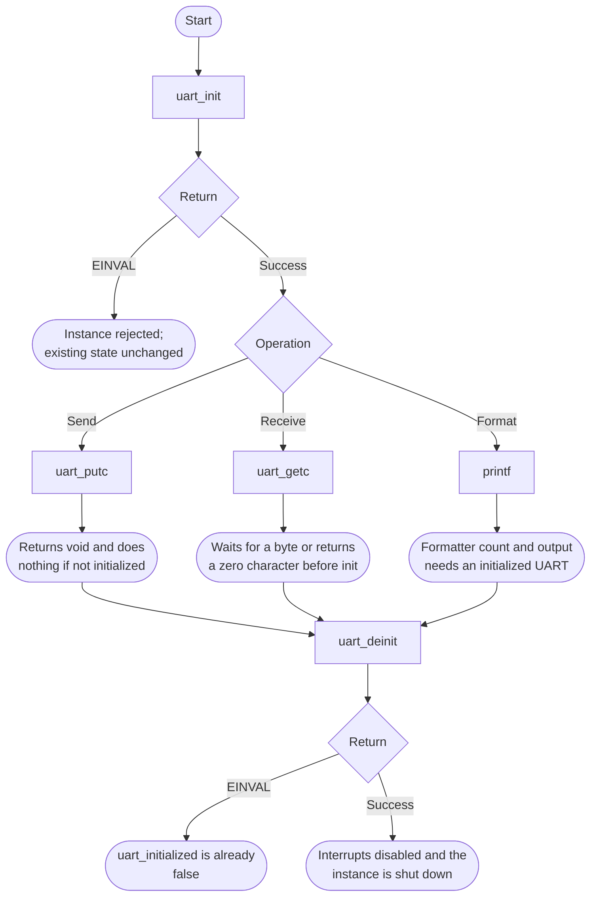

# UART Bare-Metal API Guide

## Overview

UART is a 16550-compatible serial port with Synopsys DesignWare extensions. It is the console interface for this software stack.

This module initializes the console UART and provides polled character-at-a-time send and receive, plus `printf` routed to the serial port. Every diagnostic message and every console command in this repository goes through it.

Include [`uart_api.h`](uart_api.h). Initialize UART0 before sending or receiving characters. The API retains its initialization state and takes no handle on character calls.


## Quick-start API flow

`uart_putc()` and `uart_getc()` do not return a status. If the module is not initialized they return without sending, and `uart_getc()` returns a zero character. See [Before You Start](#before-you-start).



### Walkthrough

1. Initialize UART0 (instance 0). `UART_MAX_INSTANCE` is 1 in this release; all other instance indices return `-EINVAL`.
2. Check `uart_is_initialized()` if a later putc seems to vanish. That function returns a Boolean, not errno.
3. After initialization, `uart_getc()` waits indefinitely until a byte arrives. It has no nonblocking or timeout result. Before initialization it returns `'\0'`; check `uart_is_initialized()` first if a received zero byte matters to your protocol.
4. Deinit only after init succeeded.

```C
#include <stdint.h>
#include "uart_api.h"

/* Illustrative. Not run on a board. */
int uart0_up(uint32_t baud, uint32_t clock)
{
    return uart_init(0U, baud, clock);
}
```

## Before You Start

- The startup code in this repository already calls `uart_init()` for UART0 before printing anything, so applications normally do not call it.
- How `uart_init()` configures the port depends on the build. In an Agilex 5 or Agilex 3 `OCRAM` build, it sets up the pins, releases the reset and programs the baud rate from `baudrate` and `clock_freq`. In a `DDR` build on those platforms, it does not touch the hardware: the port keeps the configuration that earlier firmware set, and `baudrate` and `clock_freq` are ignored.
- Only UART0 (instance 0) is supported.
- A serial terminal must be attached to the board's console pins to see any output.

## Public API Summary

| Function | Purpose | Returns |
|---|---|---|
| `uart_init()` | Initializes the console port for the given baud rate and input clock, and marks the module ready so that send, receive and `printf` work. | Returns 0 on success; `-EINVAL` |
| `uart_is_initialized()` | Reports whether the UART API has been initialized. | No status code. Returns true when the module is initialized, and false otherwise. |
| `uart_putc()` | Sends one character, blocking until the port accepts it, and expands a newline to carriage-return plus newline. | No return value. |
| `uart_getc()` | Receives one character, blocking until one arrives. | No status code. Returns the character, or `'\0'` if the module is not initialized. |
| `printf()` | Formats text with the repository's lightweight `printf` implementation and sends it to the console UART. | No status code. Returns the character count from the formatter, even if the UART is uninitialized and drops the output. |
| `uart_deinit()` | Disables the UART interrupts, puts the UART into reset and stops its clock, and marks the console uninitialized. | Returns 0 on success; `-EINVAL` if not initialized |

Public header: [`uart_api.h`](uart_api.h).


## Return values and error handling

Shared conventions: [`RETURN_VALUES.md`](../../RETURN_VALUES.md).

| API / group | Return value | Meaning and exact triggering condition | Customer action / output validity |
|---|---|---|---|
| `uart_init` | `-EINVAL` | `instance >= UART_MAX_INSTANCE`. | The existing API state is unchanged; an already initialized session remains initialized. No new base is selected. |
| `uart_init` | `0` | The instance check passed, `platform_uart_init()` was called, and the flag was set. | Later putc/getc use this instance. The function does not return a code if the pad is muxed elsewhere. |
| `uart_is_initialized` | `bool` | True after a successful init, false after deinit or before init. | Not an errno. |
| `uart_putc` | No return value. | Returns immediately when not initialized. Otherwise calls the console putc and ignores that call's status. | A missing character is not reported. |
| `uart_getc` | `char` | `\0` when not initialized. Otherwise the byte from the console getc, including a real zero. | You cannot distinguish "not initialized" from a zero data byte by the return alone. Call `uart_is_initialized()` first. |
| `printf` | `int` | The count returned by the formatter. | This is the C `printf` this module provides. It is not an errno status. |
| `uart_deinit` | `-EINVAL` | `uart_initialized` is false. | No shutdown was performed. |
| `uart_deinit` | `0` | Interrupts were disabled and the instance was shut down. | Further putc calls do nothing until the next init. |

## API Notes

### `uart_init()`

Initializes the console port for the given baud rate and input clock, and marks the module ready so that send, receive and `printf` work.

Initialize UART before console output; normal startup already does so.

| Returns | When | Meaning |
|---|---|---|
| `-EINVAL` | `instance` is not 0 | only UART0 is supported |

> In an `OCRAM` build, the input clock frequency is a caller argument, not something the module discovers. Passing the wrong value produces a working port at the wrong baud rate, which looks like corrupted output rather than like a failure. In a `DDR` build on Agilex 5 or Agilex 3, both arguments are ignored.

### `uart_putc()`

Sends one character, blocking until the port accepts it, and expands a newline to carriage-return plus newline.

> If the module is not initialized this returns immediately without sending anything. Silent output with no error is the normal symptom of a missing or failed `uart_init()`.

### `uart_getc()`

Receives one character, blocking until one arrives.

The public API has no pending-byte query or receive timeout. An application that
must keep doing other work cannot use `uart_getc()` as a polling operation.

### `printf()`

The repository's `printf` ([`lib/lib_printf.c`](../../lib/lib_printf.c)) is a small formatter, not the C library version:

| Supported | Not supported |
|---|---|
| `%c`, `%s`, `%d`, `%i`, `%u`, `%x`, `%X`, `%p`, `%%` | `%f` and other floating-point conversions |
| a field width, optionally zero-padded (`%08x`) | the `-` (left-justify) flag and precision (`%.2`) |
| `ll` for 64-bit values (`%llu`, `%llx`) | a single `l`: it is accepted but the value is read as 32 bits, which prints wrong values for 64-bit arguments on AArch64 |

An unsupported conversion is printed literally. The return is the character count
produced by the lightweight formatter. It is a count rather than an errno-style
status, and it does not confirm that the terminal received the characters.
Before UART initialization, `printf()` still formats and counts characters while
`uart_putc()` discards the output.

### `uart_deinit()`

Disables the UART interrupts, puts the UART into reset, stops its clock, and marks the console uninitialized.

Keep the console UART initialized for interactive use. Deinitializing it stops diagnostics and the console prompt. In a `DDR` build, a later `uart_init()` does not reprogram the hardware, so the console is not expected to come back without a board reset.

| Returns | When | Meaning |
|---|---|---|
| `-EINVAL` | the module is not initialized | nothing was changed |

## Important Constraints

| Constraint | Application impact |
|---|---|
| Blocking, unbuffered input and output | `uart_getc()` blocks indefinitely on an idle port and cannot be polled, so an application that must stay responsive needs its own strategy. |
| Send failures are silent | Output calls return nothing when the module is not initialized, so a missing `uart_init()` presents as a dead board rather than as an error. |
| Only UART0 | The platform limit is one instance; any other instance index is rejected with `-EINVAL`. |
| One active instance | Module state is held in file-scope objects, so one initialization is active at a time. There is no internal locking; serialize access yourself. |

## Troubleshooting

| Symptom | Likely area | What to try |
|---|---|---|
| No console output at all | Initialization or board setup | Confirm `uart_init()` returned 0. Output calls silently do nothing when the module is not initialized. Then confirm the pins are muxed to UART, the reset is deasserted and the terminal settings match. |
| Output appears but every character is corrupted | Terminal settings, baud rate or input clock | Confirm the terminal is set to 115200 8-N-1. In an `OCRAM` build the divisor is computed from the clock frequency passed to `uart_init()`; a wrong frequency yields a working port at the wrong speed. |
| The console stopped after `uart_deinit()` | Expected | The UART was put into reset. Reset the board. |
| `uart_init()` returns `-EINVAL` | Instance index | Only instance 0 is supported. |

## Related Documentation

- [`uart_api.h`](uart_api.h) - public API declarations and types.
- [`drivers/uart/uart.md`](../../drivers/uart/uart.md) - driver implementation notes.
- [`README.md`](../../README.md) - board bring-up, boot modes, UART and the first console session.
- [`Console and CLI`](../console/README.md) - related module.
- [`Clock Manager`](../clk_mngr/README.md) - related module.
